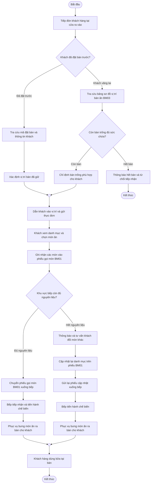
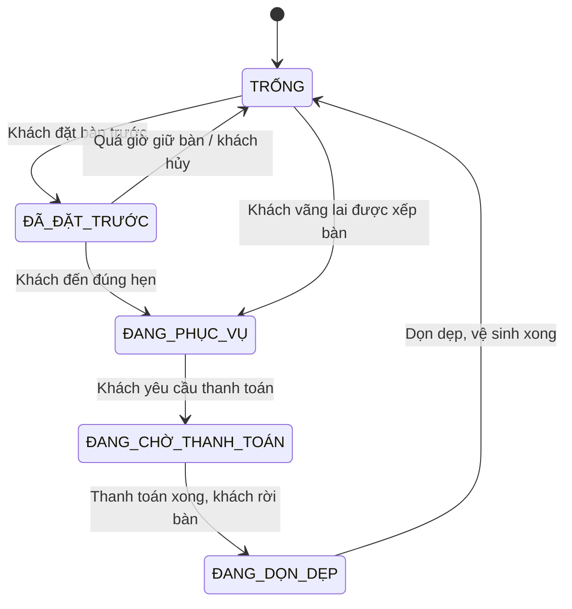
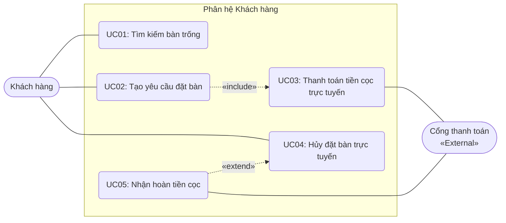
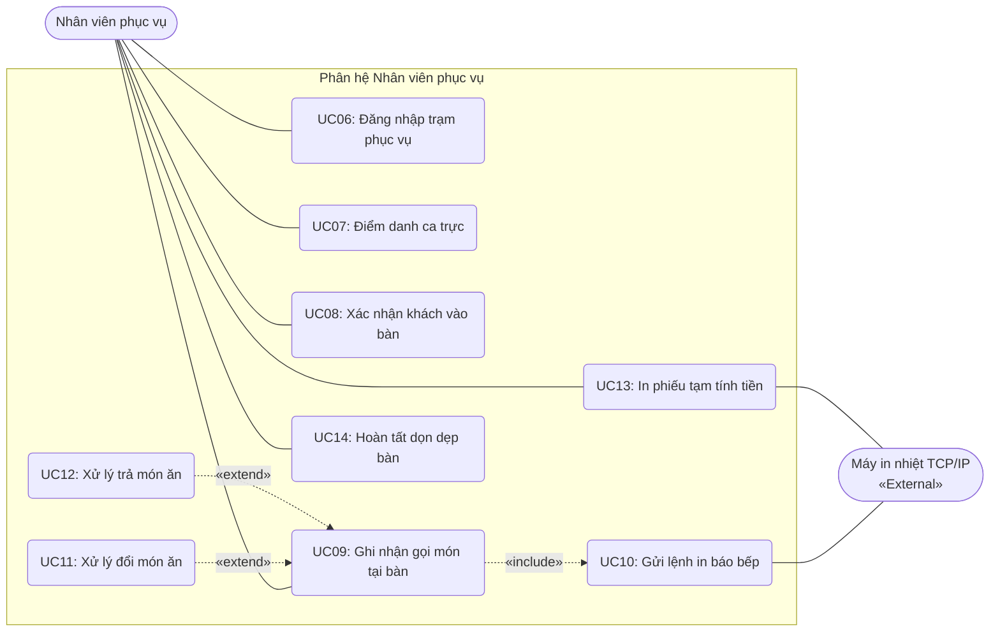
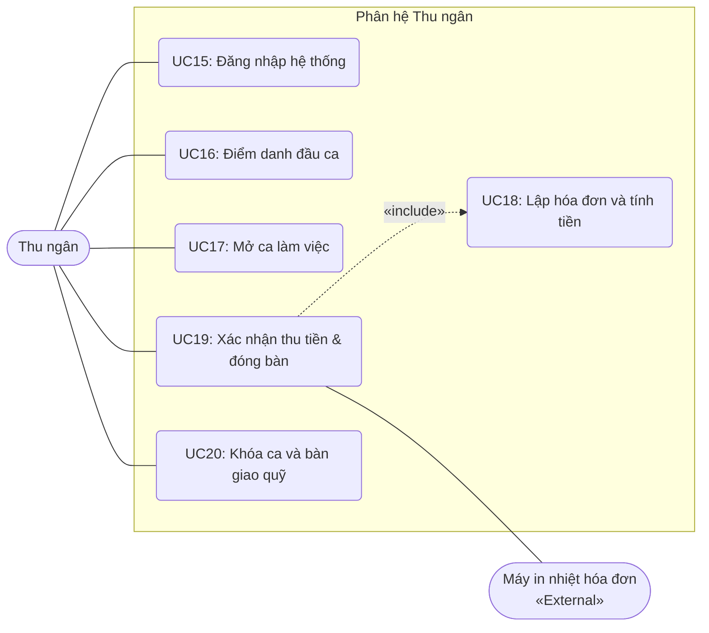
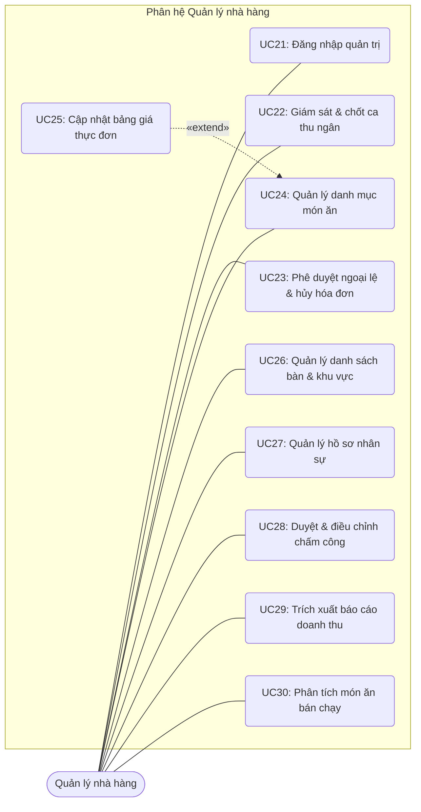
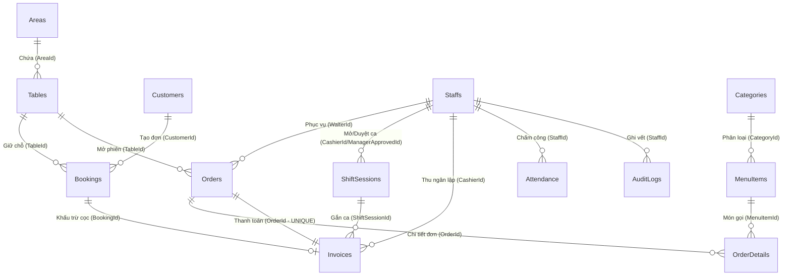
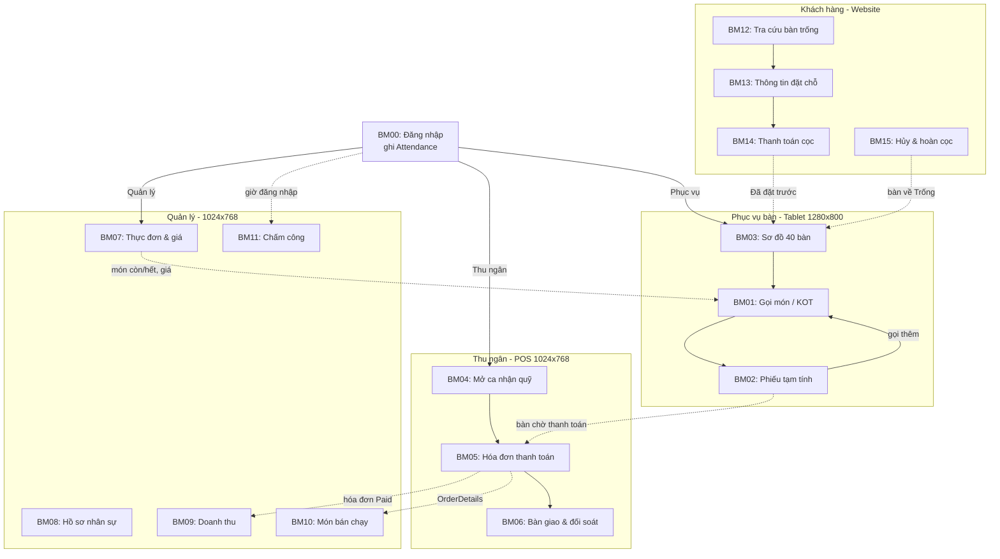
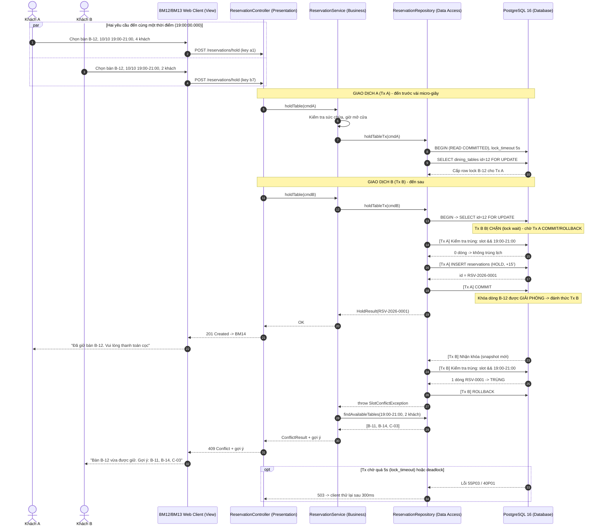
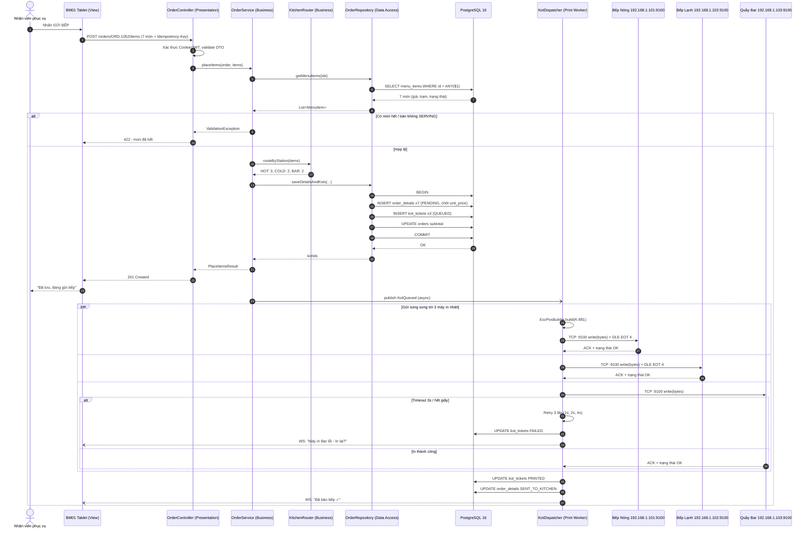

# TRƯỜNG ĐẠI HỌC TƯ THỤC QUỐC TẾ SÀI GÒN
---
## BÁO CÁO ĐỒ ÁN MÔN HỌC
**MÔN HỌC:** KIẾN TRÚC PHẦN MỀM  
**ĐỀ TÀI:** HỆ THỐNG QUẢN LÝ VIỆC ĐẶT BÀN Ở NHÀ HÀNG (NHÀ HÀNG SEN VIỆT)

- **Giảng viên hướng dẫn:** Nguyễn Thị Bích Nguyên
- **Thực hiện bởi nhóm sinh viên:**

| Họ và tên | Mã số sinh viên | Lớp | Vai trò |
| :--- | :--- | :--- | :--- |
| **Lê Mạnh Thịnh** | 84802403248 | 24DPM | Trưởng nhóm |
| **Nguyễn Minh Hoàng** | 84802503599 | 25DPM | Thành viên |
| **Lê Minh Trọng** | 84802503715 | 25DPM | Thành viên |

*TP.HCM, tháng 09/2026*

---

## MỤC LỤC
- [DANH MỤC TỪ VIẾT TẮT](#danh-mục-từ-viết-tắt)
- [CHƯƠNG I. TỔNG QUAN](#chương-i-tổng-quan)
  - [I. Giới thiệu đề tài](#i-giới-thiệu-đề-tài)
  - [II. Cơ sở lý thuyết](#ii-cơ-sở-lý-thuyết)
- [CHƯƠNG II. PHÂN TÍCH NỘI DUNG, YÊU CẦU](#chương-ii-phân-tích-nội-dung-yêu-cầu)
  - [I. Quy trình 1: Quy trình đặt bàn, thanh toán cọc và hủy bàn trực tuyến](#i-quy-trình-1-quy-trình-đặt-bàn-thanh-toán-cọc-và-hủy-bàn-trực-tuyến)
  - [II. Quy trình 2: Quy trình phục vụ sàn, điều phối gọi món và in báo bếp](#ii-quy-trình-2-quy-trình-phục-vụ-sàn-điều-phối-gọi-món-và-in-báo-bếp)
  - [III. Quy trình 3: Quy trình thanh toán, quản lý nhân sự và báo cáo doanh thu](#iii-quy-trình-3-quy-trình-thanh-toán-quản-lý-nhân-sự-và-báo-cáo-doanh-thu)
  - [IV. Yêu cầu chức năng nghiệp vụ](#iv-yêu-cầu-chức-năng-nghiệp-vụ)
  - [V. Yêu cầu chức năng hệ thống và yêu cầu chất lượng](#v-yêu-cầu-chức-năng-hệ-thống-và-yêu-cầu-chất-lượng)
- [CHƯƠNG III. PHÂN TÍCH THIẾT KẾ](#chương-iii-phân-tích-thiết-kế)
  - [I. Sơ đồ Use Case](#i-sơ-đồ-use-case)
  - [II. Sơ đồ hoạt động (Activity Diagrams)](#ii-sơ-đồ-hoạt-động-activity-diagrams)
  - [III. Thiết kế cơ sở dữ liệu](#iii-thiết-kế-cơ-sở-dữ-liệu)
  - [IV. Thiết kế giao diện (BM00 – BM15)](#iv-thiết-kế-giao-diện-bm00--bm15)
  - [V. Thiết kế xử lý (Sequence Diagrams)](#v-thiết-kế-xử-lý-sequence-diagrams)
- [CHƯƠNG IV. ĐÁNH GIÁ THIẾT KẾ & THỰC THI](#chương-iv-đánh-giá-thiết-kế--thực-thi)
- [CHƯƠNG V. TRIỂN KHAI & KIỂM THỬ](#chương-v-triển-khai--kiểm-thử)
- [CHƯƠNG VI. KẾT LUẬN & HƯỚNG PHÁT TRIỂN](#chương-vi-kết-luận--hướng-phát-triển)

---

## DANH MỤC TỪ VIẾT TẮT

| Từ viết tắt | Thuật ngữ tiếng Anh | Giải nghĩa tiếng Việt |
| :--- | :--- | :--- |
| **ACID** | Atomicity, Consistency, Isolation, Durability | 4 tính chất chuẩn của giao dịch cơ sở dữ liệu (Nguyên tử, Nhất quán, Cô lập, Bền vững) |
| **BLL** | Business Logic Layer | Tầng xử lý logic nghiệp vụ |
| **CSRF** | Cross-Site Request Forgery | Tấn công giả mạo yêu cầu chéo trang |
| **DAL** | Data Access Layer | Tầng truy xuất dữ liệu |
| **DTO** | Data Transfer Object | Đối tượng truyền tải dữ liệu giữa các tầng |
| **ERD** | Entity-Relationship Diagram | Sơ đồ thực thể - mối quan hệ |
| **ESC/POS** | Epson Standard Code for POS | Tập lệnh điều khiển máy in hóa đơn/in nhiệt tiêu chuẩn |
| **GTGT (VAT)** | Value Added Tax | Thuế Giá trị gia tăng |
| **IoC / DI** | Inversion of Control / Dependency Injection | Đảo ngược điều khiển / Tiêm phụ thuộc |
| **IPN** | Instant Payment Notification | Tín hiệu thông báo thanh toán tức thời (Webhook) |
| **KDS** | Kitchen Display System | Hệ thống màn hình hiển thị nhà bếp |
| **KOT** | Kitchen Order Ticket | Phiếu báo bếp (lệnh chế biến in nhiệt tại bếp/bar) |
| **MVC** | Model - View - Controller | Mẫu kiến trúc phân tách Dữ liệu - Giao diện - Điều khiển |
| **ORM** | Object-Relational Mapping | Kỹ thuật ánh xạ đối tượng - quan hệ |
| **POS** | Point of Sale | Điểm bán hàng / Máy trạm thu ngân và phục vụ |
| **RBAC** | Role-Based Access Control | Kiểm soát truy cập dựa trên vai trò |

---

# CHƯƠNG I. TỔNG QUAN

## I. Giới thiệu đề tài

### 1. Mục tiêu của đề tài
Hoạt động vận hành tại các nhà hàng quy mô 40 bàn phân bổ trên 4 phân khu **Tầng trệt**, **Sân vườn**, **Tầng lầu** và **Phòng VIP** thường gặp tình trạng mất đồng bộ dữ liệu giữa các bộ phận. Việc ghi nhận đặt bàn qua sổ sách hay ứng dụng nhắn tin rời rạc gây trùng lịch, trễ nải khâu báo bếp do nhân viên phải di chuyển nhiều, đồng thời khó kiểm soát tỷ lệ hủy bàn sát giờ cùng nguy cơ thất thoát tiền mặt trong ca trực.

Đề tài hướng đến xây dựng hệ thống phần mềm quản lý tập trung trên nền tảng **PostgreSQL 16** đạt chuẩn **3NF**, số hóa toàn bộ **16 biểu mẫu nghiệp vụ từ BM00 đến BM15**. Mục tiêu trọng tâm gồm:
- Tự động hóa quy trình đặt bàn trực tuyến với mức cọc $200.000\text{ VNĐ}$ hoặc $500.000\text{ VNĐ}$ kèm cơ chế hoàn cọc tự động khi hủy trước $2\text{ tiếng}$.
- Định tuyến lệnh in nhiệt KOT khổ $80\text{ mm}$ qua mạng TCP/IP xuống từng trạm bếp.
- Thực thi giao dịch thanh toán ACID có phụ thu $50.000\text{ VNĐ}$ khung giờ cao điểm.
- Kiểm soát độ lệch két tiền mặt so với định mức quỹ $2.000.000\text{ VNĐ}$ đầu ca.

Hệ thống phục vụ trực tiếp năm nhóm người dùng:
1. **Khách hàng:** Đặt bàn qua giao diện web.
2. **Nhân viên phục vụ:** Thao tác mở bàn và gọi món trên máy POS cầm tay / máy tính bảng.
3. **Đầu bếp cùng nhân viên pha chế:** Tiếp nhận vé in nhiệt tại khu chế biến.
4. **Thu ngân:** Xử lý hóa đơn và chốt quỹ két tiền cuối ngày.
5. **Quản lý nhà hàng:** Thiết lập thực đơn, phân quyền nhân sự, phê duyệt ngoại lệ đổi trả món và theo dõi báo cáo doanh thu định kỳ.

**Các mục tiêu cụ thể của hệ thống:**
- Cho phép khách hàng chủ động tra cứu bàn trống và hoàn tất đặt chỗ trực tuyến kèm thanh toán đặt cọc trên trình duyệt web, loại bỏ việc đặt bàn thủ công qua điện thoại hoặc ghi sổ giấy.
- Số hóa đồng bộ các khâu vận hành nội bộ gồm sơ đồ bàn ăn thời gian thực, điều phối gọi món tại bàn, truyền dữ liệu đơn món xuống khu vực bếp, lập hóa đơn thanh toán, chấm công nhân sự và thống kê tài chính.
- Triệt tiêu tình trạng đặt bàn ảo hoặc khách bỏ bàn không đến thông qua cơ chế đặt cọc tự động và thuật toán khấu trừ tiền cọc theo thời gian hủy bàn.
- Cung cấp số liệu doanh thu tức thì, phân tích tỷ trọng tiêu thụ món ăn giúp người điều hành hoạch định mua sắm nguyên liệu và điều chỉnh giá niêm yết chính xác.
- Hiện thực hóa chuẩn xác kiến trúc **Multi-Tier** kết hợp mô hình **MVC**, tạo nền tảng mã nguồn phân tách rõ ràng giữa giao diện, quy tắc nghiệp vụ và hạ tầng dữ liệu.

### 2. Phạm vi sử dụng
- **Phạm vi triển khai thực tế:** Hệ thống được thiết kế và triển khai phục vụ thực tế cho mô hình Nhà hàng Ẩm thực dịch vụ ăn uống tại bàn (Nhà hàng Sen Việt) với quy mô đơn cơ sở gồm **40 bàn ăn**, phân bố tại 4 khu vực vật lý:
  - **Tầng trệt:** 15 bàn
  - **Sân vườn:** 10 bàn
  - **Tầng lầu:** 10 bàn
  - **Khu vực phòng VIP:** 5 bàn
  - Năng lực phục vụ tối đa của nhà hàng đạt **250 thực khách** tại cùng một thời điểm.
- **Năng lực chịu tải của phần mềm:** Hệ thống đáp ứng khả năng vận hành đồng thời cho tối thiểu **20 thiết bị trạm nội bộ** (gồm máy POS thu ngân, máy tính bảng của nhân viên phục vụ, màn hình quản lý) và hỗ trợ tối đa **100 kết nối truy cập trực tuyến cùng lúc** từ phía khách hàng tra cứu đặt bàn trong khung giờ cao điểm (từ 18:00 đến 21:00 các ngày cuối tuần) với độ trễ phản hồi không vượt quá $1.0\text{ giây}$ đối với các tác vụ thông thường.

### 3. Nền tảng kỹ thuật
- **Nền tảng thực thi và Ngôn ngữ lập trình:** Sử dụng **C# 12** chạy trên môi trường **.NET 8 LTS**. Nền tảng này tích hợp sẵn bộ chứa Inversion of Control (IoC Container) để cấu hình Dependency Injection, quản lý bộ nhớ tự động và hỗ trợ chia tách giải pháp thành các project vật lý riêng biệt (`.csproj`) nhằm khóa cứng ranh giới kiến trúc đa tầng ngay từ khâu biên dịch.
- **Tầng Presentation (Giao diện và Điều hướng):** Tổ chức trong project `Restaurant.Web` dạng ASP.NET Core MVC theo mô hình Monolithic thuần. Controller nhận HTTP Request, gọi xử lý từ tầng nghiệp vụ, gán dữ liệu vào ViewModel rồi kết xuất trực tiếp ra trình duyệt thông qua Razor Views (`.cshtml`). Phiên làm việc của nhân sự vận hành được quản lý tập trung bằng Cookie Authentication nội tại của ASP.NET Core. Giao diện sử dụng framework **Bootstrap 5.3** kết hợp JavaScript thuần để tương tác dữ liệu, không sử dụng framework SPA để tránh phát sinh chi phí cấu hình CORS và xác thực API phân tán.
- **Tầng Business Logic (Nghiệp vụ hệ thống):** Triển khai độc lập trong project `Restaurant.Business` dạng Class Library. Tầng này tập hợp các dịch vụ xử lý logic như `BookingService`, `OrderService`, `BillingService`. Dữ liệu giao tiếp giữa tầng này với tầng Web được chuẩn hóa qua các đối tượng DTO (Data Transfer Object). Toàn bộ quy tắc vận hành khắt khe gồm: thuật toán kiểm tra xung đột thời gian đặt bàn trước và sau $2\text{ tiếng}$, tính toán tỷ lệ hoàn cọc lũy tiến $\Delta t$, áp dụng phụ thu $50.000\text{ VNĐ}$ cho khung giờ cao điểm, tính chiết khấu thẻ thành viên theo phân hạng, trích xuất thuế GTGT $8\%$ và khấu trừ tiền cọc bảo chứng đều được đóng gói và thực thi tập trung tại tầng này, bảo đảm không bị rò rỉ mã xử lý lên tầng điều khiển Controller.
- **Tầng Data Access (Truy xuất dữ liệu) và ORM:** Đặt trong project `Restaurant.DataAccess` dạng Class Library. Tầng này sử dụng **Entity Framework Core 8.0** kết hợp gói driver `Npgsql.EntityFrameworkCore.PostgreSQL` phiên bản 8.x để làm cầu nối với cơ sở dữ liệu. Nhóm áp dụng **Repository Pattern** và **Unit of Work** để bọc `RestaurantDbContext`. Toàn bộ câu lệnh đọc ghi dữ liệu được viết bằng cú pháp LINQ, tự động tham số hóa (Parameterized Queries) để loại trừ nguy cơ tấn công SQL Injection.
- **Hệ quản trị cơ sở dữ liệu:** **PostgreSQL phiên bản 16**. Hệ thống khai thác triệt để cơ chế giao dịch tuân thủ chuẩn ACID và tính năng khóa mức hàng (Row-level locking) thông qua cú pháp `SELECT ... FOR UPDATE` để xử lý triệt để bài toán tranh chấp bàn ăn khi có nhiều yêu cầu đặt chỗ gửi lên cùng một thời điểm.
- **Công cụ phát triển và Quản trị:** Môi trường lập trình Visual Studio 2022 Community kết hợp Visual Studio Code. Quản trị và kiểm tra dữ liệu bằng công cụ pgAdmin 4 hoặc DBeaver Community Edition. Khởi tạo môi trường cơ sở dữ liệu cục bộ nhanh chóng bằng Docker Compose. Toàn bộ mã nguồn dự án được lưu trữ và kiểm soát phiên bản qua Git trên GitHub.

---

## II. Cơ sở lý thuyết

### 1. Kiến trúc Multi-Tier
Kiến trúc Multi-Tier phân tách một phần mềm thành các tầng độc lập theo chiều dọc. Mỗi tầng đảm nhận một nhóm trách nhiệm chuyên biệt và chỉ giao tiếp với tầng nằm kế tiếp nó:

$$\text{Presentation Layer (Giao diện)} \rightarrow \text{Business Layer (Nghiệp vụ)} \rightarrow \text{Data Access Layer (Truy xuất)} \rightarrow \text{Database (Lưu trữ)}$$

- **Presentation Layer:** Tầng đón nhận tương tác trực tiếp từ người dùng, thu thập dữ liệu đầu vào từ bàn phím hoặc thao tác bấm chuột, gửi thông tin xuống tầng nghiệp vụ và định dạng dữ liệu nhận về để hiển thị lên màn hình. Tầng này không chứa logic xử lý số liệu tài chính hay lưu trữ.
- **Business Logic Layer (BLL):** Tầng trung tâm nắm giữ toàn bộ luật vận hành của nhà hàng. Mọi quy tắc về kiểm tra bàn trống, xác định tỷ lệ hoàn cọc, tính tiền hóa đơn, áp dụng thuế đều được viết tại đây. Tầng này độc lập hoàn toàn với giao diện HTML hay các câu lệnh SQL, giúp thuật toán nghiệp vụ có thể tái sử dụng cho nhiều nền tảng client khác nhau.
- **Data Access Layer (DAL):** Tầng phụ trách toàn bộ việc kết nối, truy vấn, chèn, sửa và xóa dữ liệu trong cơ sở dữ liệu. Tầng này che giấu cấu trúc bảng dữ liệu thực tế khỏi tầng nghiệp vụ thông qua các lớp Repository và cơ chế ORM.
- **Database Layer:** Hệ quản trị cơ sở dữ liệu vật lý đảm nhiệm việc lưu trữ toàn bộ các bảng thực thể, duy trì ràng buộc khóa chính, khóa ngoại và chỉ mục tìm kiếm.

### 2. Mô hình MVC (Model - View - Controller)
Mô hình MVC là mẫu kiến trúc tổ chức mã nguồn ở tầng tương tác người dùng:
- **Model:** Đại diện cho dữ liệu hiển thị hoặc dữ liệu trao đổi trong phạm vi giao diện, thường là các lớp `ViewModel` hoặc `Data Transfer Object (DTO)` chứa các thuộc tính cần thể hiện trên trang web.
- **View:** Thành phần chịu trách nhiệm trực quan hóa dữ liệu thành giao diện đồ họa. Trong ứng dụng ASP.NET Core MVC, View là các tệp Razor (`.cshtml`) kết hợp giữa mã HTML và cú pháp C# để kết xuất dữ liệu cho trình duyệt.
- **Controller:** Đóng vai trò bộ điều phối. Khi người dùng gửi một yêu cầu HTTP, Controller tiếp nhận yêu cầu, trích xuất tham số từ URL hoặc thân form, gọi phương thức xử lý tương ứng ở tầng nghiệp vụ, sau đó lựa chọn View thích hợp để hiển thị kết quả về cho người dùng.

### 3. Mối liên kết giữa MVC và Multi-Tier
Trong hệ thống này, MVC không đứng ngang hàng với Multi-Tier mà được lồng trọn vẹn bên trong **Presentation Layer** của kiến trúc đa tầng:
- Controller thuộc Presentation Layer chỉ làm nhiệm vụ tiếp nhận yêu cầu và điều hướng hiển thị. Controller tuyệt đối không viết mã nghiệp vụ tính toán và không được phép gọi trực tiếp xuống Data Access Layer hay `DbContext` để truy vấn SQL.
- Mọi luồng dữ liệu bắt buộc phải di chuyển tuần tự: `Controller` gọi `Business Service`, `Business Service` gọi `Repository`, `Repository` đọc ghi trên `Database`.
- Ranh giới đa tầng được khóa cứng ở mức biên dịch: Project `Restaurant.Web` chỉ thêm tham chiếu (`Project Reference`) tới project `Restaurant.Business`. Việc ngăn chặn tham chiếu trực tiếp từ `Restaurant.Web` tới `Restaurant.DataAccess` đảm bảo lập trình viên không thể viết mã tắt gọi xuyên tầng, bảo toàn tính toàn vẹn của mô hình kiến trúc.

### 4. Cơ chế ánh xạ ORM và Entity Framework Core 8
Entity Framework Core 8 là giải pháp Object-Relational Mapping (ORM) giúp ánh xạ các bảng quan hệ trong PostgreSQL thành các đối tượng C# strongly-typed:
- **Triển khai mẫu Repository và Unit of Work:** Repository trừu tượng hóa các thao tác dữ liệu cơ bản cho từng thực thể (ví dụ `ITableRepository`, `IOrderRepository`), trong khi Unit of Work quản lý một phiên làm việc duy nhất của `DbContext`, đảm bảo mọi thao tác ghi dữ liệu phức tạp được xác nhận đồng thời.
- **Biên dịch truy vấn LINQ:** Các biểu thức LINQ được driver Npgsql chuyển hóa thành câu lệnh SQL có tham số hóa (Parameterized Queries) tại máy chủ cơ sở dữ liệu, ngăn chặn lỗ hổng tấn công SQL Injection.

### 5. Cơ chế giao dịch ACID và Khóa mức hàng trên PostgreSQL 16
Hệ quản trị PostgreSQL 16 bảo đảm 4 tiêu chuẩn giao dịch:
- **Atomicity (Nguyên tử):** Toàn bộ các thao tác trừ cọc, chốt bàn, tạo hóa đơn phải cùng hoàn tất hoặc cùng bị hủy bỏ. Hệ thống sử dụng `IDbContextTransaction` để tự động Rollback toàn bộ khi phát sinh sự cố mạng.
- **Consistency (Nhất quán):** Dữ liệu luôn tuân thủ các ràng buộc khóa chính, khóa ngoại và trạng thái bàn ăn hợp lệ trước và sau giao dịch.
- **Isolation (Cô lập):** Hệ thống sử dụng kỹ thuật khóa bi quan (Pessimistic Locking) thông qua cú pháp:
  ```sql
  SELECT * FROM Tables WHERE Id = @TableId FOR UPDATE;
  ```
  Khóa độc quyền này chặn đứng hiện tượng Race Condition khi hai người dùng cùng bấm giữ một bàn ăn trong cùng một thời điểm.
- **Durability (Bền vững):** Mọi thay đổi khi đã Commit đều được ghi vết vào tệp nhật ký ghi trước (Write-Ahead Logging), bảo đảm dữ liệu an toàn ngay cả khi mất điện đột ngột.

### 6. Cơ sở lý thuyết nghiệp vụ quản lý nhà hàng (F&B Operations)
Nghiệp vụ thực tế của nhà hàng bao gồm ba quy chuẩn cốt lõi:
1. **Quy chuẩn in báo bếp KOT (Kitchen Order Ticket):** Khi nhân viên xác nhận đơn tại bàn, hệ thống tự động bóc tách danh mục món theo phân khu chế biến vật lý: món xào, nướng gửi lệnh in nhiệt mạng nội bộ TCP/IP đến **Bếp nóng**; gỏi, salad gửi đến **Bếp lạnh**; nước uống gửi đến **Quầy pha chế**. Quy trình này triệt tiêu tình trạng thất lạc đơn giấy và nhầm lẫn thứ tự làm món.
2. **Quy định tài chính và thuế Giá trị gia tăng:** Dịch vụ ăn uống áp dụng thuế suất thuế GTGT $8\%$ theo quy định. Tiền cọc giữ chỗ của khách là khoản bảo chứng công nợ, không cấu thành doanh thu chịu thuế tại thời điểm nhận tiền. Thuế GTGT $8\%$ chỉ được tính trên tiền hàng thực tế sau khi đã trừ chiết khấu thành viên và cộng phụ thu. Khoản cọc được giảm trừ ở bước thanh toán cuối cùng.
3. **Quy tắc kiểm soát quỹ ca trực thu ngân (Cash Balancing):** Đầu ca, thu ngân nhận định mức $2.000.000\text{ VNĐ}$ tiền lẻ làm quỹ ban đầu. Mọi hóa đơn thu tiền đều gắn với mã phiên trực `ShiftSessions`. Cuối ca, thu ngân kiểm đếm tiền mặt thực tế và đối soát với số lý thuyết:
   $$\text{Chênh lệch quỹ} = \text{Tiền mặt thực tế} - \text{Tiền mặt lý thuyết}$$
   Mọi mức chênh lệch khác $0\text{ VNĐ}$ đều bắt buộc lập văn bản giải trình lý do trước khi bàn giao số dư cho ca tiếp theo.

---

# CHƯƠNG II. PHÂN TÍCH NỘI DUNG, YÊU CẦU

## I. Quy trình 1: Quy trình đặt bàn, thanh toán cọc và hủy bàn trực tuyến

### 1. Quy trình tra cứu và đặt giữ bàn trực tuyến

| Bước | Nội dung thực hiện |
| :---: | :--- |
| **1** | Khách hàng truy cập trang đặt bàn, nhập các tiêu chí tìm kiếm: ngày đến, giờ đến dự kiến, số lượng thực khách và khu vực ngồi mong muốn (Tầng trệt, Sân vườn, Phòng VIP). |
| **2** | Hệ thống gửi truy vấn kiểm tra cơ sở dữ liệu: lọc các bàn có sức chứa lớn hơn hoặc bằng số khách và không tồn tại đơn đặt nào bị trùng khung giờ trước và sau $2\text{ tiếng}$ đang ở trạng thái `Chờ thanh toán` hoặc `Đã xác nhận`. Kết quả danh sách bàn phù hợp hiển thị trực quan cho khách lựa chọn. |
| **3** | Khách hàng chọn bàn ăn ưng ý, nhập đầy đủ thông tin liên lạc gồm họ tên, số điện thoại đúng định dạng 10 chữ số, địa chỉ email nhận vé và các yêu cầu chuẩn bị đặc biệt (ghế trẻ em, trang trí tiệc sinh nhật). |
| **4** | Khách hàng bấm xác nhận đặt bàn. Tầng nghiệp vụ kiểm tra lại tính khả dụng của bàn tại thời điểm bấm nhằm triệt tiêu xung đột dữ liệu, tạo bản ghi mới với trạng thái `Chờ thanh toán cọc` và tạm khóa giữ chỗ bàn ăn trong thời gian tối đa $15\text{ phút}$. |

### 2. Quy trình thanh toán tiền cọc trực tuyến

| Bước | Nội dung thực hiện |
| :---: | :--- |
| **1** | Hệ thống áp dụng quy định mức cọc giữ chỗ: $200.000\text{ VNĐ}$ cho bàn dưới 6 người hoặc $500.000\text{ VNĐ}$ cho bàn từ 6 người trở lên, sau đó sinh đường dẫn liên kết chuyển hướng khách hàng sang cổng thanh toán trực tuyến. |
| **2** | Khách hàng lựa chọn hình thức thanh toán (quét mã QR ngân hàng hoặc ví điện tử) và hoàn tất thao tác chuyển khoản trên giao diện cổng thanh toán. |
| **3** | Cổng thanh toán xử lý giao dịch và gửi tín hiệu phản hồi tự động (Webhook/IPN) về máy chủ ứng dụng nhà hàng. |
| **4** | Nếu giao dịch thành công, hệ thống cập nhật trạng thái đơn đặt sang `Đã xác nhận`, khóa khung giờ của bàn ăn trên sơ đồ vận hành và tự động gửi email thông báo xác nhận kèm mã đặt chỗ tới khách hàng. Nếu quá thời hạn $15\text{ phút}$ không hoàn tất thanh toán, hệ thống tự động hủy đơn và giải phóng bàn về trạng thái `Trống`. |

### 3. Quy trình hủy đặt bàn và tính toán hoàn cọc

| Bước | Nội dung thực hiện |
| :---: | :--- |
| **1** | Khách hàng tra cứu đơn đặt bằng số điện thoại và mã đặt chỗ, truy cập chức năng hủy đặt bàn và chọn xác nhận hủy trên giao diện. |
| **2** | Hệ thống xác định độ lệch thời gian: $\Delta t = \text{Giờ nhận bàn quy định} - \text{Giờ bấm hủy thực tế}$, tính theo đơn vị giờ. |
| **3** | Hệ thống áp dụng thuật toán tính tỷ lệ hoàn tiền: Nếu $\Delta t \ge 2\text{ giờ}$ (hủy đúng hạn), tỷ lệ hoàn cọc là $100\%$. Nếu $0 \le \Delta t < 2\text{ giờ}$ (hủy trễ hạn), tỷ lệ hoàn cọc tính theo công thức $(\Delta t / 2) \times 100\%$. Nếu $\Delta t < 0$ (quá giờ hẹn nhận bàn), tỷ lệ hoàn cọc bằng $0\%$. |
| **4** | Hệ thống tính số tiền hoàn thực tế bằng $\text{Tiền cọc} \times \text{Tỷ lệ hoàn cọc}$, cập nhật trạng thái đơn đặt sang `Đã hủy`, mở lại trạng thái bàn `Trống`, đồng thời tạo lệnh hoàn tiền tự động qua cổng thanh toán và gửi thông báo xác nhận qua email của khách hàng. |

---

## II. Quy trình 2: Quy trình phục vụ sàn, điều phối gọi món và in báo bếp

### 1. Quy trình tiếp đón khách và chuyển đổi trạng thái bàn


*Hình II.1. Sơ đồ quy trình tiếp đón khách và phục vụ tại bàn*

| Bước | Nội dung thực hiện |
| :---: | :--- |
| **1** | Nhân viên phục vụ tiếp nhận khách: Đối với khách có đặt trước, nhân viên đối chiếu mã đặt chỗ hoặc số điện thoại để xác thực. Đối với khách vãng lai, nhân viên kiểm tra sơ đồ sàn để tìm bàn có trạng thái `Trống` (màu xanh lá cây) phù hợp với số lượng khách. |
| **2** | Nhân viên dẫn khách vào đúng bàn ăn đã chỉ định và bàn giao menu thực đơn. |
| **3** | Nhân viên thao tác trên màn hình trạm phục vụ: chuyển trạng thái bàn từ `Đã đặt trước` (hoặc `Trống`) sang `Đang phục vụ` (màu đỏ), hệ thống tự động kích hoạt một phiên phục vụ mới kèm mã định danh nhân viên tiếp đón. |
| **4** | Khi khách dùng bữa xong và yêu cầu tính tiền, nhân viên bấm lệnh kết thúc phục vụ để chuyển bàn sang trạng thái `Đang chờ thanh toán`, đồng thời gửi tín hiệu về quầy thu ngân. |
| **5** | Sau khi thu ngân hoàn tất thu tiền, hệ thống chuyển bàn sang trạng thái `Đang dọn dẹp`. Nhân viên thu dọn bát đĩa, vệ sinh mặt bàn rồi bấm hoàn tất trên phần mềm để đưa bàn trở lại trạng thái `Trống`, sẵn sàng đón lượt khách tiếp theo. |


*Hình 1. Sơ đồ trạng thái bàn ăn*

### 2. Quy trình ghi nhận món gọi tại bàn và in phiếu báo bếp

| Bước | Nội dung thực hiện |
| :---: | :--- |
| **1** | Nhân viên phục vụ tiếp nhận yêu cầu gọi món từ khách trực tiếp tại bàn thông qua thiết bị máy tính bảng hoặc máy POS cầm tay. |
| **2** | Nhân viên chọn món ăn từ thực đơn điện tử, nhập số lượng đĩa và nhập ghi chú chế biến cụ thể (không cay, ít đường, không hành tây, ăn chín kỹ). |
| **3** | Nhân viên đọc lại toàn bộ danh mục món cho khách rà soát, bấm xác nhận đơn gọi món trên hệ thống. Dữ liệu được lưu vào bảng chi tiết đơn với trạng thái `Đã gọi`. |
| **4** | Hệ thống tự động phân loại danh mục món ăn theo từng phân khu chế biến và gửi lệnh in nhiệt mạng nội bộ TCP/IP: món chiên, xào, nướng chuyển đến máy in **Bếp nóng**; món gỏi, salad chuyển đến máy in **Bếp lạnh**; đồ uống và tráng miệng chuyển đến máy in **Quầy bar**. |
| **5** | Đầu bếp tiếp nhận phiếu in nhiệt, bấm xác nhận chuyển trạng thái món sang `Đang chế biến`. Khi chế biến xong, đầu bếp bấm chuyển sang `Sẵn sàng phục vụ` để nhân viên bưng thức ăn ra bàn và cập nhật món sang `Đã phục vụ`. |

### 3. Quy trình xử lý đổi món và trả món

| Bước | Nội dung thực hiện |
| :---: | :--- |
| **1** | Nhân viên tiếp nhận yêu cầu đổi món hoặc trả món từ khách kèm lý do cụ thể (gọi nhầm, đổi khẩu vị, món lỗi chất lượng, nguội lạnh hoặc lên nhầm bàn). |
| **2** | Nhân viên kiểm tra trạng thái thực tế của món ăn trên phần mềm quản lý trạm phục vụ và đối chiếu với nhân viên bếp. |
| **3** | **Xử lý đổi món:** Nếu món ăn ở bếp vẫn ở trạng thái `Đã gọi` và chưa bắt đầu chế biến, nhân viên thao tác hủy món cũ trên hệ thống, thêm món mới và phát lệnh in điều chỉnh xuống bếp. Nếu món ăn đã chế biến xong, việc đổi món phải chuyển qua quản lý ca phê duyệt. |
| **4** | **Xử lý trả món:** Nhân viên ghi nhận lý do trả món vào hệ thống. Nếu lỗi thuộc về nhà hàng (món hỏng, nhầm món), nhân viên cập nhật đơn giá món về $0\text{ VNĐ}$ trên đơn tính tiền và yêu cầu bếp làm lại món mới nếu khách đồng ý. Nếu do khách tự đổi ý sau khi bếp đã hoàn tất nấu, hệ thống vẫn giữ nguyên tiền tính phí theo chính sách vận hành. |
| **5** | Hệ thống tự động đồng bộ lại toàn bộ danh mục món ăn và thành tiền của bàn phục vụ để chuẩn bị số liệu chính xác cho bước in phiếu tạm tính. |

---

## III. Quy trình 3: Quy trình thanh toán, quản lý nhân sự và báo cáo doanh thu

### 1. Quy trình thu tiền và xuất hóa đơn tài chính

| Bước | Nội dung thực hiện |
| :---: | :--- |
| **1** | Khách hàng dùng bữa xong ra hiệu tính tiền. Nhân viên phục vụ bấm lệnh kết thúc phục vụ trên trạm máy POS, hệ thống chuyển trạng thái bàn ăn sang `Đang chờ thanh toán` và gửi cảnh báo về quầy thu ngân. |
| **2** | Thu ngân chọn số bàn tương ứng trên sơ đồ màn hình cảm ứng. Hệ thống nạp toàn bộ danh mục món ăn từ bảng `OrderDetails` của phiên phục vụ hiện tại, hiển thị tên món, số lượng, đơn giá và tổng tiền tạm tính. |
| **3** | Thu ngân nhập số điện thoại khách hàng để kiểm tra quyền lợi thành viên. Hệ thống tự động chiết khấu: hạng Bạc giảm $5\%$, hạng Vàng giảm $10\%$, hạng Kim Cương giảm $15\%$. Nếu lượt ăn có đặt trước và đã nộp cọc ($200.000\text{ VNĐ}$ hoặc $500.000\text{ VNĐ}$), hệ thống đưa khoản cọc này vào mục giảm trừ công nợ. |
| **4** | Hệ thống áp dụng quy tắc tài chính: Tiền hàng trước thuế bằng tổng tiền món trừ chiết khấu thành viên, cộng phụ thu giờ cao điểm $50.000\text{ VNĐ}$ nếu hóa đơn mở trong khung 18:00 đến 21:00 cuối tuần. Thuế GTGT tính $8\%$ trên tiền hàng trước thuế. Số tiền thực thu bằng tiền hàng trước thuế cộng thuế GTGT trừ tiền cọc bàn, kết quả làm tròn đến hàng nghìn đồng. |
| **5** | Khách hàng chọn phương thức thanh toán bằng tiền mặt hoặc quét mã QR. Nếu khách quét mã, hệ thống sinh mã VietQR động chứa chính xác số tiền cần trả và cú pháp chuyển khoản gắn liền với mã hóa đơn. |
| **6** | Thu ngân bấm xác nhận hoàn tất. Hệ thống mở một Transaction trong cơ sở dữ liệu PostgreSQL: lưu bản ghi mới vào bảng `Invoices`, đổi trạng thái hóa đơn thành `Paid`, đổi trạng thái bàn sang `Cleaning` để phục vụ vào dọn dẹp, đồng thời phát lệnh in hóa đơn nhiệt khổ $80\text{ mm}$ giao khách. Toàn bộ dữ liệu gọi món của bàn bị khóa vĩnh viễn, ngăn chặn mọi hành vi chỉnh sửa dữ liệu. |

### 2. Quy trình quản lý ca làm việc và chấm công nhân sự

| Bước | Nội dung thực hiện |
| :---: | :--- |
| **1** | Nhân viên đăng nhập tài khoản cá nhân trên phần mềm khi đến nhà hàng. Hệ thống ghi nhận mốc thời gian thực tế vào bảng `Attendance`. Nếu thời gian đăng nhập trễ hơn $15\text{ phút}$ so với giờ bắt đầu ca quy định (Ca ngày từ 08:00 đến 16:00, Ca tối từ 16:00 đến 23:30), hệ thống tự động ghi nhận trạng thái `Đi trễ`. |
| **2** | Đầu mỗi ca trực, thu ngân nhận $2.000.000\text{ VNĐ}$ tiền lẻ thối từ quản lý, truy cập màn hình Mở ca và nhập số tiền này vào hệ thống. Phần mềm tạo phiên làm việc mới trong bảng `ShiftSessions` với trạng thái `Active`. Toàn bộ hóa đơn thanh toán phát sinh sau đó đều tự động liên kết với mã phiên ca trực này. |
| **3** | Quản lý theo dõi bảng điều khiển trực quan để nắm bắt số lượng nhân sự đang hiện diện tại các khu vực sàn, bar và bếp. Trường hợp có nhân sự xin đổi ca hoặc về sớm vì sự cố đột xuất, quản lý thực hiện thao tác duyệt ngoại lệ trên phần mềm và lưu lý do vào nhật ký hệ thống. |
| **4** | Hết ca trực, thu ngân khóa chức năng xuất hóa đơn của phiên làm việc. Thu ngân kiểm đếm toàn bộ tiền mặt thực tế trong két và nhập chi tiết từng mệnh giá vào bảng kê tiền mặt trên phần mềm. |
| **5** | Hệ thống tính số tiền mặt lý thuyết bằng số tiền đầu ca cộng tổng tiền mặt thu trong ca trừ các khoản hoàn cọc. Phần mềm so sánh số thực tế với số lý thuyết. Nếu phát hiện chênh lệch thừa hoặc thiếu dù chỉ $1.000\text{ VNĐ}$, hệ thống bắt buộc thu ngân phải nhập giải trình lý do trước khi cho phép lưu. Quản lý kiểm tra thực tế két tiền, ký duyệt điện tử để đóng ca và nhân viên bấm kết ca để ghi nhận giờ về. |

### 3. Quy trình báo cáo doanh thu theo ngày và theo món bán chạy

| Bước | Nội dung thực hiện |
| :---: | :--- |
| **1** | Định kỳ cuối ngày lúc 23:30 hoặc khi kiểm toán đột xuất, quản lý truy cập phân hệ Thống kê, thiết lập mốc ngày bắt đầu, ngày kết thúc và loại tiêu chí báo cáo cần trích xuất. |
| **2** | Tầng Business Logic gọi xuống tầng Data Access để quét các hóa đơn có trạng thái `Paid` trong khoảng thời gian đã chọn. Hệ thống bóc tách các chỉ số: doanh thu gộp, tổng thuế GTGT $8\%$ thu hộ, doanh thu thuần, tổng tiền giảm giá thành viên, số lượt bàn phục vụ và giá trị hóa đơn bình quân. Giao diện trực quan hóa tỷ trọng giữa nguồn thu tiền mặt và chuyển khoản ngân hàng. |
| **3** | Hệ thống thực hiện câu lệnh tổng hợp trên bảng `OrderDetails` để đếm số lượng suất ăn tiêu thụ của từng món và tính tổng doanh thu món đó mang lại. Danh sách được sắp xếp thứ tự giảm dần, chỉ rõ nhóm món chủ lực bán chạy nhất và nhóm món tiêu thụ kém có sản lượng dưới 5 phần mỗi tuần. |
| **4** | Quản lý xem trước số liệu trên bảng và biểu đồ cột. Khi cần lưu trữ hoặc nộp báo cáo, quản lý bấm xuất tệp. Hệ thống đóng gói dữ liệu thành tệp Excel định dạng `.xlsx` hoặc tệp `.pdf` hoàn chỉnh kèm mốc thời gian xuất dữ liệu, phục vụ việc lập kế hoạch nhập nguyên liệu thực phẩm cho ngày hôm sau. |

---

## IV. Yêu cầu chức năng nghiệp vụ

### 1. Chức năng của Tác nhân Khách hàng

| STT | Công việc | Loại công việc | Quy định / Công thức liên quan | Biểu mẫu liên quan | Ghi chú |
| :---: | :--- | :--- | :--- | :--- | :--- |
| **1** | Tìm kiếm bàn trống | Tra cứu | - Giờ đặt bàn phải sau thời điểm tra cứu tối thiểu $60\text{ phút}$.<br>- Hệ thống chỉ lọc các bàn có trạng thái `Trống` và không trùng lịch đặt trong khoảng thời gian trước và sau $2\text{ tiếng}$.<br>- Sức chứa bàn thỏa mãn: $\text{Sức chứa} \ge \text{Số khách nhập vào}$. | **BM12** Giao diện tìm bàn | Khách hàng |
| **2** | Tạo yêu cầu đặt bàn | Lưu trữ | - Bắt buộc nhập họ tên, số điện thoại đúng chuẩn 10 chữ số, địa chỉ thư điện tử hợp lệ.<br>- Hệ thống tạo bản ghi Đặt bàn với trạng thái `Chờ thanh toán cọc` và tạm khóa giữ chỗ bàn tối đa $15\text{ phút}$.<br>- Quá $15\text{ phút}$ không nộp cọc, đơn đặt tự động hủy. | **BM13** Phiếu thông tin đặt chỗ | Khách hàng |
| **3** | Thanh toán tiền cọc | Tính toán | - Tiền cọc quy định cố định: $200.000\text{ VNĐ}$ cho bàn dưới 6 người, $500.000\text{ VNĐ}$ cho bàn từ 6 người trở lên.<br>- Chuyển hướng sang cổng thanh toán trực tuyến. Nhận tín hiệu giao dịch thành công để cập nhật trạng thái đơn sang `Đã xác nhận` và chuyển bàn sang `Đã đặt trước`. | **BM14** Cổng thanh toán cọc | Khách hàng |
| **4** | Hủy đặt bàn trực tuyến | Cập nhật | - Xác định độ lệch thời gian: $\Delta t = T_{\text{nhận}} - T_{\text{hủy}}$ (đơn vị: giờ), với $T_{\text{nhận}}$ là thời điểm nhận bàn theo lịch hẹn và $T_{\text{hủy}}$ là thời điểm gửi yêu cầu hủy.<br>- Phân loại xử lý: Hủy đúng hạn khi $\Delta t \ge 2$; Hủy trễ hạn khi $0 \le \Delta t < 2$; Không thể hủy khi $\Delta t < 0$ do đã quá giờ nhận bàn. | **BM15** Giao diện quản lý lịch đặt | Khách hàng |
| **5** | Nhận hoàn tiền cọc | Tính toán | - Công thức xác định số tiền hoàn lại: $\text{Số tiền hoàn} = \text{Tiền cọc} \times \text{Tỷ lệ hoàn cọc}(\Delta t)$.<br>- Tỷ lệ hoàn cọc quy định cụ thể: $\text{Tỷ lệ hoàn} = 100\%$ khi $\Delta t \ge 2$; $\text{Tỷ lệ hoàn} = (\Delta t / 2) \times 100\%$ khi $0 \le \Delta t < 2$; $\text{Tỷ lệ hoàn} = 0\%$ khi $\Delta t < 0$. | **BM15** Giao diện quản lý lịch đặt | Khách hàng |

### 2. Chức năng của Tác nhân Nhân viên phục vụ

| STT | Công việc | Loại công việc | Quy định / Công thức liên quan | Biểu mẫu liên quan | Ghi chú |
| :---: | :--- | :--- | :--- | :--- | :--- |
| **1** | Đăng nhập trạm phục vụ | Tra cứu | - Tài khoản thuộc vai trò Phục vụ bàn và đang hoạt động.<br>- Các trường đăng nhập không được để trống username/email, mật khẩu.<br>- Mật khẩu phải khớp mã băm trong cơ sở dữ liệu.<br>- Khóa tài khoản $15\text{ phút}$ nếu nhập sai quá 5 lần liên tiếp. | **BM00** Màn hình đăng nhập | Phục vụ bàn |
| **2** | Điểm danh ca trực | Lưu trữ | - Nhân viên xác thực tài khoản trên máy POS đầu ca làm việc (Ca ngày từ 08:00, Ca tối từ 16:00).<br>- Hệ thống ghi nhận mốc thời gian thực tế vào bảng `Attendance`.<br>- Tự động đánh dấu `Đi trễ` nếu đăng nhập muộn quá $15\text{ phút}$. | **BM11** Bảng chấm công | Phục vụ bàn |
| **3** | Xác nhận khách vào bàn | Cập nhật | - Đối chiếu mã đặt bàn hoặc số điện thoại khách. Chuyển trạng thái bàn từ `Đã đặt trước` (hoặc `Trống` đối với khách vãng lai) sang `Đang phục vụ`.<br>- Khởi tạo phiên phục vụ mới gắn với mã bàn và mã nhân viên tiếp đón. | **BM03** Sơ đồ trạng thái bàn | Phục vụ bàn |
| **4** | Ghi nhận gọi món tại bàn | Lưu trữ | - Chỉ thực hiện trên bàn có trạng thái `Đang phục vụ`.<br>- Chọn món theo thực đơn, nhập số lượng đĩa lớn hơn 0, ghi chú chi tiết khẩu vị chế biến.<br>- Hệ thống lưu vào bảng chi tiết gọi món với trạng thái món là `Đã gọi`. | **BM01** Phiếu gọi món | Phục vụ bàn |
| **5** | Gửi lệnh in báo bếp | Trích xuất | - Chuyển toàn bộ danh sách món vừa xác nhận sang lệnh in nhiệt gửi qua giao thức TCP/IP đến máy in bếp.<br>- Tự động bóc tách món theo phân khu chế biến: bếp nóng, bếp lạnh, quầy pha chế.<br>- Cập nhật trạng thái món sang `Đang chế biến`. | **BM01** Phiếu gọi món | Phục vụ bàn |
| **6** | Xử lý đổi món ăn | Cập nhật | - Chỉ cho phép đổi món khi trạng thái món ở bếp chưa chuyển sang `Đã nấu xong`.<br>- Trừ số lượng món cũ, thêm bản ghi món mới vào phiên gọi món.<br>- Gửi phiếu in điều chỉnh hủy món xuống máy in bếp kèm lý do đổi. | **BM01** Phiếu gọi món | Phục vụ bàn |
| **7** | Xử lý trả món ăn | Cập nhật | - Bắt buộc chọn nguyên nhân trả món: `Lỗi chất lượng chế biến`, `Giao nhầm bàn`, `Khách đổi ý`.<br>- Nếu lỗi từ phía nhà hàng, cập nhật đơn giá món về $0\text{ VNĐ}$ trên đơn tính tiền.<br>- Nếu lỗi do khách tự đổi ý sau khi bếp đã hoàn tất nấu, giữ nguyên giá tính phí theo quy định. | **BM01** Phiếu gọi món | Phục vụ bàn |
| **8** | In phiếu tạm tính tiền | Trích xuất | - Tổng hợp toàn bộ món có trạng thái `Đã phục vụ` tại bàn ăn theo công thức: $\text{Tiền tạm tính} = \text{Tổng tiền món} + \text{Thuế GTGT } 8\% - \text{Tiền cọc bàn}$. Trong đó $\text{Thuế GTGT } 8\% = \text{Tổng tiền món} \times 0.08$.<br>- Chuyển trạng thái bàn sang `Đang chờ thanh toán` và gửi thông báo về quầy thu ngân. | **BM02** Phiếu tạm tính | Phục vụ bàn |
| **9** | Hoàn tất dọn dẹp bàn | Cập nhật | - Thực hiện sau khi thu ngân đã xác nhận thanh toán và khách rời khỏi bàn.<br>- Chuyển trạng thái bàn ăn từ `Đang dọn dẹp` sang `Trống` để hệ thống mở lại quyền đón lượt khách tiếp theo trên sơ đồ sàn. | **BM03** Sơ đồ trạng thái bàn | Phục vụ bàn |

### 3. Chức năng của Tác nhân Thu ngân

| STT | Công việc | Loại công việc | Quy định / Công thức liên quan | Biểu mẫu liên quan | Ghi chú |
| :---: | :--- | :--- | :--- | :--- | :--- |
| **1** | Đăng nhập hệ thống | Tra cứu | - Tài khoản thuộc vai trò Thu ngân và đang ở trạng thái kích hoạt.<br>- Mật khẩu phải khớp mã băm trong cơ sở dữ liệu. Hệ thống khóa tài khoản $15\text{ phút}$ nếu nhập sai quá 5 lần liên tiếp. | **BM00** Màn hình đăng nhập | Thu ngân |
| **2** | Điểm danh đầu ca | Lưu trữ | - Thu ngân xác thực danh tính khi vào ca trực. Hệ thống ghi nhận mốc thời gian thực tế vào bảng `Attendance`.<br>- Nếu thời gian thực tế muộn hơn $15\text{ phút}$ so với giờ bắt đầu ca quy định, hệ thống tự động ghi nhận trạng thái `Đi trễ`. | **BM11** Bảng chấm công | Thu ngân |
| **3** | Mở ca làm việc | Lưu trữ | - Mỗi quầy thu ngân chỉ tồn tại một phiên ca mở tại một thời điểm.<br>- Bắt buộc nhập số tiền mặt bàn giao đầu ca (mặc định định mức $2.000.000\text{ VNĐ}$), giá trị không được là số âm.<br>- Hệ thống tạo phiên làm việc mới trong bảng `ShiftSessions` với trạng thái `Active`. | **BM04** Phiếu mở ca | Thu ngân |
| **4** | Lập hóa đơn và tính tiền | Tính toán | Công thức xác định tổng tiền thanh toán cuối cùng:<br>$\text{Tiền thanh toán} = \text{Tiền hàng trước thuế} + \text{Thuế GTGT } 8\% - \text{Tiền cọc bàn}$<br>Quy định chi tiết:<br>1. $\text{Tiền hàng trước thuế} = \text{Tổng tiền món} + \text{Phụ thu giờ cao điểm} - \text{Giảm giá thẻ thành viên}$.<br>2. $\text{Tổng tiền món} = \sum (\text{Đơn giá} \times \text{Số lượng})$ của các món có trạng thái `Đã phục vụ`.<br>3. $\text{Phụ thu giờ cao điểm} = 50.000\text{ VNĐ}$ nếu Đơn gọi món (`Order`) mở trong khung 18:00 đến 21:00 thứ Bảy hoặc Chủ nhật, các ngày khác tính bằng $0\text{ VNĐ}$.<br>4. $\text{Giảm giá thẻ thành viên} = \text{Tổng tiền món} \times \text{Tỷ lệ chiết khấu}$ (hạng Bạc: $5\%$, hạng Vàng: $10\%$, hạng Kim Cương: $15\%$).<br>5. $\text{Thuế GTGT } 8\% = \text{Tiền hàng trước thuế} \times 0.08$.<br>6. Kết quả làm tròn đến hàng nghìn đồng. | **BM05** Hóa đơn thanh toán | Thu ngân |
| **5** | Xác nhận thu tiền và đóng bàn | Cập nhật | - Thu ngân chọn phương thức thu tiền mặt hoặc quét mã VietQR.<br>- Sau khi nhận đủ tiền, Hệ thống lưu bản ghi mới vào bảng Hóa đơn (`Invoices`) với trạng thái `Đã thanh toán`, đóng Đơn gọi món (`Order.IsClosed = true`), chuyển trạng thái bàn sang `Đang dọn dẹp`, phát lệnh in hóa đơn nhiệt và khóa toàn bộ quyền chỉnh sửa Chi tiết gọi món (`OrderDetail`) của bàn. | **BM05** Hóa đơn thanh toán | Thu ngân |
| **6** | Khóa ca và bàn giao quỹ | Lưu trữ | - Thực hiện vào cuối ca trực. Hệ thống tính tiền lý thuyết:<br>$\text{Tiền lý thuyết} = \text{Tiền đầu ca} + \text{Tiền mặt thu trong ca} - \text{Tiền hoàn cọc}$<br>- Thu ngân đếm tiền trong két và nhập số thực tế. Hệ thống tính $\text{Chênh lệch} = \text{Tiền thực tế} - \text{Tiền lý thuyết}$. Nếu chênh lệch khác $0\text{ VNĐ}$, bắt buộc nhập văn bản giải trình lý do trước khi gửi Quản lý duyệt chốt ca. | **BM06** Biên bản bàn giao ca | Thu ngân |

### 4. Chức năng của Tác nhân Quản lý nhà hàng

| STT | Công việc | Loại công việc | Quy định / Công thức liên quan | Biểu mẫu liên quan | Ghi chú |
| :---: | :--- | :--- | :--- | :--- | :--- |
| **1** | Đăng nhập hệ thống | Tra cứu | - Tài khoản thuộc vai trò Quản lý và đang hoạt động.<br>- Khóa tài khoản $15\text{ phút}$ nếu đăng nhập sai mật khẩu quá 5 lần liên tiếp. | **BM00** Màn hình đăng nhập | Quản lý |
| **2** | Giám sát và chốt ca thu ngân | Cập nhật | - Quản lý kiểm tra tiền mặt thực tế trong két, xem biên bản đối soát chênh lệch quỹ của thu ngân.<br>- Quản lý nhập mã xác thực để đóng phiên làm việc của ca trực và chuyển số dư tiền mặt sang ca tiếp theo. | **BM06** Biên bản bàn giao ca | Quản lý |
| **3** | Phê duyệt ngoại lệ và hủy hóa đơn | Cập nhật | - Áp dụng khi cần hủy hóa đơn đã thanh toán hoặc giảm giá đột xuất trên $20\%$.<br>- Quản lý bắt buộc nhập văn bản giải trình lý do. Hệ thống tự động ghi vết danh tính quản lý, địa chỉ IP và mốc thời gian vào bảng nhật ký kiểm toán (`AuditLogs`). | **BM05** Hóa đơn thanh toán | Quản lý |
| **4** | Quản lý danh mục món ăn | Lưu trữ | - Tên món ăn không được trùng nhau trong thực đơn.<br>- Đơn giá bán niêm yết phải lớn hơn $0\text{ VNĐ}$.<br>- Mỗi món phải gán vào đúng một phân loại: `Khai vị`, `Món chính`, `Đồ uống`, `Tráng miệng`. Trạng thái gồm: `Đang kinh doanh`, `Hết nguyên liệu`, `Ngừng phục vụ`. | **BM07** Danh mục thực đơn | Quản lý |
| **5** | Cập nhật bảng giá thực đơn | Cập nhật | - Bảng giá mới chỉ có hiệu lực với các đơn gọi món tạo sau thời điểm cập nhật.<br>- Hệ thống nghiêm cấm ghi đè giá mới vào các đơn gọi món hoặc hóa đơn đã tạo trong quá khứ. | **BM07** Danh mục thực đơn | Quản lý |
| **6** | Quản lý danh sách bàn và khu vực | Lưu trữ | - Mã số bàn là duy nhất trên toàn hệ thống.<br>- Quy chuẩn sức chứa thiết lập từ 2 đến 20 người mỗi bàn.<br>- Mỗi bàn phải liên kết với một khu vực vật lý cụ thể: `Tầng trệt`, `Khu sân vườn`, `Tầng lầu`, `Phòng VIP`. | **BM03** Sơ đồ bàn ăn | Quản lý |
| **7** | Quản lý hồ sơ nhân sự | Lưu trữ | - Mã nhân viên sinh tự động.<br>- Số điện thoại và số căn cước công dân không được trùng lặp.<br>- Mỗi nhân viên bắt buộc gán vào một vai trò phân quyền duy nhất: `Quản lý`, `Thu ngân`, `Phục vụ bàn`. | **BM08** Danh sách nhân sự | Quản lý |
| **8** | Duyệt và điều chỉnh chấm công | Cập nhật | - Quản lý theo dõi thời gian điểm danh thực tế của toàn bộ nhân viên.<br>- Quản lý có thẩm quyền phê duyệt chấm công bổ sung hoặc gỡ cờ `Đi trễ` cho các trường hợp nhân sự có lý do chính đáng được chấp thuận. | **BM11** Bảng chấm công | Quản lý |
| **9** | Trích xuất báo cáo doanh thu theo thời gian | Trích xuất | - Khoảng thời gian tra cứu có ngày kết thúc lớn hơn hoặc bằng ngày bắt đầu.<br>- Hệ thống tổng hợp toàn bộ hóa đơn có trạng thái `Đã thanh toán`, bóc tách doanh thu thuần, tiền thuế GTGT đã thu hộ và cơ cấu thanh toán theo tiền mặt hoặc chuyển khoản. Hỗ trợ xuất tệp Excel (`.xlsx`) và PDF. | **BM09** Báo cáo doanh thu | Quản lý |
| **10** | Phân tích hiệu suất món ăn bán chạy | Trích xuất | - Hệ thống tổng hợp các dòng chi tiết đơn gọi món trong kỳ khảo sát, nhóm theo món và xếp thứ tự giảm dần theo sản lượng đĩa bán ra.<br>- Lập danh sách các món chủ lực mang lại doanh thu cao nhất và các món tiêu thụ kém dưới 5 phần mỗi tuần. | **BM10** Báo cáo bán hàng | Quản lý |

---

## V. Yêu cầu chức năng hệ thống và yêu cầu chất lượng

### 1. Yêu cầu chức năng hệ thống
- **Kiểm soát truy cập dựa trên vai trò (RBAC):** Hệ thống sử dụng cơ chế Cookie Authentication kết hợp Authorize Policy của ASP.NET Core để phân quyền ba nhóm Tác nhân gồm `Quản lý`, `Thu ngân` và `Phục vụ bàn`. Mỗi tài khoản khi đăng nhập thành công được gắn các Claim nhận diện cụ thể. Tầng Middleware chặn đứng yêu cầu ở mức HTTP Request nếu người dùng cố tình truy cập vào các Controller hoặc Action nằm ngoài phạm vi phân quyền, tự động điều hướng sang trang mã lỗi `HTTP 403 Forbidden`.
- **Ghi vết nhật ký kiểm toán (Audit Trail):** Mọi thao tác làm biến đổi dữ liệu nhạy cảm liên quan đến tài chính bắt buộc phải lưu vết tự động vào bảng `AuditLogs` trong PostgreSQL. Dữ liệu ghi vết gồm mã nhân viên thực hiện, địa chỉ IP máy trạm, thời gian chính xác theo chuẩn UTC, tên bảng dữ liệu chịu tác động, giá trị trường thông tin trước khi sửa và sau khi sửa. Các hành vi bắt buộc ghi vết gồm: xóa món khỏi bàn đang phục vụ, phê duyệt giảm giá trên $20\%$, hủy hóa đơn đã phát hành và điều chỉnh giá niêm yết trong thực đơn.
- **Kiểm soát xung đột giữ chỗ đồng thời (Concurrency Control):** Hệ thống ngăn chặn tình trạng hai khách hàng hoặc nhân viên cùng đặt hoặc xếp một bàn ăn vào cùng một thời điểm. Tầng Data Access sử dụng tính năng khóa bi quan (Pessimistic Locking) của PostgreSQL thông qua cú pháp `SELECT ... FOR UPDATE` khi đọc trạng thái bàn ăn trong khoảng thời gian được yêu cầu. Giao dịch giữ chỗ được ưu tiên xử lý tuần tự, phiên thao tác đến sau nhận thông báo bàn đang được xử lý và phải chờ hoặc chọn vị trí khác.
- **Quản lý phiên làm việc và điều phối in ấn:** Hệ thống hỗ trợ kết nối trực tiếp với các máy in nhiệt chuẩn giấy khổ $80\text{ mm}$ qua giao thức mạng nội bộ TCP/IP. Ngay khi nhân viên bấm xác nhận gọi món trên màn hình phục vụ, hệ thống kích hoạt luồng xuất dữ liệu định dạng ESC/POS gửi lệnh in tới máy in tại khu vực chế biến của bếp. Khi thu ngân bấm kết thúc bàn, lệnh in hóa đơn được gửi tới máy in nhiệt đặt tại quầy thu ngân.
- **Cơ chế tự động hóa bảo trì cơ sở dữ liệu:** Hệ thống thiết lập lịch trình tự động thực thi công cụ `pg_dump` của PostgreSQL vào lúc 02:00 sáng mỗi ngày để sao lưu toàn bộ cấu trúc bảng và dữ liệu kinh doanh ra tập tin nén. Định kỳ vào ngày đầu tiên của mỗi tháng, hệ thống tự động chạy tác vụ `VACUUM FULL` và tái lập chỉ mục (`REINDEX`) các bảng có tần suất truy vấn lớn gồm `OrderDetails`, `Invoices` và `Bookings` nhằm giải phóng không gian lưu trữ và duy trì tốc độ đọc ghi.

### 2. Yêu cầu chất lượng và phi chức năng
- **Hiệu năng và Năng lực xử lý (Performance):** Thời gian phản hồi cho các giao dịch nghiệp vụ thường nhật tại quầy thu ngân và nhân viên bàn như mở bàn, thêm món, chuyển bàn không được vượt quá $1.0\text{ giây}$. Thời gian kết xuất các báo cáo thống kê doanh thu phức tạp theo năm hoặc lọc món bán chạy không vượt quá $2.5\text{ giây}$. Hệ thống duy trì trạng thái ổn định với độ trễ phản hồi không tăng quá $15\%$ khi chịu tải đồng thời 100 kết nối hoạt động liên tục trong các khung giờ cao điểm từ 18:00 đến 21:00.
- **Tính toàn vẹn và Nhất quán dữ liệu (Data Integrity & ACID):** Toàn bộ thao tác thanh toán, trừ tiền cọc, chốt bàn và cập nhật quỹ thu ngân phải được bọc trọn vẹn trong một giao dịch cơ sở dữ liệu duy nhất qua `IDbContextTransaction` của Entity Framework Core. Nếu có bất kỳ lỗi logic hoặc ngắt kết nối mạng phát sinh ở bước trung gian, cơ chế tự động `Rollback` được kích hoạt để khôi phục trạng thái ban đầu của mọi bảng liên quan, triệt tiêu hiện tượng lệch số liệu kế toán hoặc mất dữ liệu lịch sử gọi món.
- **An toàn thông tin và Bảo mật (Security):** Mật khẩu người dùng được băm một chiều bằng thuật toán **PBKDF2** tích hợp trong ASP.NET Core Identity với hệ số lặp tối thiểu $100.000\text{ vòng}$ và muối (salt) ngẫu nhiên $128\text{-bit}$, không lưu mật khẩu thô trong cơ sở dữ liệu. Toàn bộ kết nối giữa trình duyệt của các thiết bị trạm và máy chủ được mã hóa thông qua giao thức HTTPS bắt buộc chuẩn **TLS 1.3**. Tầng Data Access viết bằng truy vấn LINQ được biên dịch thành các truy vấn có tham số (Parameterized Queries) do driver Npgsql sinh ra, ngăn chặn triệt để lỗ hổng tấn công SQL Injection. Các trường biểu mẫu nhập liệu trên giao diện Razor Views tích hợp thẻ `@Html.AntiForgeryToken()` nhằm vô hiệu hóa các cuộc tấn công giả mạo yêu cầu chéo trang (CSRF).
- **Tính khả dụng và Khả năng tương thích thiết bị (Usability & Compatibility):** Giao diện xây dựng trên nền tảng Bootstrap 5.3 tương thích với các kích thước màn hình thông dụng trong ngành dịch vụ nhà hàng. Màn hình thu ngân và quản lý tối ưu hóa điểm chạm cảm ứng cho các máy POS chuyên dụng độ phân giải chuẩn $1024 \times 768\text{ điểm ảnh}$. Giao diện phục vụ hiển thị cân đối trên màn hình máy tính bảng kích thước 10 inch độ phân giải $1280 \times 800\text{ điểm ảnh}$. Các trang hiển thị số liệu biểu đồ tương thích hoàn toàn với các trình duyệt thông dụng gồm Google Chrome phiên bản 120 trở lên, Microsoft Edge và Mozilla Firefox.
- **Tính bảo trì và Khả năng mở rộng (Maintainability & Extensibility):** Mã nguồn phân tách độc lập qua các project vật lý riêng biệt trong Solution .NET 8. Các lớp nghiệp vụ phụ thuộc vào tầng dữ liệu thông qua các Interface trừu tượng (như `ITableRepository`, `IOrderRepository`), cho phép thay thế hoặc nâng cấp hệ quản trị cơ sở dữ liệu mà không cần sửa đổi mã nguồn xử lý logic kinh doanh ở tầng Business Logic. Hệ thống sẵn sàng mở rộng cổng giao tiếp API bên cạnh giao diện Razor Views truyền thống khi nhà hàng cần tích hợp thêm ứng dụng đặt bàn trên thiết bị di động trong tương lai.

---

# CHƯƠNG III. PHÂN TÍCH THIẾT KẾ

## I. Sơ đồ Use Case

### 1. Danh sách tác nhân hệ thống
Hệ thống vận hành dựa trên sự phối hợp giữa 4 tác nhân con người và 2 tác nhân ngoại vi:

| Tên tác nhân | Phân loại | Mô tả vai trò và phạm vi trách nhiệm | Quyền hạn trên hệ thống |
| :--- | :--- | :--- | :--- |
| **Khách hàng** | Tác nhân chính | Khách dùng bữa có nhu cầu tìm bàn, đặt chỗ trước và thanh toán cọc trực tuyến qua website. | Truy cập giao diện đặt bàn công khai, tạo thông tin đặt bàn, tra cứu lịch đặt, bấm hủy đặt bàn và nhận hoàn tiền cọc. |
| **Nhân viên phục vụ** | Tác nhân chính | Nhân sự phụ trách mặt bằng sàn, tiếp đón thực khách, ghi nhận món ăn và dọn bàn. | Thao tác trên thiết bị cầm tay hoặc máy POS trạm: điểm danh đầu ca, mở bàn, ghi nhận món ăn, in phiếu báo bếp, đổi trả món, in phiếu tạm tính và hoàn tất dọn bàn. |
| **Thu ngân** | Tác nhân chính | Nhân sự phụ trách tính tiền, quản lý quỹ tiền mặt và thu chi tại quầy. | Điểm danh ca trực, mở ca làm việc và nhận quỹ ban đầu, lập hóa đơn, áp dụng ưu đãi, xác nhận thu tiền mặt hoặc VietQR, xuất hóa đơn và khóa quỹ cuối ca. |
| **Quản lý nhà hàng** | Tác nhân chính | Người chịu trách nhiệm vận hành tổng thể, phê duyệt ngoại lệ và hoạch định tài chính. | Toàn quyền kiểm trị: phê duyệt hủy hóa đơn, duyệt đổi trả món đã nấu, chốt sổ ca thu ngân, chỉnh sửa thực đơn, quản lý nhân sự, hiệu chỉnh chấm công và xem báo cáo thống kê. |
| **Cổng thanh toán** | Tác nhân ngoại vi | Hệ thống trung gian thanh toán trực tuyến (VNPay/Momo Sandbox). | Tiếp nhận yêu cầu thanh toán cọc, xử lý giao dịch trừ tiền và gửi phản hồi tự động qua Webhook về máy chủ. |
| **Máy in nhiệt** | Tác nhân ngoại vi | Thiết bị phần cứng kết nối mạng nội bộ qua giao thức TCP/IP. | Nhận chuỗi lệnh dữ liệu định dạng ESC/POS từ máy chủ để in phiếu báo bếp KOT tại các khu chế biến và in hóa đơn tại quầy. |

*Bảng 2. Danh sách tác nhân tham gia hệ thống*

### 2. Danh sách 30 Use Case theo các tác nhân
Không gian chức năng của hệ thống gồm 30 Use Case nghiệp vụ, phân chia độc lập thành 4 phân hệ:

| ID | Tên Use Case | Actor chính | Actor phụ | Mục đích |
| :---: | :--- | :--- | :--- | :--- |
| **UC01** | Tìm kiếm bàn trống | Khách hàng | - | Cho phép khách hàng tra cứu danh sách bàn ăn khả dụng theo thời gian đến, số lượng khách và khu vực ngồi. |
| **UC02** | Tạo yêu cầu đặt bàn | Khách hàng | - | Thu thập thông tin khách hàng, tạo bản ghi đặt chỗ và tạm khóa giữ chỗ bàn ăn trong thời gian $15\text{ phút}$. |
| **UC03** | Thanh toán tiền cọc trực tuyến | Khách hàng | Cổng thanh toán | Thực hiện thanh toán khoản tiền bảo chứng giữ chỗ thông qua cổng thanh toán trực tuyến để xác nhận đặt bàn. |
| **UC04** | Hủy đặt bàn trực tuyến | Khách hàng | - | Cho phép khách hàng tra cứu và thực hiện hủy lịch hẹn trước giờ nhận bàn quy định. |
| **UC05** | Nhận hoàn tiền cọc | Khách hàng | Cổng thanh toán | Xử lý hoàn tiền cọc tự động về tài khoản khách hàng theo thuật toán tính tỷ lệ thời gian hủy hợp lệ. |
| **UC06** | Đăng nhập trạm phục vụ | Nhân viên phục vụ | - | Xác thực danh tính và quyền hạn của nhân viên phục vụ trên thiết bị máy POS cầm tay hoặc máy tính bảng sàn. |
| **UC07** | Điểm danh ca trực | Nhân viên phục vụ | - | Ghi nhận mốc thời gian bắt đầu ca làm việc thực tế của nhân viên phục vụ và kiểm soát tình trạng đi trễ. |
| **UC08** | Xác nhận khách vào bàn | Nhân viên phục vụ | - | Đối chiếu thông tin đặt chỗ hoặc tiếp nhận khách vãng lai, chuyển trạng thái bàn sang `Đang phục vụ` và tạo phiên gọi món mới. |
| **UC09** | Ghi nhận gọi món tại bàn | Nhân viên phục vụ | - | Tiếp nhận yêu cầu gọi món từ thực khách, chọn món theo thực đơn, ghi chú khẩu vị và lưu vào chi tiết phiên phục vụ. |
| **UC10** | Gửi lệnh in báo bếp | Nhân viên phục vụ | Máy in nhiệt TCP/IP | Tự động phân loại danh mục món ăn theo phân khu chế biến và xuất lệnh in phiếu KOT xuống Bếp nóng, Bếp lạnh, Quầy bar. |
| **UC11** | Xử lý đổi món ăn | Nhân viên phục vụ | Quản lý nhà hàng, Máy in nhiệt TCP/IP | Hủy món ăn cũ chưa chế biến hoặc đã được quản lý duyệt đổi, thêm món mới thay thế và gửi vé in điều chỉnh xuống bếp. |
| **UC12** | Xử lý trả món ăn | Nhân viên phục vụ | Quản lý nhà hàng | Tiếp nhận phản ánh lỗi món ăn, chuyển quản lý xác định nguyên nhân để cập nhật đơn giá về $0\text{ VNĐ}$ hoặc giữ nguyên phí. |
| **UC13** | In phiếu tạm tính tiền | Nhân viên phục vụ | Máy in nhiệt TCP/IP | Tổng hợp danh mục món đã phục vụ, tính thuế GTGT $8\%$, khấu trừ cọc và in phiếu tạm tính cho khách kiểm tra tại bàn. |
| **UC14** | Hoàn tất dọn dẹp bàn | Nhân viên phục vụ | - | Xác nhận bàn ăn đã được thu dọn và vệ sinh sạch sẽ, chuyển trạng thái bàn từ `Đang dọn dẹp` trở về `Trống`. |
| **UC15** | Đăng nhập hệ thống | Thu ngân | - | Xác thực tài khoản của thu ngân để mở quyền truy cập phân hệ thu ngân và quản lý ca trực. |
| **UC16** | Điểm danh đầu ca | Thu ngân | - | Ghi nhận mốc thời gian bắt đầu ca làm việc thực tế của thu ngân vào hệ thống chấm công. |
| **UC17** | Mở ca làm việc | Thu ngân | - | Khởi tạo phiên làm việc mới của quầy thu ngân và ghi nhận số tiền mặt định mức nhận bàn giao đầu ca. |
| **UC18** | Lập hóa đơn và tính tiền | Thu ngân | - | Tự động tính toán tổng tiền món, áp dụng phụ thu giờ cao điểm, chiết khấu hạng thành viên, thuế GTGT $8\%$ và trừ tiền cọc. |
| **UC19** | Xác nhận thu tiền & đóng bàn | Thu ngân | Máy in nhiệt hóa đơn | Xác nhận thu đủ tiền qua tiền mặt hoặc VietQR, lưu hóa đơn, đóng phiên gọi món, chuyển bàn sang dọn dẹp và in hóa đơn. |
| **UC20** | Khóa ca và bàn giao quỹ | Thu ngân | - | Kiểm đếm tiền mặt thực tế trong két, đối soát với số lý thuyết của ca trực và lập biên bản giải trình chênh lệch. |
| **UC21** | Đăng nhập quản trị | Quản lý nhà hàng | - | Xác thực quyền hạn quản lý cấp cao để truy cập toàn bộ các phân hệ cấu hình, kiểm toán và báo cáo. |
| **UC22** | Giám sát & chốt ca thu ngân | Quản lý nhà hàng | - | Kiểm tra thực tế két tiền, phê duyệt biên bản đối soát ca của thu ngân và ký duyệt đóng phiên làm việc. |
| **UC23** | Phê duyệt ngoại lệ & hủy hóa đơn | Quản lý nhà hàng | - | Phê duyệt yêu cầu hủy hóa đơn sai sót hoặc áp dụng mức giảm giá đột xuất trên $20\%$ kèm lý do lưu vết kiểm toán. |
| **UC24** | Quản lý danh mục món ăn | Quản lý nhà hàng | - | Thêm mới, chỉnh sửa thông tin, phân loại món theo nhóm thực đơn và quản lý trạng thái kinh doanh của món ăn. |
| **UC25** | Cập nhật bảng giá thực đơn | Quản lý nhà hàng | - | Thiết lập giá niêm yết mới cho món ăn, áp dụng cho các đơn gọi món mới và bảo toàn giá của các đơn gọi món cũ. |
| **UC26** | Quản lý danh sách bàn & khu vực | Quản lý nhà hàng | - | Thiết lập mã số bàn, quy chuẩn sức chứa và phân bổ vị trí các bàn ăn vào 4 phân khu vật lý của nhà hàng. |
| **UC27** | Quản lý hồ sơ nhân sự | Quản lý nhà hàng | - | Quản lý thông tin định danh nhân viên, cấp tài khoản truy cập và phân quyền vai trò Quản lý, Thu ngân hoặc Phục vụ bàn. |
| **UC28** | Duyệt & điều chỉnh chấm công | Quản lý nhà hàng | - | Kiểm soát dữ liệu điểm danh thực tế, điều chỉnh giờ công và phê duyệt gỡ cờ đi trễ cho nhân viên có lý do chính đáng. |
| **UC29** | Trích xuất báo cáo doanh thu | Quản lý nhà hàng | - | Thống kê doanh thu thuần, tiền thuế GTGT đã thu và tỷ trọng dòng tiền theo khoảng thời gian, hỗ trợ xuất file Excel/PDF. |
| **UC30** | Phân tích món ăn bán chạy | Quản lý nhà hàng | - | Truy vấn và xếp hạng sản lượng tiêu thụ từng món ăn để xác định các món chủ lực mang lại doanh thu và các món bán chậm. |

*Bảng 3. Danh sách Use Case*

### 3. Sơ đồ Use Case theo các tác nhân

#### a) Phân hệ Khách hàng (Customer Subsystem)
Phân hệ xử lý chu trình đặt chỗ từ xa gồm 5 Use Case. Khách hàng muốn thanh toán tiền cọc (`UC03`) bắt buộc phải qua bước tạo yêu cầu đặt bàn (`UC02`) để có mã giữ chỗ tạm thời trong $15\text{ phút}$ (`UC02 ..> UC03 : «include»`). Thao tác nhận hoàn tiền cọc (`UC05`) là luồng mở rộng phát sinh từ Hủy đặt bàn (`UC04`) khi thỏa mãn điều kiện hủy trước giờ hẹn $\Delta t \ge 0$ (`UC05 ..> UC04 : «extend»`).



#### b) Phân hệ Nhân viên phục vụ (Floor Operations Subsystem)
Phân hệ vận hành sàn gồm 9 Use Case (`UC06` – `UC14`). Nhân viên phục vụ là tác nhân chính. Máy in nhiệt nhận lệnh in từ hệ thống qua mạng nội bộ.



#### c) Phân hệ Thu ngân (Cashier Subsystem)
Phân hệ gồm 6 Use Case quản lý tiền quỹ và hóa đơn (`UC15` – `UC20`). Khi thu ngân xác nhận thu tiền và đóng bàn (`UC19`), hệ thống bắt buộc phải qua bước tính toán số tiền hàng, thuế GTGT $8\%$, phụ thu và trừ tiền cọc (`UC19 ..> UC18 : «include»`). Thao tác đóng bàn kích hoạt máy in nhiệt xuất hóa đơn tài chính khổ $80\text{ mm}$.



#### d) Phân hệ Quản lý nhà hàng (Management Subsystem)
Phân hệ gồm 10 Use Case bao quát toàn bộ quyền quản trị (`UC21` – `UC30`). Use Case Cập nhật bảng giá thực đơn (`UC25`) là luồng mở rộng từ Quản lý danh mục món ăn (`UC24`) nhằm bảo toàn đơn giá lịch sử của các hóa đơn cũ (`UC25 ..> UC24 : «extend»`).



### 4. Đặc tả Use Case trọng tâm

#### 4.1. Đặc tả Use Case UC03: Thanh toán tiền cọc trực tuyến

| Thuộc tính đặc tả | Nội dung chi tiết |
| :--- | :--- |
| **Mã Use Case** | UC03 |
| **Tên Use Case** | Thanh toán tiền cọc trực tuyến |
| **Tác nhân chính** | Khách hàng |
| **Tác nhân phụ** | Cổng thanh toán trực tuyến (Sandbox) |
| **Mục đích** | Xác nhận việc giữ chỗ bàn ăn bằng khoản tiền bảo chứng thông qua giao dịch thanh toán điện tử. |
| **Tiền điều kiện** | Khách hàng đã chọn được bàn trống hợp lệ và hệ thống đã tạo bản ghi Đặt bàn với trạng thái `Chờ thanh toán cọc`. Bàn ăn đang được tạm khóa giữ chỗ trong $15\text{ phút}$. |
| **Hậu điều kiện** | Bản ghi Đặt bàn chuyển sang trạng thái `Đã xác nhận`. Trạng thái bàn trên sơ đồ mặt bằng chuyển sang `Đã đặt trước`. Khách hàng nhận được thư điện tử xác nhận kèm mã đặt bàn. |
| **Luồng sự kiện chính** | 1. Hệ thống xác định mức tiền cọc: $200.000\text{ VNĐ}$ cho bàn dưới 6 khách hoặc $500.000\text{ VNĐ}$ cho bàn từ 6 khách trở lên.<br>2. Hệ thống sinh mã giao dịch thanh toán và chuyển hướng trình duyệt của Khách hàng sang cổng thanh toán trực tuyến.<br>3. Khách hàng chọn hình thức chuyển khoản quét mã VietQR hoặc ví điện tử và xác nhận giao dịch trên cổng thanh toán.<br>4. Cổng thanh toán trừ tiền thành công và phát tín hiệu Webhook chứa kết quả giao dịch về máy chủ hệ thống.<br>5. Hệ thống xác thực tính hợp lệ của chữ ký dữ liệu phản hồi, cập nhật trạng thái bản ghi Đặt bàn thành `Đã xác nhận`.<br>6. Hệ thống chuyển trạng thái bàn ăn sang `Đã đặt trước` và khóa khung giờ phục vụ tương ứng trên lịch hệ thống.<br>7. Hệ thống tự động gửi thư điện tử thông báo thành công kèm thông tin giờ hẹn và mã đặt chỗ cho Khách hàng. |
| **Luồng ngoại lệ** | **A1: Khách hàng chủ động hủy thanh toán tại cổng thanh toán.** Cổng thanh toán gửi phản hồi thất bại. Hệ thống hiển thị cảnh báo giao dịch chưa hoàn tất và duy trì thời gian đếm ngược của phiên giữ chỗ $15\text{ phút}$.<br>**A2: Hết thời gian tạm giữ chỗ $15\text{ phút}$.** Hệ thống không nhận được tín hiệu thanh toán thành công trong $15\text{ phút}$ kể từ lúc tạo đơn. Tác vụ ngầm tự động chuyển trạng thái đơn đặt sang `Đã hủy` và mở lại trạng thái bàn `Trống`. |
| **Quy định liên quan** | Bàn đặt phải có sức chứa lớn hơn hoặc bằng số lượng thực khách. Thời gian giữ chỗ trực tuyến tối đa đúng $15\text{ phút}$. Mức tiền cọc cố định không phân biệt ngày thường hay ngày lễ. |
| **Biểu mẫu liên quan** | BM13 (Phiếu thông tin đặt chỗ), BM14 (Cổng thanh toán cọc) |

*Bảng 4. Đặc tả Use Case UC03*

#### 4.2. Đặc tả Use Case UC09: Ghi nhận gọi món tại bàn

| Thuộc tính đặc tả | Nội dung chi tiết |
| :--- | :--- |
| **Mã Use Case** | UC09 |
| **Tên Use Case** | Ghi nhận gọi món tại bàn |
| **Tác nhân chính** | Nhân viên phục vụ |
| **Tác nhân phụ** | Máy in nhiệt TCP/IP |
| **Mục đích** | Lưu lại danh mục món ăn do khách chọn tại bàn và kích hoạt quy trình chế biến của nhà bếp. |
| **Tiền điều kiện** | Nhân viên phục vụ đã đăng nhập vào hệ thống. Bàn ăn tương ứng đang ở trạng thái `Đang phục vụ` và phiên Đơn gọi món (`Order`) đã được khởi tạo. |
| **Hậu điều kiện** | Các bản ghi Chi tiết gọi món (`OrderDetail`) được lưu vào cơ sở dữ liệu với trạng thái `Đã gọi`. Lệnh in nhiệt báo bếp (KOT) được gửi thành công đến các khu chế biến. |
| **Luồng sự kiện chính** | 1. Nhân viên phục vụ chọn số bàn đang phục vụ trên màn hình cảm ứng của thiết bị cầm tay.<br>2. Hệ thống tải thực đơn theo từng nhóm danh mục: Khai vị, Món chính, Đồ uống, Tráng miệng.<br>3. Nhân viên phục vụ chọn từng món ăn, nhập số lượng đĩa và điền các ghi chú chế biến cụ thể.<br>4. Nhân viên phục vụ đọc lại toàn bộ danh mục món cho khách đối soát và bấm nút Xác nhận đơn.<br>5. Hệ thống kiểm tra số lượng món lớn hơn 0 và lưu các bản ghi Chi tiết gọi món vào cơ sở dữ liệu với trạng thái ban đầu là `Đã gọi`.<br>6. Hệ thống thực hiện Use Case UC10 (Gửi lệnh in báo bếp): tự động phân loại món theo phân khu chế biến, tạo dữ liệu định dạng ESC/POS và gửi qua giao thức TCP/IP tới máy in Bếp nóng, Bếp lạnh hoặc Quầy bar.<br>7. Hệ thống cập nhật trạng thái các dòng món vừa in sang `Đang chế biến` và xuất thông báo gửi đơn thành công trên máy POS. |
| **Luồng ngoại lệ** | **A1: Món ăn vừa hết nguyên liệu.** Hệ thống phát hiện món vừa được Quản lý chuyển sang `Hết nguyên liệu`, chặn lưu đơn và yêu cầu nhân viên tư vấn khách chọn món thay thế.<br>**A2: Mất kết nối máy in nhiệt tại khu chế biến.** Đơn gọi món vẫn được lưu an toàn trong CSDL (Transactional Outbox), hệ thống thử lại 3 lần và hiển thị cảnh báo trên máy POS để nhân viên bấm In lại hoặc chuyển máy in dự phòng. |
| **Quy định liên quan** | Không cho phép nhập số lượng món ăn là số âm hoặc bằng 0. Đơn giá của từng món ăn được chốt cứng theo giá niêm yết tại thời điểm xác nhận đơn và không bị thay đổi nếu sau đó quản lý cập nhật giá thực đơn. |
| **Biểu mẫu liên quan** | BM01 (Phiếu gọi món báo bếp), BM03 (Sơ đồ trạng thái bàn) |

*Bảng 5. Đặc tả Use Case UC09*

#### 4.3. Đặc tả Use Case UC18: Lập hóa đơn và tính tiền

| Thuộc tính đặc tả | Nội dung chi tiết |
| :--- | :--- |
| **Mã Use Case** | UC18 |
| **Tên Use Case** | Lập hóa đơn và tính tiền |
| **Tác nhân chính** | Thu ngân |
| **Tác nhân phụ** | Quản lý nhà hàng (hỗ trợ xác thực ngoại lệ nếu có) |
| **Mục đích** | Tính toán chính xác toàn bộ số tiền thanh toán thực tế của bàn ăn theo đúng các công thức tài chính và chính sách ưu đãi. |
| **Tiền điều kiện** | Thu ngân đã mở phiên làm việc ca trực (`ShiftSession` đang ở trạng thái `Active`). Bàn ăn đã được nhân viên phục vụ chuyển sang trạng thái `Đang chờ thanh toán`. |
| **Hậu điều kiện** | Số liệu tạm tính của hóa đơn được xác lập đầy đủ gồm tiền hàng, phụ thu, giảm giá, thuế và tiền cọc khấu trừ, sẵn sàng cho bước thu tiền UC19. |
| **Luồng sự kiện chính** | 1. Thu ngân chọn bàn ăn có trạng thái `Đang chờ thanh toán` trên sơ đồ màn hình quầy.<br>2. Hệ thống tải toàn bộ các bản ghi Chi tiết gọi món (`OrderDetail`) của Đơn gọi món (`Order`) hiện tại, lọc các món có trạng thái `Đã phục vụ` và tính: $\text{Tổng tiền món} = \sum (\text{Đơn giá} \times \text{Số lượng})$. |
| *(tiếp theo)* | 3. Thu ngân nhập số điện thoại của khách hàng để kiểm tra quyền lợi thành viên. Hệ thống xác định tỷ lệ chiết khấu: hạng Bạc giảm $5\%$, hạng Vàng giảm $10\%$, hạng Kim Cương giảm $15\%$, khách chưa đăng ký giảm $0\%$. Số tiền giảm giá được tính: $\text{Giảm giá} = \text{Tổng tiền món} \times \text{Tỷ lệ chiết khấu}$.<br>4. Hệ thống kiểm tra thời điểm mở bàn (`OpenedAt`) của Đơn gọi món. Nếu bàn mở trong khung giờ từ 18:00 đến 21:00 thứ Bảy hoặc Chủ nhật, hệ thống tự động áp dụng $\text{Phụ thu} = 50.000\text{ VNĐ}$, các khung giờ khác phụ thu bằng $0\text{ VNĐ}$.<br>5. Hệ thống tính tiền hàng trước thuế: $\text{Tiền hàng trước thuế} = \text{Tổng tiền món} + \text{Phụ thu} - \text{Giảm giá}$.<br>6. Hệ thống tính tiền thuế giá trị gia tăng theo thuế suất luật định: $\text{Thuế GTGT } 8\% = \text{Tiền hàng trước thuế} \times 0.08$.<br>7. Hệ thống kiểm tra liên kết đặt cọc (`BookingId`). Nếu bàn có đặt cọc trước, hệ thống đưa giá trị cọc ($200.000\text{ VNĐ}$ hoặc $500.000\text{ VNĐ}$) vào mục trừ cọc, ngược lại tiền trừ cọc bằng $0\text{ VNĐ}$.<br>8. Hệ thống tính tiền thực thu cuối cùng: $\text{Tiền thanh toán} = \text{Tiền hàng trước thuế} + \text{Thuế GTGT } 8\% - \text{Tiền cọc bàn}$, làm tròn đến hàng nghìn đồng và kết xuất lên màn hình thu ngân. |
| **Luồng ngoại lệ** | **A1: Bàn ăn phát sinh giảm giá đặc biệt vượt định mức thông thường.** Khách hàng có phiếu ưu đãi riêng hoặc chính sách tri ân giảm trên $20\%$. Thu ngân không có thẩm quyền áp dụng, phải chuyển màn hình cho Quản lý đăng nhập tài khoản quản trị để nhập lý do và phê duyệt ngoại lệ UC23.<br>**A2: Đơn gọi món vẫn còn món ăn chưa phục vụ.** Hệ thống phát hiện tồn tại bản ghi Chi tiết gọi món ở trạng thái `Đang chế biến`. Hệ thống hiển thị thông báo chặn tính tiền, yêu cầu thu ngân liên hệ phục vụ kiểm tra với bếp để phục vụ nốt hoặc hủy món trước khi tính toán. |
| **Quy định liên quan** | Thuế GTGT $8\%$ chỉ được áp dụng trên doanh thu thực sau khi đã trừ giảm giá thành viên và cộng phụ thu. Tiền cọc là khoản bảo chứng công nợ, không chịu thuế GTGT tại thời điểm thanh toán và chỉ được khấu trừ ở bước tính toán cuối cùng. |
| **Biểu mẫu liên quan** | BM02 (Phiếu tạm tính), BM05 (Hóa đơn thanh toán) |

*Bảng 6. Đặc tả Use Case UC18*

---

## II. Sơ đồ hoạt động (Activity Diagrams)

Sáu sơ đồ hoạt động dưới đây mô hình hóa các tiến trình nghiệp vụ động của hệ thống theo chuẩn UML 2.5 với các làn bơi (Swimlanes) đại diện cho từng tác nhân con người, phân hệ phần mềm hoặc thiết bị ngoại vi.

### 1. Quy trình Đặt bàn và Thanh toán cọc trực tuyến (UC01, UC02, UC03)
- **Luồng hoạt động theo Swimlanes (Khách hàng | Hệ thống | Cổng thanh toán Sandbox):**
  1. **Khách hàng:** Nhập ngày giờ, số lượng khách và chọn phân khu.
  2. **Hệ thống:** Truy vấn danh sách bàn trống theo khung giờ ($\pm 2\text{ giờ}$, đặt trước tối thiểu $60\text{ phút}$). Nếu không có bàn trống phù hợp $\rightarrow$ Thông báo hết bàn trong khung giờ và kết thúc. Nếu có $\rightarrow$ Hiển thị danh sách bàn khả dụng.
  3. **Khách hàng:** Chọn bàn ăn, nhập thông tin cá nhân (Họ tên, SĐT, Email) và xác nhận yêu cầu đặt bàn.
  4. **Hệ thống:** Tạo bản ghi `Booking` trạng thái `PendingPayment` $\rightarrow$ Tạm khóa trạng thái bàn sang `Reserved` trong $15\text{ phút}$ $\rightarrow$ Xác định tiền cọc ($200.000\text{ VNĐ}$ nếu $< 6\text{ khách}$, $500.000\text{ VNĐ}$ nếu $\ge 6\text{ khách}$) $\rightarrow$ Khởi tạo giao dịch thanh toán và sinh mã VietQR/chuyển hướng.
  5. **Kiểm tra thời hạn $15\text{ phút}$:**
     - *Nhánh thành công:* **Cổng thanh toán Sandbox** xử lý trừ tiền và gửi Webhook giao dịch thành công $\rightarrow$ **Hệ thống** xác thực chữ ký dữ liệu Webhook $\rightarrow$ Cập nhật `Booking` sang `Confirmed` $\rightarrow$ Khóa cố định lịch bàn sang `Reserved` $\rightarrow$ Gửi thư điện tử xác nhận kèm mã đặt chỗ $\rightarrow$ **Khách hàng** nhận email xác nhận đặt bàn thành công.
     - *Nhánh quá hạn $15\text{ phút}$ / Thất bại:* Tiến trình ngầm (`Background Worker`) quét hết hạn $\rightarrow$ Cập nhật `Booking` sang `Cancelled` $\rightarrow$ Giải phóng bàn ăn về trạng thái `Available`.

### 2. Quy trình Hủy đặt bàn và Hoàn tiền cọc (UC04, UC05)
- **Luồng hoạt động theo Swimlanes (Khách hàng | Hệ thống | Cổng thanh toán Sandbox):**
  1. **Khách hàng:** Nhập mã đặt bàn và số điện thoại để tra cứu.
  2. **Hệ thống:** Hiển thị thông tin chi tiết lịch hẹn đã xác nhận.
  3. **Khách hàng:** Bấm xác nhận yêu cầu hủy đặt bàn.
  4. **Hệ thống:** Kiểm tra độ lệch thời gian $\Delta t = T_{\text{nhận}} - T_{\text{hủy}}$:
     - *Khi $\Delta t \ge 2\text{ giờ}$ (Hủy đúng hạn):* Hoàn $100\%$ tiền cọc.
     - *Khi $0 \le \Delta t < 2\text{ giờ}$ (Hủy trễ hạn):* Hoàn $(\Delta t / 2) \times 100\%$ tiền cọc (theo thuật toán lũy tiến ở Chương II và BM15).
     - *Khi $\Delta t < 0$ (Quá giờ nhận bàn):* Từ chối hủy / hoàn $0\text{ VNĐ}$.
  5. **Hệ thống & Cổng thanh toán:** Cập nhật trạng thái `Booking` sang `Cancelled`, giải phóng bàn ăn về `Available`, gọi API hoàn tiền sang Cổng thanh toán để hoàn tiền về tài khoản nguồn của khách và gửi email thông báo.

### 3. Quy trình Tiếp nhận khách và Gọi món báo bếp (UC08, UC09, UC10)
- **Luồng hoạt động theo Swimlanes (Nhân viên phục vụ | Hệ thống | Khách hàng | Bếp / Quầy Bar - Máy in nhiệt):**
  1. **Nhân viên phục vụ:** Đăng nhập trạm sàn, tiếp đón khách tại bàn và thao tác "Xác nhận khách vào bàn" trên máy POS.
  2. **Hệ thống:** Khởi tạo phiên `Order` mới $\rightarrow$ Chuyển trạng thái bàn sang `Occupied`.
  3. **Khách hàng:** Xem thực đơn và gọi món.
  4. **Nhân viên phục vụ:** Chọn món, nhập số lượng đĩa, điền ghi chú chế biến và bấm "Xác nhận đơn" trên máy POS.
  5. **Hệ thống:** Lưu các bản ghi `OrderDetails` với trạng thái `Ordered` $\rightarrow$ Chốt cứng đơn giá niêm yết tại thời điểm gọi $\rightarrow$ Tự động bóc tách danh mục món theo `TargetKitchen` $\rightarrow$ Đóng gói gói tin ESC/POS và mở socket TCP/IP gửi đồng thời (song song) tới 3 máy in:
     - Máy in **Bếp nóng** nhận lệnh in vé KOT món nóng.
     - Máy in **Bếp lạnh** nhận lệnh in vé KOT món nguội/khai vị.
     - Máy in **Quầy bar** nhận lệnh in vé KOT đồ uống.
  6. **Bếp / Quầy Bar:** Đầu bếp/Pha chế tiếp nhận vé và tiến hành chế biến $\rightarrow$ **Hệ thống** cập nhật trạng thái các món sang `Cooking`.
  7. **Nhân viên phục vụ:** Nhận món ăn đã nấu xong từ khu chế biến, bưng phục vụ món tại bàn cho khách và cập nhật trạng thái món trên POS sang `Served`.

### 4. Quy trình Xử lý đổi trả món ăn tại bàn (UC11, UC12)
- **Luồng hoạt động theo Swimlanes (Nhân viên phục vụ | Hệ thống | Quản lý nhà hàng):**
  1. **Nhân viên phục vụ:** Tiếp nhận phản ánh đổi hoặc trả món từ khách hàng $\rightarrow$ Kiểm tra món ăn đã qua chế biến chưa:
     - *Nhánh chưa chế biến:* Nhân viên phục vụ thao tác hủy món trực tiếp trên màn hình POS $\rightarrow$ **Hệ thống** cập nhật trạng thái `OrderDetail` sang `Cancelled` và gửi lệnh in nhiệt hủy món xuống trạm bếp.
     - *Nhánh đã nấu / Có lỗi chất lượng:* Nhân viên phục vụ báo sự cố cho **Quản lý nhà hàng** $\rightarrow$ Quản lý kiểm tra thực tế và xác nhận quyền quản trị trên POS $\rightarrow$ **Hệ thống** xác thực tài khoản Quản lý, ghi vết hành động vào bảng `AuditLogs`, cập nhật trạng thái món và điều chỉnh đơn giá về $0\text{ VNĐ}$ (nếu lỗi nhà hàng), gửi lệnh in thông báo trả món xuống trạm bếp.
  2. **Kiểm tra nhu cầu chọn món thay thế:** Nếu khách có nhu cầu đổi món mới $\rightarrow$ Nhân viên thực hiện chọn lại món mới trên giao diện POS $\rightarrow$ **Hệ thống** tạo bản ghi `OrderDetail` mới trạng thái `Ordered` và phát lệnh in nhiệt vé KOT bổ sung xuống bếp.

### 5. Quy trình Lập hóa đơn và Thanh toán bàn ăn (UC13, UC18, UC19, UC14)
- **Luồng hoạt động theo Swimlanes (Nhân viên phục vụ | Hệ thống | Thu ngân | Khách hàng):**
  1. **Nhân viên phục vụ:** Bấm thao tác "In tạm tính" trên máy POS $\rightarrow$ **Hệ thống** lọc danh sách các món trạng thái `Served` trong `Order`, tính sơ bộ thành tiền và trừ tiền cọc bàn, xuất lệnh in phiếu tạm tính BM02 gửi máy in nhiệt $\rightarrow$ Nhân viên chuyển phiếu tạm tính cho khách kiểm tra đối soát $\rightarrow$ Cập nhật trạng thái bàn sang `PreCheck`.
  2. **Thu ngân:** Chọn bàn ăn trên màn hình trạm thu ngân và nhập số điện thoại khách hàng tra cứu thẻ thành viên.
  3. **Hệ thống tính toán tài chính:**
     - $\text{SubTotal} = \text{Tổng tiền các món Served}$
     - Kiểm tra mở bàn trong khung 18:00 – 21:00 Thứ 7/Chủ nhật: Nếu đúng $\rightarrow \text{PeakSurcharge} = 50.000\text{ VNĐ}$; Nếu sai $\rightarrow \text{PeakSurcharge} = 0\text{ VNĐ}$.
     - Tính chiết khấu thẻ: Bạc ($5\%$), Vàng ($10\%$), Kim Cương ($15\%$) $\rightarrow \text{DiscountAmount}$.
     - $\text{Tiền chịu thuế} = \text{SubTotal} + \text{PeakSurcharge} - \text{DiscountAmount}$
     - $\text{VatAmount} = \text{Tiền chịu thuế} \times 8\%$
     - Kiểm tra tiền cọc: Khấu trừ $\text{DepositDeducted}$ ($200.000\text{ VNĐ}$, $500.000\text{ VNĐ}$ hoặc $0\text{ VNĐ}$).
     - $\text{FinalAmount} = \text{Tiền chịu thuế} + \text{VatAmount} - \text{DepositDeducted}$ (Làm tròn đến hàng nghìn đồng).
  4. **Thanh toán:** Thu ngân hỏi phương thức thanh toán của khách (VietQR hoặc Tiền mặt). Nếu VietQR $\rightarrow$ Hệ thống sinh mã VietQR động chứa chính xác số tiền `FinalAmount` để khách quét mã. Nếu Tiền mặt $\rightarrow$ Khách đưa tiền mặt, thu ngân nhận tiền, kiểm đếm và trả lại tiền thừa.
  5. **Khối giao dịch ACID (`IDbContextTransaction`):** Khi thu ngân bấm "Xác nhận thanh toán & Đóng bàn", hệ thống thực thi nguyên tử:
     - Tạo bản ghi `Invoice` mới lưu chi tiết thanh toán.
     - Cập nhật trạng thái `Order` sang `IsClosed = true`.
     - Cập nhật trạng thái bàn sang `Cleaning`.
     - Phát lệnh in hóa đơn tài chính BM05 khổ $80\text{ mm}$ ra máy in quầy để giao cho khách.
  6. **Khép phiên:** Nhân viên phục vụ dọn dẹp bàn ăn sau khi khách rời đi, bấm "Hoàn tất dọn dẹp" trên POS trạm $\rightarrow$ Hệ thống cập nhật trạng thái bàn về `Available`.

### 6. Quy trình Khóa ca và Bàn giao quỹ thu ngân (UC17, UC20, UC22)
- **Luồng hoạt động theo Swimlanes (Thu ngân | Hệ thống | Quản lý nhà hàng):**
  1. **Thu ngân:** Hết ca trực, chọn chức năng "Khóa ca và bàn giao quỹ", kiểm đếm tiền mặt thực tế trong két theo từng mệnh giá và nhập số tiền thực tế (`ActualCash`) vào hệ thống.
  2. **Hệ thống:**
     - Tính $\text{TheoreticalCash} = 2.000.000\text{ VNĐ} + \text{Tổng thu tiền mặt} - \text{Hoàn cọc}$
     - Tính $\text{DifferenceAmount} = \text{ActualCash} - \text{TheoreticalCash}$
     - Nếu $\text{DifferenceAmount} \ne 0$: Bắt buộc thu ngân nhập văn bản giải trình lý do lệch két.
  3. **Quản lý nhà hàng:** Kiểm tra thực tế két tiền, đối soát báo cáo doanh thu và nhập mã xác nhận phê duyệt chốt ca.
  4. **Hệ thống:** Cập nhật `ShiftSessions` sang trạng thái `Closed` và khóa sổ kế toán ca trực.

---

## III. Thiết kế cơ sở dữ liệu

### 1. Mô hình ERD (5 cụm thực thể logic)
Mô hình dữ liệu quan niệm được tổ chức thành 5 cụm thực thể logic liên kết chặt chẽ theo luồng vận hành thực tế của nhà hàng:
1. **Cụm Không gian và Bàn ăn:** Gồm hai thực thể `Areas` và `Tables`. Thực thể `Areas` lưu trữ 4 phân khu vật lý (Tầng trệt, Sân vườn, Tầng lầu, Phòng VIP). Một khu vực chứa nhiều bàn ăn ($1:N$ với `Tables`). Mỗi bàn ăn đại diện cho một vị trí vật lý có sức chứa cố định từ 2 đến 20 khách và chuyển đổi qua 5 trạng thái phục vụ.
2. **Cụm Khách hàng và Đặt chỗ trực tuyến:** Gồm hai thực thể `Customers` và `Bookings`. Một khách hàng có thể thực hiện nhiều lượt đặt bàn qua thời gian ($1:N$ với `Bookings`). Mỗi bản ghi đặt bàn liên kết trực tiếp với một vị trí trong `Tables` để khóa chỗ tạm thời hoặc cố định, đồng thời lưu trữ định mức cọc $200.000\text{ VNĐ}$ hoặc $500.000\text{ VNĐ}$ và số tiền hoàn cọc khi hủy chỗ hợp lệ.
3. **Cụm Thực đơn và Phân khu chế biến:** Gồm hai thực thể `Categories` và `MenuItems`. Thực thể `Categories` phân loại món ăn (Khai vị, Món chính, Đồ uống, Tráng miệng) và mang thuộc tính `TargetKitchen` để định tuyến in nhiệt xuống Bếp nóng, Bếp lạnh hoặc Quầy bar. Một danh mục chứa nhiều món ăn ($1:N$ với `MenuItems`).
4. **Cụm Vận hành bàn và Chi tiết gọi món:** Gồm hai thực thể `Orders` và `OrderDetails`. Mỗi lượt khách vào bàn sẽ kích hoạt một bản ghi `Orders` do nhân viên phục vụ (`Staffs`) khởi tạo. Một đơn gọi món chứa nhiều dòng chi tiết món ăn ($1:N$ với `OrderDetails`). Mỗi dòng trong `OrderDetails` liên kết với một món ăn trong `MenuItems`, chốt cứng đơn giá niêm yết tại thời điểm gửi bếp và theo dõi trạng thái chế biến độc lập.
5. **Cụm Tài chính ca trực, Hóa đơn và Kiểm toán:** Gồm năm thực thể `Staffs`, `ShiftSessions`, `Invoices`, `Attendance`, `AuditLogs`. Thực thể `Staffs` quản trị tài khoản và phân quyền cho ba vai trò Quản lý, Thu ngân, Phục vụ. Một thu ngân mở nhiều phiên làm việc ($1:N$ với `ShiftSessions`). Mỗi hóa đơn thanh toán trong `Invoices` gắn liền với một phiên gọi món trong `Orders` theo quan hệ $1:1$ bắt buộc để khép phiên phục vụ, thuộc về một ca trực trong `ShiftSessions`, liên kết với nhân viên thu ngân xử lý và tham chiếu tới `Bookings` để khấu trừ tiền cọc. Bảng `Attendance` lưu trữ lịch sử điểm danh của nhân sự. Bảng `AuditLogs` ghi vết toàn bộ hành vi hủy món, hủy hóa đơn hoặc giảm giá đột xuất.

### 2. Sơ đồ quan hệ cơ sở dữ liệu (Database Diagram)



### 3. Cấu trúc chi tiết 13 bảng dữ liệu (PostgreSQL 16)

#### Bảng 1: `Areas` (Phân khu vật lý sàn)
Lưu trữ thông tin các khu vực mặt bằng phục vụ của nhà hàng.

| Tên cột | Kiểu dữ liệu | Khóa | Cho phép Null | Ràng buộc và Mô tả |
| :--- | :--- | :---: | :---: | :--- |
| `AreaId` | `SERIAL` | PK | Không | Khóa chính tự tăng định danh phân khu |
| `AreaName` | `VARCHAR(50)` | Không | Không | Tên khu vực: Tầng trệt, Sân vườn, Tầng lầu, Phòng VIP |
| `Description` | `VARCHAR(255)` | Không | Có | Mô tả đặc điểm vị trí và điều kiện không gian |

#### Bảng 2: `Tables` (Danh mục bàn ăn)
Quản lý vị trí, sức chứa và trạng thái hoạt động thực tế của 40 bàn ăn.

| Tên cột | Kiểu dữ liệu | Khóa | Cho phép Null | Ràng buộc và Mô tả |
| :--- | :--- | :---: | :---: | :--- |
| `TableId` | `SERIAL` | PK | Không | Khóa chính tự tăng định danh bàn ăn |
| `AreaId` | `INTEGER` | FK | Không | Khóa ngoại tham chiếu `Areas(AreaId)` |
| `TableNumber` | `VARCHAR(10)` | Không | Không | Số hiệu bàn duy nhất toàn hệ thống (T01..T15, S01..S10, L01..L10, V01..V05) |
| `Capacity` | `INTEGER` | Không | Không | `CHECK (Capacity BETWEEN 2 AND 20)`, sức chứa khách |
| `Status` | `VARCHAR(30)` | Không | Không | Trạng thái: `Available`, `Reserved`, `Occupied`, `PreCheck`, `Cleaning` |

#### Bảng 3: `Customers` (Hồ sơ khách hàng)
Lưu trữ thông tin định danh và tích lũy điểm thưởng của khách đặt bàn.

| Tên cột | Kiểu dữ liệu | Khóa | Cho phép Null | Ràng buộc và Mô tả |
| :--- | :--- | :---: | :---: | :--- |
| `CustomerId` | `SERIAL` | PK | Không | Khóa chính tự tăng định danh khách hàng |
| `FullName` | `VARCHAR(100)` | Không | Không | Họ và tên khách hàng |
| `PhoneNumber` | `VARCHAR(15)` | Không | Không | Số điện thoại dùng để tra cứu và tích điểm |
| `Email` | `VARCHAR(100)` | Không | Có | Địa chỉ thư điện tử nhận biên lai xác nhận đặt chỗ |
| `MembershipLevel` | `VARCHAR(20)` | Không | Không | Hạng thành viên: `Standard`, `Silver`, `Gold`, `Diamond` |
| `TotalPoints` | `INTEGER` | Không | Không | Điểm tích lũy, mặc định khởi tạo giá trị 0 |

#### Bảng 4: `Bookings` (Quản lý đặt bàn và tiền cọc)
Lưu trữ giao dịch giữ chỗ bàn trước của thực khách và tình trạng ký quỹ.

| Tên cột | Kiểu dữ liệu | Khóa | Cho phép Null | Ràng buộc và Mô tả |
| :--- | :--- | :---: | :---: | :--- |
| `BookingId` | `SERIAL` | PK | Không | Khóa chính tự tăng định danh phiếu đặt chỗ |
| `CustomerId` | `INTEGER` | FK | Không | Khóa ngoại tham chiếu `Customers(CustomerId)` |
| `TableId` | `INTEGER` | FK | Không | Khóa ngoại tham chiếu `Tables(TableId)` |
| `BookingTime` | `TIMESTAMPTZ` | Không | Không | Mốc thời gian hẹn khách đến dùng bữa |
| `GuestCount` | `INTEGER` | Không | Không | `CHECK (GuestCount > 0)`, số lượng khách dự kiến |
| `DepositAmount` | `NUMERIC(12,2)` | Không | Không | `CHECK (DepositAmount >= 0)`, định mức cọc $200.000$ hoặc $500.000$ |
| `Status` | `VARCHAR(30)` | Không | Không | Trạng thái: `PendingPayment`, `Confirmed`, `Cancelled`, `Completed` |
| `RefundAmount` | `NUMERIC(12,2)` | Không | Có | Tiền cọc hoàn trả khi hủy chỗ hợp lệ |
| `CreatedAt` | `TIMESTAMPTZ` | Không | Không | Thời điểm tạo phiếu đặt dùng để tính giới hạn $15\text{ phút}$ thanh toán |

#### Bảng 5: `Categories` (Nhóm món ăn)
Phân loại thực đơn phục vụ công tác hiển thị và điều phối lệnh in bếp.

| Tên cột | Kiểu dữ liệu | Khóa | Cho phép Null | Ràng buộc và Mô tả |
| :--- | :--- | :---: | :---: | :--- |
| `CategoryId` | `SERIAL` | PK | Không | Khóa chính tự tăng định danh nhóm thực đơn |
| `CategoryName` | `VARCHAR(50)` | Không | Không | Tên nhóm: Khai vị, Món chính, Đồ uống, Tráng miệng |
| `TargetKitchen` | `VARCHAR(30)` | Không | Không | Phân khu chế biến nhận lệnh in: `HotKitchen`, `ColdKitchen`, `Bar` |

#### Bảng 6: `MenuItems` (Danh mục thực đơn)
Lưu thông tin món ăn, đồ uống và đơn giá bán lẻ niêm yết hiện hành.

| Tên cột | Kiểu dữ liệu | Khóa | Cho phép Null | Ràng buộc và Mô tả |
| :--- | :--- | :---: | :---: | :--- |
| `MenuItemId` | `SERIAL` | PK | Không | Khóa chính tự tăng định danh món ăn |
| `CategoryId` | `INTEGER` | FK | Không | Khóa ngoại tham chiếu `Categories(CategoryId)` |
| `ItemName` | `VARCHAR(100)` | Không | Không | Tên gọi của món ăn hoặc thức uống (duy nhất) |
| `Price` | `NUMERIC(12,2)` | Không | Không | `CHECK (Price > 0)`, đơn giá bán lẻ niêm yết |
| `Status` | `VARCHAR(30)` | Không | Không | Trạng thái kinh doanh: `Available`, `OutOfStock`, `Discontinued` |

#### Bảng 7: `Orders` (Phiên phục vụ tại bàn)
Theo dõi vòng đời một lượt phục vụ bàn ăn từ khi khách vào đến lúc rời đi.

| Tên cột | Kiểu dữ liệu | Khóa | Cho phép Null | Ràng buộc và Mô tả |
| :--- | :--- | :---: | :---: | :--- |
| `OrderId` | `SERIAL` | PK | Không | Khóa chính tự tăng định danh phiên phục vụ |
| `TableId` | `INTEGER` | FK | Không | Khóa ngoại tham chiếu `Tables(TableId)` |
| `WaiterId` | `INTEGER` | FK | Không | Khóa ngoại tham chiếu `Staffs(StaffId)` nhân viên mở bàn |
| `OpenedAt` | `TIMESTAMPTZ` | Không | Không | Mốc thời gian nhân viên xác nhận khách vào bàn |
| `IsClosed` | `BOOLEAN` | Không | Không | Cờ xác định phiên phục vụ, mặc định `false`, `true` khi đã thanh toán |
| `ClosedAt` | `TIMESTAMPTZ` | Không | Có | Mốc thời gian hoàn tất thanh toán và khép phiên |

#### Bảng 8: `OrderDetails` (Chi tiết gọi món)
Lưu trữ từng dòng món ăn được khách gọi trong suốt thời gian dùng bữa.

| Tên cột | Kiểu dữ liệu | Khóa | Cho phép Null | Ràng buộc và Mô tả |
| :--- | :--- | :---: | :---: | :--- |
| `OrderDetailId` | `SERIAL` | PK | Không | Khóa chính tự tăng định danh dòng gọi món |
| `OrderId` | `INTEGER` | FK | Không | Khóa ngoại tham chiếu `Orders(OrderId)` |
| `MenuItemId` | `INTEGER` | FK | Không | Khóa ngoại tham chiếu `MenuItems(MenuItemId)` |
| `Quantity` | `INTEGER` | Không | Không | `CHECK (Quantity > 0)`, số lượng đĩa hoặc phần |
| `UnitPrice` | `NUMERIC(12,2)` | Không | Không | Đơn giá chốt cứng lúc gọi món, bằng 0 nếu duyệt trả món lỗi |
| `SpecialNotes` | `VARCHAR(255)` | Không | Có | Yêu cầu chế biến riêng (không cay, ít đường, không hành) |
| `Status` | `VARCHAR(30)` | Không | Không | Trạng thái: `Ordered`, `Cooking`, `Ready`, `Served`, `Cancelled` |

#### Bảng 9: `Staffs` (Hồ sơ nhân sự)
Quản lý thông tin định danh và quyền hạn truy cập của toàn bộ nhân viên.

| Tên cột | Kiểu dữ liệu | Khóa | Cho phép Null | Ràng buộc và Mô tả |
| :--- | :--- | :---: | :---: | :--- |
| `StaffId` | `SERIAL` | PK | Không | Khóa chính tự tăng định danh nhân sự |
| `Username` | `VARCHAR(50)` | Không | Không | Tên tài khoản đăng nhập, giá trị duy nhất toàn hệ thống |
| `PasswordHash` | `VARCHAR(255)` | Không | Không | Chuỗi mật khẩu băm bảo mật theo chuẩn PBKDF2 |
| `FullName` | `VARCHAR(100)` | Không | Không | Họ và tên đầy đủ của nhân sự |
| `Role` | `VARCHAR(20)` | Không | Không | Vai trò phân quyền: `Manager`, `Cashier`, `Waiter` |
| `CitizenId` | `VARCHAR(20)` | Không | Không | Số Căn cước công dân duy nhất của nhân sự (`UNIQUE`) |
| `PhoneNumber` | `VARCHAR(15)` | Không | Không | Số điện thoại liên hệ cá nhân (`UNIQUE`) |
| `IsActive` | `BOOLEAN` | Không | Không | Trạng thái hoạt động, mặc định `true`, chuyển `false` khi khóa |

#### Bảng 10: `ShiftSessions` (Ca trực thu ngân)
Quản lý phiên làm việc của quầy thu ngân và kiểm soát dòng tiền mặt.

| Tên cột | Kiểu dữ liệu | Khóa | Cho phép Null | Ràng buộc và Mô tả |
| :--- | :--- | :---: | :---: | :--- |
| `ShiftSessionId` | `SERIAL` | PK | Không | Khóa chính tự tăng định danh phiên ca trực |
| `CashierId` | `INTEGER` | FK | Không | Khóa ngoại tham chiếu `Staffs(StaffId)` thu ngân nhận ca |
| `OpenedAt` | `TIMESTAMPTZ` | Không | Không | Mốc thời gian mở két nhận ca làm việc |
| `InitialCash` | `NUMERIC(12,2)` | Không | Không | Tiền mặt định mức bàn giao đầu ca, mặc định $2.000.000\text{ VNĐ}$ |
| `ActualCash` | `NUMERIC(12,2)` | Không | Có | Tiền mặt kiểm đếm thực tế trong két khi đóng ca |
| `TheoreticalCash` | `NUMERIC(12,2)` | Không | Có | Tiền mặt lý thuyết hệ thống tính toán dựa trên hóa đơn |
| `DifferenceAmount` | `NUMERIC(12,2)` | Không | Có | Chênh lệch tiền két bằng `ActualCash` trừ `TheoreticalCash` |
| `ReasonDiscrepancy` | `TEXT` | Không | Có | Văn bản giải trình bắt buộc nếu phát sinh chênh lệch quỹ |
| `ManagerApprovedId` | `INTEGER` | FK | Có | Khóa ngoại tham chiếu `Staffs(StaffId)` quản lý duyệt chốt ca |
| `Status` | `VARCHAR(20)` | Không | Không | Trạng thái ca trực: `Active`, `Closed` |
| `ClosedAt` | `TIMESTAMPTZ` | Không | Có | Mốc thời gian hoàn tất chốt sổ đóng ca |

#### Bảng 11: `Invoices` (Hóa đơn tài chính bán lẻ)
Lưu trữ chứng từ thanh toán chính thức có giá trị pháp lý của bàn ăn.

| Tên cột | Kiểu dữ liệu | Khóa | Cho phép Null | Ràng buộc và Mô tả |
| :--- | :--- | :---: | :---: | :--- |
| `InvoiceId` | `SERIAL` | PK | Không | Khóa chính tự tăng định danh hóa đơn bán lẻ |
| `OrderId` | `INTEGER` | FK | Không | Khóa ngoại duy nhất (`UNIQUE`) tham chiếu `Orders(OrderId)` |
| `CashierId` | `INTEGER` | FK | Không | Khóa ngoại tham chiếu `Staffs(StaffId)` thu ngân thu tiền |
| `ShiftSessionId` | `INTEGER` | FK | Không | Khóa ngoại tham chiếu `ShiftSessions(ShiftSessionId)` |
| `BookingId` | `INTEGER` | FK | Có | Khóa ngoại tham chiếu `Bookings(BookingId)` nếu bàn có cọc |
| `SubTotal` | `NUMERIC(12,2)` | Không | Không | `CHECK (SubTotal >= 0)`, tổng tiền các món `Served` |
| `PeakSurcharge` | `NUMERIC(12,2)` | Không | Không | Phụ thu giờ cao điểm 18:00 đến 21:00 cuối tuần ($50.000$ hoặc $0$) |
| `DiscountAmount` | `NUMERIC(12,2)` | Không | Không | Tiền chiết khấu thành viên theo tỷ lệ $5\%$, $10\%$ hoặc $15\%$ |
| `VatAmount` | `NUMERIC(12,2)` | Không | Không | Tiền thuế GTGT $8\%$ tính trên doanh thu sau giảm trừ |
| `DepositDeducted` | `NUMERIC(12,2)` | Không | Không | Tiền cọc bàn được khấu trừ vào công nợ cuối cùng |
| `FinalAmount` | `NUMERIC(12,2)` | Không | Không | `CHECK (FinalAmount >= 0)`, số tiền khách thực tế phải trả |
| `PaymentMethod` | `VARCHAR(20)` | Không | Không | Hình thức thanh toán: `Cash`, `VietQR` |
| `PaidAt` | `TIMESTAMPTZ` | Không | Không | Mốc thời gian hoàn tất giao dịch thanh toán |

#### Bảng 12: `Attendance` (Lịch sử chấm công điểm danh)
Theo dõi thời gian làm việc thực tế và kiểm soát kỷ luật ca trực.

| Tên cột | Kiểu dữ liệu | Khóa | Cho phép Null | Ràng buộc và Mô tả |
| :--- | :--- | :---: | :---: | :--- |
| `AttendanceId` | `SERIAL` | PK | Không | Khóa chính tự tăng định danh bản ghi chấm công |
| `StaffId` | `INTEGER` | FK | Không | Khóa ngoại tham chiếu `Staffs(StaffId)` |
| `ShiftType` | `INTEGER` | Không | Không | Ca làm việc: `1` (Ca sáng 08:00–16:00), `2` (Ca tối 16:00–23:30) |
| `CheckInTime` | `TIMESTAMPTZ` | Không | Không | Mốc thời gian nhân viên điểm danh đầu ca |
| `CheckOutTime` | `TIMESTAMPTZ` | Không | Có | Mốc thời gian nhân viên hoàn tất ca làm việc |
| `IsLate` | `BOOLEAN` | Không | Không | Cờ xác định nhân viên có đi trễ so với giờ quy định ($> 15\text{ phút}$) |
| `LateMinutes` | `INTEGER` | Không | Có | Số phút đi trễ thực tế hệ thống tự động tính |
| `ManagerNote` | `VARCHAR(255)` | Không | Có | Ghi chú phê duyệt của quản lý khi chấp thuận giải trình |

#### Bảng 13: `AuditLogs` (Nhật ký kiểm toán biến động)
Lưu trữ vết dữ liệu của các hành vi tác động nhạy cảm để chống gian lận.

| Tên cột | Kiểu dữ liệu | Khóa | Cho phép Null | Ràng buộc và Mô tả |
| :--- | :--- | :---: | :---: | :--- |
| `LogId` | `SERIAL` | PK | Không | Khóa chính tự tăng định danh bản ghi kiểm toán |
| `StaffId` | `INTEGER` | FK | Không | Khóa ngoại tham chiếu `Staffs(StaffId)` người thực hiện |
| `ActionType` | `VARCHAR(50)` | Không | Không | Hành vi: `CancelItem`, `CancelInvoice`, `OverrideDiscount`, `UpdatePrice` |
| `TableAffected` | `VARCHAR(50)` | Không | Không | Tên bảng dữ liệu chịu tác động (`OrderDetails`, `Invoices`...) |
| `OldValues` | `TEXT` | Không | Có | Dữ liệu cũ định dạng chuỗi JSON trước khi thay đổi |
| `NewValues` | `TEXT` | Không | Có | Dữ liệu mới định dạng chuỗi JSON sau khi cập nhật |
| `Reason` | `TEXT` | Không | Có | Văn bản giải trình lý do của hành vi nghiệp vụ |
| `IpAddress` | `VARCHAR(45)` | Không | Có | Địa chỉ IP của thiết bị trạm thực hiện thao tác |
| `Timestamp` | `TIMESTAMPTZ` | Không | Không | Mốc thời gian phát sinh hành vi theo chuẩn quốc tế UTC |

---

## IV. Thiết kế giao diện (BM00 – BM15)

Phần này đặc tả **16 biểu mẫu giao diện (BM00 – BM15)** của hệ thống Nhà hàng Sen Việt, chia thành 4 nhóm theo tác nhân sử dụng. Mỗi biểu mẫu được trình bày theo cùng một cấu trúc: (a) mục đích và phạm vi, (b) bố cục giao diện mẫu có đánh số thành phần, (c) bảng mô tả thành phần, (d) bảng xử lý sự kiện đi qua các tầng của kiến trúc Multi-Tier, (e) quy tắc nghiệp vụ.

### 1. Nguyên tắc và quy ước thiết kế giao diện
- **Công nghệ giao diện:** Razor Views (`.cshtml`) trong project `Restaurant.Web` (ASP.NET Core 8 MVC), Bootstrap 5.3, Bootstrap Icons và JavaScript thuần. Mỗi biểu mẫu là một View được một Action của Controller kết xuất; dữ liệu đổ vào View qua ViewModel; Controller chỉ gọi Service ở `Restaurant.Business`, không gọi trực tiếp `Restaurant.DataAccess`.

| Quy ước | Nội dung áp dụng |
| :--- | :--- |
| **Độ phân giải mục tiêu** | Máy tính bảng phục vụ $1280 \times 800$ (BM00–BM03); máy POS thu ngân và màn hình quản lý $1024 \times 768$ (BM04–BM11); website khách hàng $1280 \times 800$ và co giãn trên điện thoại (BM12–BM15). |
| **Bố cục** | Thanh điều hướng trên cùng hiển thị tên nhân viên, vai trò, mã NV, đồng hồ máy chủ; menu chỉ chứa các chức năng của vai trò đăng nhập (RBAC). Trang khách hàng có thanh tiến trình 4 bước: `Tìm bàn` $\rightarrow$ `Thông tin đặt chỗ` $\rightarrow$ `Thanh toán cọc` $\rightarrow$ `Hoàn tất`. |
| **Màu trạng thái bàn** | `Trống` – xanh lá; `Đã đặt trước` – xanh dương; `Đang phục vụ` – đỏ; `Đang chờ thanh toán` – cam; `Đang dọn dẹp` – xám. Dùng thống nhất ở BM03, BM05, BM12. |
| **Màu nút** | Một nút hành động chính/màn hình (xanh đậm hoặc vàng); nút nguy hiểm (hủy, đóng ca) màu đỏ và luôn yêu cầu xác nhận; nút phụ dạng viền. |
| **Nhãn và ô bắt buộc** | Nhãn đặt trên ô nhập; ô bắt buộc có dấu `*` đỏ; lỗi hiển thị ngay dưới ô (viền đỏ), ô hợp lệ có dấu xanh (Bootstrap validation). |
| **Định dạng dữ liệu** | Tiền VNĐ phân cách hàng nghìn bằng dấu chấm (`673.000đ`); ngày `dd/MM/yyyy`; giờ `HH:mm` 24h; giờ lấy theo máy chủ. |
| **Kiểm tra dữ liệu 2 lớp** | Kiểm tra trên trình duyệt (phản hồi tức thì) và kiểm tra lại ở Service (bắt buộc, vì trình duyệt có thể bị bỏ qua). |
| **Bảo mật biểu mẫu** | Mọi form POST có `@Html.AntiForgeryToken()`; kết nối HTTPS/TLS 1.3; thao tác nhạy cảm (đổi giá, giảm giá $> 20\%$, hủy hóa đơn, trả món đã nấu, chốt ca) yêu cầu mã xác thực Quản lý và ghi `AuditLogs`. |

*Bảng 3.4.1. Quy ước thiết kế giao diện*

| Mã | Tên biểu mẫu | Nhóm | Tác nhân | Controller/Action |
| :---: | :--- | :--- | :--- | :--- |
| **BM00** | Đăng nhập | Vận hành sàn | Mọi nhân viên | `AccountController.Login` |
| **BM01** | Phiếu gọi món báo bếp | Vận hành sàn | Phục vụ bàn | `OrderController.Edit / SendToKitchen` |
| **BM02** | Phiếu tạm tính | Vận hành sàn | Phục vụ bàn | `OrderController.Preview / PrintPreBill` |
| **BM03** | Sơ đồ trạng thái 40 bàn ăn tại 4 phân khu | Vận hành sàn | Phục vụ bàn, Quản lý | `FloorController.Index` |
| **BM04** | Phiếu mở ca nhận quỹ $2.000.000\text{ VNĐ}$ | Tài chính ca trực | Thu ngân, Quản lý | `ShiftController.Open` |
| **BM05** | Hóa đơn thanh toán bán lẻ | Tài chính ca trực | Thu ngân | `InvoiceController.Create / Pay` |
| **BM06** | Biên bản bàn giao và đối soát két quỹ | Tài chính ca trực | Thu ngân, Quản lý | `ShiftController.Close` |
| **BM07** | Danh mục thực đơn và bảng giá | Quản trị | Quản lý | `MenuController.Index / Edit` |
| **BM08** | Hồ sơ nhân sự | Quản trị | Quản lý | `EmployeeController.Index / Edit` |
| **BM09** | Báo cáo doanh thu theo mốc ngày | Quản trị | Quản lý | `ReportController.Revenue` |
| **BM10** | Báo cáo phân tích món ăn bán chạy | Quản trị | Quản lý | `ReportController.BestSellers` |
| **BM11** | Bảng chấm công đi trễ | Quản trị | Quản lý | `AttendanceController.Index / Approve` |
| **BM12** | Giao diện tra cứu bàn trống | Đặt chỗ trực tuyến | Khách hàng | `BookingController.Search` |
| **BM13** | Phiếu điền thông tin đặt chỗ | Đặt chỗ trực tuyến | Khách hàng | `BookingController.Create` |
| **BM14** | Cổng thanh toán cọc | Đặt chỗ trực tuyến | Khách hàng, Cổng thanh toán | `PaymentController.Checkout / Ipn` |
| **BM15** | Giao diện hủy bàn nhận hoàn tiền | Đặt chỗ trực tuyến | Khách hàng | `BookingController.Cancel` |

*Bảng 3.4.2. Danh mục 16 biểu mẫu giao diện*

### 2. Sơ đồ liên kết màn hình và Kịch bản dữ liệu mẫu xuyên suốt


*Hình 3.4.1. Sơ đồ liên kết 16 biểu mẫu giao diện*

> **Kịch bản dữ liệu mẫu xuyên suốt 16 biểu mẫu:**  
> Khách hàng **Nguyễn Minh Anh** (`0912345678`, hạng Vàng $-10\%$) đặt bàn **T05** (Tầng trệt, sức chứa 6) cho **4 khách** lúc **18:30 thứ Bảy 17/10/2026**, mã đặt chỗ `BK-20261017-0007`, tiền cọc $200.000\text{đ}$; tại nhà hàng, nhân viên phục vụ **Nguyễn Thu Hà** (`NV0012`) mở order `ORD-20261017-0042` lúc 18:42 có tổng tiền món $843.000\text{đ}$ (tạm tính ở BM02 là $710.000\text{đ}$); thu ngân **Trần Minh Khoa** (`NV0007`) lập hóa đơn ở BM05 có cộng phụ thu cao điểm $50.000\text{đ}$, giảm giá thẻ Vàng $84.300\text{đ}$, VAT $8\%$ ($64.696\text{đ}$), trừ cọc $200.000\text{đ}$ $\rightarrow$ thực thu $673.000\text{đ}$; cuối ca đối soát két quỹ ở BM06 chênh lệch $-10.000\text{đ}$ được Quản lý **Phạm Quốc Bảo** (`NV0001`) duyệt chốt ca.

---

### 3. Nhóm vận hành sàn (BM00 – BM03)

#### BM00 – Đăng nhập

**a) Mục đích và phạm vi**
- **Mục đích:** Xác thực nhân viên, xác định vai trò (`Quản lý`, `Thu ngân`, `Phục vụ bàn`) để phân quyền, đồng thời ghi nhận giờ đăng nhập đầu ca làm giờ chấm công.
- **Tác nhân:** Phục vụ bàn, Thu ngân, Quản lý.
- **Thiết bị / độ phân giải:** Máy tính bảng $1280 \times 800$, máy POS $1024 \times 768$.
- **Đường dẫn (Controller/Action):** `GET/POST /Account/Login` – `AccountController.Login`.
- **Dữ liệu vào:** Tên đăng nhập, mật khẩu, tùy chọn ghi nhớ.
- **Dữ liệu ra:** Cookie xác thực chứa Claim (mã NV, vai trò, ca); bản ghi `Attendance`; chuyển đến màn hình theo vai trò.

**b) Bố cục giao diện theo mẫu (BM00)**
```text
+--------------------------------------------------------------------------------------------------+
| https://pos.senviet.vn/Account/Login                                            [BM00-Đăng nhập] |
+---------------------------------------------+----------------------------------------------------+
| [S] Nhà hàng Sen Việt                       |                                                    |
|                                             |  Đăng nhập (1)                                     |
|                                             |  Máy trạm: TAB-03 · Khu Tầng trệt                  |
|  Hệ thống quản lý                           |                                                    |
|  đặt bàn & vận hành                         |  Tên đăng nhập (2) *                               |
|                                             |  [ ha.nguyen                                    ]  |
|  Đăng nhập bằng tài khoản cá nhân.          |                                                    |
|  Thời điểm đăng nhập đầu ca được hệ thống   |  Mật khẩu (3) *                                    |
|  ghi nhận làm giờ chấm công (bảng           |  [ ••••••••••                           ] [👁] [!] |
|  Attendance).                               |  Tên đăng nhập hoặc mật khẩu không đúng. Bạn còn   |
|                                             |  2 lần thử trước khi tài khoản bị khóa 15 phút.    |
|  40       4         3                       |                                                    |
|  bàn ăn   khu vực   vai trò                 |  +----------------------------------------------+  |
|                                             |  | Ca hiện tại: Ca tối (16:00–23:30) (4)        |  |
|                                             |  | Hệ thống tự xác định ca theo giờ máy chủ.    |  |
|                                             |  | Đăng nhập sau 16:15 sẽ bị đánh dấu Đi trễ.   |  |
|                                             |  +----------------------------------------------+  |
|                                             |                                                    |
|                                             |  [x] Ghi nhớ đăng nhập trên máy này (5)            |
|                                             |                               Quên mật khẩu? (6)   |
|                                             |  [                 Đăng nhập (7)                ]  |
|  .NET 8 MVC · Multi-Tier · PostgreSQL 16    |  🔒 Kết nối HTTPS (TLS 1.3) · AntiForgeryToken (8) |
+---------------------------------------------+----------------------------------------------------+
```

**c) Mô tả các thành phần giao diện (Bảng 3.4.3)**

| STT | Thành phần | Kiểu điều khiển | Ràng buộc / Quy định | Ghi chú xử lý |
| :---: | :--- | :--- | :--- | :--- |
| **1** | Tiêu đề, mã máy trạm | Label | Mã máy trạm đọc từ cấu hình thiết bị | Lưu vào nhật ký đăng nhập |
| **2** | Tên đăng nhập | TextBox | Bắt buộc; 4–30 ký tự; không khoảng trắng | Tự cắt khoảng trắng đầu/cuối |
| **3** | Mật khẩu | PasswordBox + nút hiện/ẩn | Bắt buộc; $\ge 8$ ký tự | So khớp mã băm PBKDF2 ($100.000\text{ vòng}$, salt $128\text{-bit}$) |
| **4** | Thông tin ca hiện tại | Alert (chỉ đọc) | Ca ngày 08:00–16:00; Ca tối 16:00–23:30 | Ca xác định theo giờ máy chủ, báo trước mốc tính `Đi trễ` |
| **5** | Ghi nhớ đăng nhập | CheckBox | Mặc định tắt | Chỉ cho phép trên máy trạm của nhà hàng |
| **6** | Quên mật khẩu | Link | - | Gửi yêu cầu cấp lại cho Quản lý |
| **7** | Đăng nhập | Button chính | Vô hiệu khi (2) hoặc (3) trống | Phím Enter tương đương |
| **8** | Thông tin bảo mật | Label | HTTPS (TLS 1.3); form có `AntiForgeryToken` | Chống nghe lén và CSRF |

**d) Xử lý sự kiện (Bảng 3.4.4)**

| Sự kiện | Xử lý (`Controller` $\rightarrow$ `Service` $\rightarrow$ `Repository/Bảng`) | Kết quả / Thông báo |
| :--- | :--- | :--- |
| **Nhấn (7) Đăng nhập** | `AccountController.Login(LoginViewModel)` $\rightarrow$ `AuthService.Login()` $\rightarrow$ `IEmployeeRepository.GetByUsername()` (bảng `Staffs`/`Employees`). Kiểm tra tài khoản đang hoạt động, so khớp mã băm. | Sai: tăng `FailedCount`, báo *"Tên đăng nhập hoặc mật khẩu không đúng. Còn $n$ lần thử"*; sai 5 lần liên tiếp $\rightarrow$ khóa $15\text{ phút}$. |
| **Đăng nhập đúng** | `AuthService` tạo `ClaimsPrincipal` $\rightarrow$ `SignInAsync` (Cookie). `AttendanceService.CheckIn()` $\rightarrow$ `IAttendanceRepository.Add()` (bảng `Attendance`): so giờ đăng nhập với giờ bắt đầu ca. | Trễ $> 15\text{ phút}$ $\rightarrow$ trạng thái `Đi trễ` (hiển thị ở BM11). Điều hướng: Phục vụ $\rightarrow$ BM03; Thu ngân $\rightarrow$ BM04 (nếu chưa mở ca) hoặc BM05; Quản lý $\rightarrow$ BM07. |
| **Truy cập trang ngoài quyền** | Middleware Authorize Policy kiểm tra Claim vai trò. | Trả `HTTP 403 Forbidden`. |

**e) Quy tắc nghiệp vụ**
- Thông báo lỗi không nói rõ sai tên hay sai mật khẩu, tránh lộ tài khoản có tồn tại.
- Chỉ ghi `Attendance` ở lần đăng nhập đầu tiên trong ca; các lần đăng nhập lại trong ca không ghi đè giờ chấm công.

---

#### BM01 – Phiếu gọi món báo bếp

**a) Mục đích và phạm vi**
- **Mục đích:** Ghi nhận món khách gọi tại bàn, gửi lệnh in phiếu báo bếp (KOT) qua TCP/IP đến đúng khu chế biến; xử lý đổi món và trả món.
- **Tác nhân:** Phục vụ bàn (Quản lý duyệt khi trả/đổi món đã nấu xong).
- **Thiết bị / độ phân giải:** Máy tính bảng $1280 \times 800$; máy in nhiệt $80\text{ mm}$ tại Bếp nóng, Bếp lạnh, Quầy bar.
- **Đường dẫn (Controller/Action):** `/Order/Edit/{orderId}` – `OrderController.Edit`, `SendToKitchen`, `ChangeItem`, `ReturnItem`.

**b) Bố cục giao diện theo mẫu (BM01 – Màn hình chính, Hộp thoại Đổi/Trả món & Mẫu phiếu KOT)**

```text
+---------------------------------------------------------------------------------------------------+
| [S] Sen Việt | Sơ đồ bàn | Gọi món | Tạm tính           T7 17/10/2026 19:12 | Nguyễn Thu Hà (PV)  |
+------------------------------------------------------------------+--------------------------------+
| Gọi món · Bàn T05 [ĐANG PHỤC VỤ] 4 khách · mở 18:42 · ORD-0042   | Phiếu gọi món (4)    ORD-0042  |
| [🔍 Tìm món theo tên hoặc mã... (1)] [Tất cả][Khai vị][Món chính]| Bàn T05 · Tầng trệt · 4 khách  |
|                                      [Đồ uống][Tráng miệng] (2)  | PV: Thu Hà · Đặt: BK-0007      |
| +-------------------+ +-------------------+ +------------------+ | ------------------------------ |
| | Gỏi cuốn tôm thịt | | Chả giò hải sản   | | Bò lúc lắc       | | Gỏi cuốn tôm thịt [Đã phục vụ] |
| | 65.000đ [BẾP LẠNH]| | 85.000đ [BẾP NÓNG]| |189.000đ[BẾP NÓNG]| | >> Không hành   x2 [⇄] 130.000 |
| +-------------------+ +-------------------+ +------------------+ | Chả giò hải sản   [Đã phục vụ] |
| +-------------------+ +-------------------+ +------------------+ |                 x1 [⇄]  85.000 |
| | Cá kho tộ         | | Lẩu thái hải sản  | | Trà đào cam sả   | | Bò lúc lắc  [Sẵn sàng phục vụ] |
| |159.000đ [BẾP NÓNG]| |[HẾT NGUYÊN LIỆU]  | | 45.000đ[QUẦY BAR]| | >> Chín vừa     x1 [⇄] 189.000 |
| +-------------------+ +-------------------+ +------------------+ | Cá kho tộ      [Đang chế biến] |
| +-------------------+ +-------------------+ +------------------+ |                 x1 [⇄] 159.000 |
| | Bia Sài Gòn       | | Chè khúc bạch     | | Bánh flan caramel| | Bia Sài Gòn       [Đã phục vụ] |
| | 28.000đ [QUẦY BAR]| | 39.000đ [QUẦY BAR]| | [NGỪNG PHỤC VỤ]  | |                 x4 [⇄] 112.000 |
| +-------------------+ +-------------------+ +------------------+ | [Nền vàng - Chưa gửi bếp (5)]  |
| (i) Thẻ mờ = món Hết nguyên liệu hoặc Ngừng phục vụ (BM07),      | Trà đào cam sả [Chưa gửi]      |
|     không chọn được. (3)                                         | >> Ít đá    [-][2][+]   90.000 |
|                                                                  | Chè khúc bạch  [Chưa gửi]      |
|                                                                  | >> Mang ra sau [-][2][+] 78.000|
|                                                                  | ------------------------------ |
|                                                                  | Tổng tiền món (tạm):  843.000đ |
|                                                                  | Món chờ gửi:  4 phần->Quầy bar |
|                                                                  | [Tạm tính (BM02)] [Xóa chưa gửi|
|                                                                  | [ 🖨 XÁC NHẬN & GỬI BẾP (7) ]  |
+------------------------------------------------------------------+--------------------------------+
```

*Hộp thoại Đổi / Trả món (Món đã nấu xong):*
```text
+-----------------------------------------------------------------------------------+
| Đổi / Trả món · Bò lúc lắc x1 · Bàn T05 (H1)                                  [X] |
+-----------------------------------------------------------------------------------+
| (i) Trạng thái hiện tại của món: Sẵn sàng phục vụ (bếp đã nấu xong) (H2)          |
| [ Đổi món (H3) ]  [ *Trả món (H4)* ]                                              |
| Nguyên nhân trả món (H5) *                                                        |
| (o) Lỗi chất lượng chế biến    ( ) Giao nhầm bàn    ( ) Khách đổi ý               |
| Mô tả chi tiết *                                                                  |
| [ Thịt bò bị dai, khách phản ánh chưa đúng độ chín vừa.                         ] |
| +----------------------------------------+  [x] Yêu cầu bếp làm lại món mới       |
| | Kết quả tính tiền (H6):                |  Mã xác nhận Quản lý ca (H7) *         |
| | Lỗi thuộc về nhà hàng -> đơn giá về 0đ |  [ ••••••                            ] |
| | (Khách đổi ý sau khi nấu -> giữ 189k)  |  Bắt buộc vì món đã nấu - ghi AuditLogs|
| +----------------------------------------+                                        |
|                                      [ Hủy bỏ ]  [ 🖨 Xác nhận & in điều chỉnh(H8)]|
+-----------------------------------------------------------------------------------+
```

*Mẫu 4 phiếu KOT in nhiệt khổ $80\text{ mm}$ (TCP/IP – ESC/POS):*
```text
+--------------------------+ +--------------------------+ +--------------------------+ +--------------------------+
|      [BẾP NÓNG]          | |      [BẾP LẠNH]          | |      [QUẦY BAR]          | |      [ĐIỀU CHỈNH]        |
|   NHA HANG SEN VIET      | |   NHA HANG SEN VIET      | |   NHA HANG SEN VIET      | |   NHA HANG SEN VIET      |
|       BEP NONG           | |       BEP LANH           | |       QUAY BAR           | |      DIEU CHINH          |
| Printer 192.168.1.101    | | Printer 192.168.1.102    | | Printer 192.168.1.103    | | Printer 192.168.1.101    |
|--------------------------| |--------------------------| |--------------------------| |--------------------------|
| BAN T05       KOT K-0381 | | BAN T05       KOT K-0382 | | BAN T05       KOT K-0383 | | BAN T05       KOT K-0391 |
| 20261017-0042 17/10 18:50| | 20261017-0042 17/10 18:50| | 20261017-0042 17/10 18:50| | 20261017-0042 17/10 19:18|
| PV: Nguyen Thu Ha - 4 kh | | PV: Nguyen Thu Ha - 4 kh | | PV: Nguyen Thu Ha - 4 kh | | PV: Nguyen Thu Ha - 4 kh |
|--------------------------| |--------------------------| |--------------------------| |--------------------------|
| 1x CHA GIO HAI SAN       | | 2x GOI CUON TOM THIT     | | 4x BIA SAI GON           | | *** TRA MON - LAM LAI ***|
| 1x BO LUC LAC            | |    >> Khong hanh         | |--------------------------| | 1x BO LUC LAC            |
|    >> Chin vua           | |--------------------------| |        Lan gui: 1        | |    >> Lam lai - loi chat |
| 1x CA KHO TO             | |        Lan gui: 1        | +--------------------------+ |       luong              |
|--------------------------| +--------------------------+                              |--------------------------|
|        Lan gui: 1        |                                                           | TRA MON - QL duyet NV0001|
+--------------------------+                                                           +--------------------------+
```

**c) Mô tả các thành phần giao diện (Bảng 3.4.5)**

| STT | Thành phần | Kiểu điều khiển | Ràng buộc / Quy định | Ghi chú xử lý |
| :---: | :--- | :--- | :--- | :--- |
| **1** | Ô tìm món | SearchBox | Tìm theo tên hoặc mã món | Lọc trên danh sách đã tải, không gọi máy chủ mỗi phím |
| **2** | Bộ lọc phân loại | Button group | Khai vị, Món chính, Đồ uống, Tráng miệng (theo BM07) | - |
| **3** | Thẻ món | Card | Hiển thị tên, giá, khu chế biến; món `Hết nguyên liệu`/`Ngừng phục vụ` bị mờ, không chọn được | Chạm thẻ = thêm 1 phần vào phiếu |
| **4** | Đầu phiếu gọi món | Header | Bàn, khu vực, số khách, nhân viên, mã order, mã đặt trước | Chỉ đọc |
| **5** | Dòng món chưa gửi (nền vàng) | ListItem + nút `-/+` | Số lượng $> 0$; ghi chú $\le 200\text{ ký tự}$ | Sửa/xóa tự do trước khi gửi bếp |
| **6** | Nút Đổi/Trả món (`⇄`) | Icon button | Chỉ có ở món đã gửi bếp | Mở hộp thoại Đổi/Trả món |
| **7** | XÁC NHẬN & GỬI BẾP | Button chính | Vô hiệu khi không có món chưa gửi; chỉ bật khi bàn `Đang phục vụ` | Gọi `SendToKitchen` |
| **H1** | Tiêu đề món cần xử lý | Modal header | - | - |
| **H2** | Trạng thái hiện tại của món | Alert | `Đã gọi` / `Đang chế biến` / `Sẵn sàng phục vụ` / `Đã phục vụ` | Quyết định quy tắc áp dụng |
| **H3, H4** | Tab Đổi món / Trả món | Tabs | Đổi món chỉ khi món chưa chuyển sang `Đã nấu xong` | Đổi: hủy món cũ + thêm món mới |
| **H5** | Nguyên nhân trả món | Radio (bắt buộc) | `Lỗi chất lượng chế biến` / `Giao nhầm bàn` / `Khách đổi ý` | - |
| **H6** | Kết quả tính tiền | Label | Lỗi nhà hàng $\rightarrow$ đơn giá về $0\text{đ}$; khách đổi ý sau khi nấu xong $\rightarrow$ giữ giá | Tự tính theo nguyên nhân |
| **H7** | Mã xác nhận Quản lý | PasswordBox | Bắt buộc khi món đã nấu xong | Ghi `AuditLogs` |
| **H8** | Xác nhận & in phiếu điều chỉnh | Button nguy hiểm | - | In phiếu điều chỉnh xuống bếp kèm lý do |

**d) Xử lý sự kiện (Bảng 3.4.6)**

| Sự kiện | Xử lý (`Controller` $\rightarrow$ `Service` $\rightarrow$ `Repository/Bảng`) | Kết quả / Thông báo |
| :--- | :--- | :--- |
| **Mở BM01 từ BM03** | `OrderController.Edit(orderId)` $\rightarrow$ `OrderService.GetOrder()` $\rightarrow$ `IOrderRepository`, `IMenuRepository` (`Orders`, `OrderDetails`, `MenuItems`). | Hiển thị thực đơn đang kinh doanh và phiếu hiện tại. |
| **Nhấn (7) Gửi bếp** | `OrderService.SendToKitchen()`: kiểm tra bàn `Đang phục vụ`, món còn kinh doanh, $\text{SL} > 0$ $\rightarrow$ lưu `OrderDetails` (`Đã gọi`, chốt `UnitPrice`) trong 1 transaction $\rightarrow$ `KitchenPrintService` nhóm món theo khu chế biến $\rightarrow$ gửi chuỗi ESC/POS qua TCP/IP cổng 9100 đến từng máy in. | Món chuyển `Đang chế biến`; mỗi khu nhận 1 phiếu KOT. Máy in lỗi $\rightarrow$ báo *"Không kết nối được máy in Quầy bar – In lại"*. |
| **Đổi món (chưa nấu xong)** | `OrderService.ChangeItem()`: trừ món cũ, thêm bản ghi món mới, in phiếu hủy món cũ kèm lý do. | Danh sách món và thành tiền được đồng bộ lại. |
| **Trả món (H8 hộp thoại)** | `OrderService.ReturnItem()`: xác thực mã Quản lý nếu món đã nấu xong $\rightarrow$ cập nhật đơn giá $0\text{đ}$ (lỗi nhà hàng) hoặc giữ nguyên (khách đổi ý) $\rightarrow$ `AuditLogs` $\rightarrow$ in phiếu điều chỉnh. | Phiếu *"TRẢ MÓN – LÀM LẠI"* in tại khu chế biến tương ứng. |

**e) Quy tắc nghiệp vụ**
- Chỉ ghi nhận gọi món trên bàn có trạng thái `Đang phục vụ`.
- Đơn giá được chép vào `OrderDetails.UnitPrice` tại thời điểm gửi bếp; đổi giá ở BM07 không ảnh hưởng đơn đã gọi.
- Phân khu chế biến: chiên, xào, nướng $\rightarrow$ Bếp nóng; gỏi, salad $\rightarrow$ Bếp lạnh; đồ uống, tráng miệng $\rightarrow$ Quầy bar.

---

#### BM02 – Phiếu tạm tính

**a) Mục đích và phạm vi**
- **Mục đích:** Tổng hợp các món `Đã phục vụ` của bàn, tính tiền tạm theo công thức Chương II để khách kiểm tra, rồi chuyển bàn sang `Đang chờ thanh toán` và báo về quầy thu ngân.
- **Tác nhân:** Phục vụ bàn.
- **Thiết bị / độ phân giải:** Máy tính bảng $1280 \times 800$; máy in nhiệt $80\text{ mm}$.
- **Đường dẫn (Controller/Action):** `/Order/Preview/{orderId}` – `OrderController.Preview`, `PrintPreBill`.

**b) Bố cục giao diện theo mẫu (BM02)**
```text
+---------------------------------------------------------------------------------------------------+
| Phiếu tạm tính · Bàn T05 [ĐANG PHỤC VỤ] ORD-20261017-0042 · 4 khách · vào 18:42                   |
+--------------------------------------------------------------------+------------------------------+
| #  TÊN MÓN (1)              SL    ĐƠN GIÁ    THÀNH TIỀN  TRẠNG THÁI|   XEM TRƯỚC BẢN IN 80mm (8)  |
| 1  Gỏi cuốn tôm thịt         2     65.000       130.000 [Đã phục vụ| +--------------------------+ |
| 2  Chả giò hải sản           1     85.000        85.000 [Đã phục vụ| |    NHÀ HÀNG SEN VIỆT     | |
| 3  Bò lúc lắc                1    189.000       189.000 [Đã phục vụ| |      PHIẾU TẠM TÍNH      | |
| 4  Cá kho tộ                 1    159.000       159.000 [Đã phục vụ| | (Không phải HĐ thanh toán| |
| 5  Trà đào cam sả            2     45.000        90.000 [Đã phục vụ| | Bàn: T05 (Tầng trệt) K:4 | |
| 6  Bia Sài Gòn               4     28.000       112.000 [Đã phục vụ| | ORD-20261017-0042        | |
| 7  Chè khúc bạch             2     39.000        78.000 [Đã phục vụ| | ------------------------ | |
|--------------------------------------------------------------------| | Tổng tiền món    843.000 | |
| Quy tắc tính tạm (Chương II - BM02) (2) | Tổng tiền món:   843.000 | | Thuế GTGT 8%      67.440 | |
| - Chỉ cộng món Đã phục vụ.              | Thuế GTGT 8%:     67.440 | | Trừ cọc BK-0007 -200.000 | |
| - Thuế GTGT 8% = Tổng món * 0,08        | Trừ tiền cọc:   -200.000 | | TẠM TÍNH         710.000 | |
| - Trừ tiền cọc đơn: BK-20261017-0007 (3)| Kết quả:         710.440 | +--------------------------+ |
| [!] Phiếu tạm tính chưa phải hóa đơn.   | TẠM TÍNH (làm tròn) (5)  |                              |
| Phụ thu & giảm giá tính ở BM05. (4)     |         710.000đ         |                              |
| [ <- Quay lại gọi món (6) ]       [ 🖨 In tạm tính & chuyển "Đang chờ thanh toán" (7) ]           |
+---------------------------------------------------------------------------------------------------+
```

**c) Mô tả các thành phần giao diện (Bảng 3.4.7)**

| STT | Thành phần | Kiểu điều khiển | Ràng buộc / Quy định | Ghi chú xử lý |
| :---: | :--- | :--- | :--- | :--- |
| **1** | Bảng chi tiết món | DataGrid (chỉ đọc) | Chỉ liệt kê món trạng thái `Đã phục vụ` | Món trả do lỗi nhà hàng hiển thị đơn giá $0\text{đ}$ |
| **2** | Quy tắc tính tạm | Panel | Theo Chương II – Phục vụ bàn mục 8 | Giúp khách hiểu cách tính |
| **3** | Tiền cọc | Label | Lấy từ đơn đặt đã xác nhận gắn với bàn | $200.000\text{đ}$ (bàn $< 6\text{ người}$) |
| **4** | Lưu ý | Alert | Phiếu tạm tính không phải hóa đơn | Phụ thu, giảm giá thành viên tính ở BM05 |
| **5** | Tạm tính (làm tròn) | Label lớn | Làm tròn đến hàng nghìn | Tính ở `BillingService` |
| **6** | Quay lại gọi món | Button phụ | - | Về BM01 |
| **7** | In tạm tính & chuyển chờ thanh toán | Button chính | - | In phiếu + đổi trạng thái bàn |
| **8** | Xem trước bản in | Preview | Khổ $80\text{ mm}$ | Đúng nội dung sẽ in |

**d) Xử lý sự kiện (Bảng 3.4.8)**

| Sự kiện | Xử lý (`Controller` $\rightarrow$ `Service` $\rightarrow$ `Repository/Bảng`) | Kết quả / Thông báo |
| :--- | :--- | :--- |
| **Mở BM02** | `OrderController.Preview(orderId)` $\rightarrow$ `BillingService.CalculatePreBill()` $\rightarrow$ `IOrderRepository` (`OrderDetails`), `IBookingRepository` (`Bookings`, `Payments`). | Hiển thị bảng món và kết quả tính. |
| **Nhấn (7)** | `OrderService.RequestPayment()`: trong 1 transaction cập nhật `Tables.Status = PreCheck` (`Đang chờ thanh toán`) $\rightarrow$ gửi lệnh in ESC/POS $\rightarrow$ phát tín hiệu cập nhật sơ đồ bàn và thông báo về quầy thu ngân. | Ô bàn T05 trên BM03 chuyển màu cam; thu ngân thấy bàn trong danh sách chờ. |

**e) Quy tắc nghiệp vụ**
- Công thức (Chương II): $\text{Tiền tạm tính} = \text{Tổng tiền món} + \text{Thuế GTGT } 8\% - \text{Tiền cọc bàn}$; với $\text{Thuế GTGT } 8\% = \text{Tổng tiền món} \times 0.08$.
- Ví dụ bàn T05: $843.000 + 67.440 - 200.000 = 710.440 \rightarrow \text{làm tròn } 710.000\text{đ}$.

---

#### BM03 – Sơ đồ trạng thái 40 bàn ăn tại 4 phân khu

**a) Mục đích và phạm vi**
- **Mục đích:** Hiển thị tức thời trạng thái 40 bàn tại 4 khu (Tầng trệt 15, Sân vườn 10, Tầng lầu 10, Phòng VIP 5); là điểm bắt đầu để nhận khách, mở bàn, gọi món, tạm tính và hoàn tất dọn dẹp.
- **Tác nhân:** Phục vụ bàn; Quản lý (giám sát, quản lý danh sách bàn).
- **Thiết bị / độ phân giải:** Máy tính bảng $1280 \times 800$, màn hình quản lý.
- **Đường dẫn (Controller/Action):** `/Floor` – `FloorController.Index`, `CheckIn`, `OpenTable`, `FinishCleaning`.

**b) Bố cục giao diện theo mẫu (BM03)**
```text
+---------------------------------------------------------------------------------------------------+
| Sơ đồ trạng thái 40 bàn · 4 khu vực [((o)) Cập nhật thời gian thực] (1) [Tất cả khu][Tất cả TT](2)|
+--------------------------------------------------------------------------+------------------------+
| [Trống: 18] [Đã đặt trước: 6] [Đang phục vụ: 12] [Chờ T.Toán: 2] [Dọn: 2]| Chi tiết bàn T05 (4)   |
|                                                                          | [ĐANG PHỤC VỤ - Đỏ]    |
| Khu Tầng trệt (15 bàn: T01..T15) (3)      Khu Sân vườn (10 bàn: S01..S10)| Khu vực:     Tầng trệt |
| [T01 Trống] [T02 P.Vụ] [T03 P.Vụ]         [S01 P.Vụ] [S02 Trống][S03 Đặt]| Sức chứa:            6 |
| [T04 Trống] [*T05 P.Vụ*] [T06 Chờ TT]     [S04 Trống][S05 P.Vụ] [S06 Chờ]| Số khách:            4 |
| [T07 Đặt]   [T08 P.Vụ] [T09 Trống]        [S07 Trống][S08 Trống][S09 P.Vụ| Giờ vào:         18:42 |
| [T10 Trống] [T11 P.Vụ] [T12 Dọn dẹp]      [S10 Trống]                    | Order: ORD-20261017-42 |
| [T13 Trống] [T14 P.Vụ] [T15 Đặt trước]                                   | Đặt:   BK-20261017-007 |
|                                           Khu Phòng VIP (5 bàn: V01..V05)| Phục vụ:        Thu Hà |
| Khu Tầng lầu (10 bàn: L01..L10)           [V01 Đặt]  [V02 P.Vụ] [V03 Tr] | THAO TÁC HỢP LỆ (5):   |
| [L01 Trống] [L02 Trống][L03 P.Vụ]         [V04 Đặt]  [V05 Trống]         | [ ✎ Gọi món (BM01)   ] |
| [L04 Đặt]   [L05 Trống][L06 Trống]                                       | [ 🧾 Tạm tính (BM02) ] |
| [L07 P.Vụ]  [L08 Dọn]  [L09 Trống][L10 Tr]                               | [ Nhận khách/Check-in] |
|                                                                          | [ Hoàn tất dọn dẹp   ] |
| (i) Mỗi ô: mã bàn · sức chứa · trạng thái · thông tin phụ                | ---------------------- |
|                                                                          | Nhận khách đặt trước(6)|
|                                                                          | [Mã đặt chỗ/SĐT] [Tìm] |
+--------------------------------------------------------------------------+------------------------+
```

**c) Mô tả các thành phần giao diện (Bảng 3.4.9)**

| STT | Thành phần | Kiểu điều khiển | Ràng buộc / Quy định | Ghi chú xử lý |
| :---: | :--- | :--- | :--- | :--- |
| **1** | Chỉ báo cập nhật thời gian thực | Badge | Sơ đồ tự làm mới khi có thay đổi | Không cần bấm tải lại |
| **2** | Bộ lọc | Dropdown $\times 2$ | Khu vực; trạng thái | - |
| **(thẻ đếm)** | Thống kê 5 trạng thái | Card | Tổng các trạng thái luôn bằng 40 | Trống (18), Đã đặt trước (6), Đang phục vụ (12), Chờ TT (2), Đang dọn dẹp (2) |
| **3** | Ô bàn (40 ô) | Tile | Mã bàn duy nhất (`T01`..`V05`), sức chứa 2–20, màu theo trạng thái, thông tin phụ | Chạm để chọn bàn |
| **4** | Chi tiết bàn | Side panel | Khu vực, sức chứa, số khách, giờ vào, order, đặt trước, nhân viên | Chỉ đọc |
| **5** | Thao tác hợp lệ | Button | Chỉ bật thao tác đúng với trạng thái hiện tại | Ví dụ bàn `Đang phục vụ`: chỉ bật Gọi món, Tạm tính |
| **6** | Nhận khách đặt trước | TextBox + Button | Nhập mã đặt chỗ hoặc SĐT | Đối chiếu đơn `Đã xác nhận` |

**d) Xử lý sự kiện (Bảng 3.4.10)**

| Sự kiện | Xử lý (`Controller` $\rightarrow$ `Service` $\rightarrow$ `Repository/Bảng`) | Kết quả / Thông báo |
| :--- | :--- | :--- |
| **Mở BM03** | `FloorController.Index()` $\rightarrow$ `TableService.GetFloor()` $\rightarrow$ `ITableRepository` (`Areas`, `Tables`, `Orders`, `Bookings`) bằng 1 truy vấn kết hợp. | Vẽ 40 ô theo 4 khu. |
| **Nhận khách ((6) hoặc chọn bàn Trống)** | `TableService.OpenTable()`: khóa dòng bàn (`SELECT ... FOR UPDATE`) $\rightarrow$ kiểm tra trạng thái `Trống`/`Đã đặt trước` $\rightarrow$ tạo `Order` gắn mã bàn, mã NV $\rightarrow$ `Tables.Status = Occupied` (`Đang phục vụ`). | Bàn chuyển đỏ; hai nhân viên không thể mở cùng một bàn. |
| **Hoàn tất dọn dẹp** | `TableService.FinishCleaning()`: `Đang dọn dẹp` $\rightarrow$ `Trống`. | Bàn sẵn sàng đón lượt khách mới. |
| **Trạng thái thay đổi ở nơi khác** | BM02, BM05, BM14, BM15 hoặc tác vụ tự hủy đơn quá $15\text{ phút}$ cập nhật `Tables` $\rightarrow$ phát tín hiệu làm mới sơ đồ. | Mọi máy trạm thấy cùng một trạng thái. |

---

### 4. Nhóm tài chính ca trực (BM04 – BM06)

#### BM04 – Phiếu mở ca nhận quỹ $2.000.000\text{ VNĐ}$

**a) Mục đích và phạm vi**
- **Mục đích:** Thu ngân nhận tiền lẻ đầu ca từ Quản lý, kê khai theo mệnh giá và tạo phiên làm việc mới (`Active`).
- **Tác nhân:** Thu ngân; Quản lý (giao quỹ).
- **Thiết bị / độ phân giải:** Máy POS $1024 \times 768$; máy in nhiệt $80\text{ mm}$.
- **Đường dẫn (Controller/Action):** `/Shift/Open` – `ShiftController.Open`.

**b) Bố cục giao diện theo mẫu (BM04)**
```text
+---------------------------------------------------------------------------------------------------+
| Mở ca làm việc & nhận quỹ đầu ca (1)                      [Điểm danh 15:52 · Đúng giờ]            |
+-------------------------------------------------------------------+-------------------------------+
| Quầy: [THU-01 (Quầy chính)] | Ca: [Ca tối 16:00-23:30] | 17/10/26 |   BẢN IN PHIẾU MỞ CA (8)      |
| Thu ngân nhận quỹ: [NV0007 · Trần Minh Khoa]                      | +---------------------------+ |
| Quản lý giao quỹ (2) *: [NV0001 · Phạm Quốc Bảo             v]    | |    NHÀ HÀNG SEN VIỆT      | |
| [v] Quầy THU-01 hiện không có phiên ca nào đang mở (3)            | |  PHIẾU MỞ CA NHẬN QUỸ     | |
|                                                                   | | Số: CA-20261017-TOI-01    | |
| Bảng kê mệnh giá tiền lẻ (4)   | Số tiền quỹ đầu ca (VNĐ) (5) *   | | Quầy: THU-01 · Ca Tối     | |
| MỆNH GIÁ   SỐ TỜ   THÀNH TIỀN  | [                  2.000.000 ]   | | 200.000 x 2 =     400.000 | |
| 200.000      2        400.000  | Mặc định 2.000.000đ, không âm,   | | 100.000 x 8 =     800.000 | |
| 100.000      8        800.000  | phải khớp tổng bảng kê.          | |  50.000 x 10 =    500.000 | |
|  50.000     10        500.000  | Tổng bảng kê: 2.000.000 ✓        | |  20.000 x 10 =    200.000 | |
|  20.000     10        200.000  | Ghi chú: [Nhận đủ tiền lẻ, két 1]| |  10.000 x 10 =    100.000 | |
|  10.000     10        100.000  | [x] Tôi xác nhận đã kiểm đếm (6) | | QUỸ ĐẦU CA:     2.000.000 | |
|                                                                   | | Người giao     Người nhận | |
|                         [ Hủy ] [ -> Mở ca & tạo phiên làm việc(7)| |  P.Q.Bảo        T.M.Khoa  | |
+-------------------------------------------------------------------+-------------------------------+
```

**c) Mô tả các thành phần giao diện (Bảng 3.4.11)**

| STT | Thành phần | Kiểu điều khiển | Ràng buộc / Quy định | Ghi chú xử lý |
| :---: | :--- | :--- | :--- | :--- |
| **1** | Thông tin ca | Form (chỉ đọc một phần) | Quầy, ca, ngày, thu ngân lấy từ phiên đăng nhập | Hiện kết quả điểm danh đầu ca |
| **2** | Quản lý giao quỹ | Dropdown (bắt buộc) | Chỉ liệt kê nhân viên vai trò Quản lý | - |
| **3** | Kiểm tra phiên đang mở | Alert | Mỗi quầy chỉ một phiên ca mở tại một thời điểm | Có phiên mở $\rightarrow$ khóa nút (7) |
| **4** | Bảng kê mệnh giá | Table + ô số | Số tờ là số nguyên $\ge 0$ | Tự tính thành tiền |
| **5** | Số tiền quỹ đầu ca | Numeric (bắt buộc) | Mặc định $2.000.000\text{đ}$; không âm; phải bằng tổng bảng kê | Lệch $\rightarrow$ báo lỗi |
| **6** | Xác nhận đã kiểm đếm | CheckBox (bắt buộc) | - | - |
| **7** | Mở ca & tạo phiên | Button chính | - | Tạo `ShiftSessions` |
| **8** | Bản in phiếu mở ca | Preview $80\text{ mm}$ | Có số tiền bằng chữ và chỗ ký | In 2 liên |

**d) Xử lý sự kiện (Bảng 3.4.12)**

| Sự kiện | Xử lý (`Controller` $\rightarrow$ `Service` $\rightarrow$ `Repository/Bảng`) | Kết quả / Thông báo |
| :--- | :--- | :--- |
| **Mở BM04** | `ShiftController.Open()` $\rightarrow$ `ShiftService.GetOpenSession(counterId)` $\rightarrow$ `IShiftRepository` (`ShiftSessions`). | Nếu đã có phiên `Active` $\rightarrow$ chuyển thẳng BM05. |
| **Nhấn (7)** | `ShiftService.OpenShift(dto)`: kiểm tra không có phiên `Active` (khóa dòng quầy), số tiền $\ge 0$ và bằng tổng bảng kê $\rightarrow$ `INSERT ShiftSessions(Status = Active, InitialCash)` + chi tiết mệnh giá trong 1 transaction. | In phiếu mở ca; điều hướng sang BM05. |

---

#### BM05 – Hóa đơn thanh toán bán lẻ

**a) Mục đích và phạm vi**
- **Mục đích:** Lập hóa đơn cho bàn `Đang chờ thanh toán`: áp dụng giảm giá thành viên, phụ thu giờ cao điểm, thuế GTGT $8\%$, trừ tiền cọc; thu tiền mặt hoặc VietQR; in hóa đơn $80\text{ mm}$.
- **Tác nhân:** Thu ngân; Quản lý (duyệt hủy hóa đơn, giảm giá đột xuất $> 20\%$).
- **Thiết bị / độ phân giải:** Máy POS $1024 \times 768$; máy in nhiệt quầy thu ngân.
- **Đường dẫn (Controller/Action):** `/Invoice/Create/{orderId}` – `InvoiceController.Create`, `Pay`.

**b) Bố cục giao diện theo mẫu (BM05 & Bản in hóa đơn $80\text{ mm}$)**
```text
+---------------------------------------------------------------------------------------------------+
| Bàn T05 · ORD-20261017-0042 (1) [ĐANG CHỜ THANH TOÁN] | Tính tiền theo quy định Chương II (6)     |
+-------------------------------------------------------+-------------------------------------------+
| MÔN (ĐÃ PHỤC VỤ)        SL     Đ.GIÁ      T.TIỀN      | (1) Tổng tiền món                 843.000 |
| Gỏi cuốn tôm thịt        2    65.000     130.000      | (2) Phụ thu giờ cao điểm          +50.000 |
| Chả giò hải sản          1    85.000      85.000      | (3) Giảm giá thẻ Vàng 10% x (1)   -84.300 |
| Bò lúc lắc               1   189.000     189.000      | (4) Tiền hàng trước thuế=(1)+(2)-(3) 808.700|
| Cá kho tộ                1   159.000     159.000      | (5) Thuế GTGT 8% x (4)             64.696 |
| Trà đào cam sả           2    45.000      90.000      | (6) Trừ tiền cọc                 -200.000 |
| Bia Sài Gòn              4    28.000     112.000      | (4) + (5) - (6)                   673.396 |
| Chè khúc bạch            2    39.000      78.000      | ----------------------------------------- |
| Mở order: 18:42 Thứ Bảy 17/10/2026 · PV Thu Hà · 4 kh | TIỀN THANH TOÁN (làm tròn) (7):  673.000đ |
|-------------------------------------------------------|                                           |
| SĐT thành viên (2): [ 0912345678        ] [Kiểm tra]  | [ *💵 Tiền mặt* ]        [ 📱 VietQR ]    |
| Nguyễn Minh Anh                    [Hạng VÀNG -10%]   | Khách đưa (8): [ 700.000 ]                |
| Tiền cọc BK-20261017-0007 (3):     200.000đ · VNPay   | Tiền thối lại: [  27.000 ]                |
| Phụ thu cao điểm (4):              ✓ T7 18:00–21:00   | Phiên ca: CA-20261017-TOI-01 (Active)     |
| Giảm giá đặc biệt / Hủy HĐ (cần Quản lý duyệt) (5)    | [ 🖨 Xác nhận thu tiền & in hóa đơn (9) ]  |
+-------------------------------------------------------+-------------------------------------------+
```

*Bản in Hóa đơn thanh toán khổ $80\text{ mm}$:*
```text
+--------------------------------------------+
|             NHÀ HÀNG SEN VIỆT              |
|     123 Nguyễn Văn Linh, Q.7, TP.HCM       |
|   MST: 0312345678 - ĐT: 028 3822 1234      |
|            HÓA ĐƠN THANH TOÁN              |
|          Số HĐ: HD-20261017-0118           |
|--------------------------------------------|
| Bàn: T05 (Tầng trệt) Khách: 4              |
| Vào: 18:42  Ra: 20:31 17/10/2026           |
| Thu ngân: Trần Minh Khoa - Ca tối          |
| Thành viên: N.M.Anh (Vàng)                 |
|--------------------------------------------|
| Gỏi cuốn tôm thịt (2 x 65.000)     130.000 |
| Chả giò hải sản (1 x 85.000)        85.000 |
| Bò lúc lắc (1 x 189.000)           189.000 |
| Cá kho tộ (1 x 159.000)            159.000 |
| Trà đào cam sả (2 x 45.000)         90.000 |
| Bia Sài Gòn (4 x 28.000)           112.000 |
| Chè khúc bạch (2 x 39.000)          78.000 |
|--------------------------------------------|
| Tổng tiền món                      843.000 |
| Phụ thu cao điểm                    50.000 |
| Giảm thành viên 10%                -84.300 |
| Tiền hàng trước thuế               808.700 |
| Thuế GTGT 8%                        64.696 |
| Trừ tiền cọc                      -200.000 |
|--------------------------------------------|
| THANH TOÁN                         673.000 |
| Tiền mặt khách đưa                 700.000 |
| Tiền thối                           27.000 |
|--------------------------------------------|
|      Đã thanh toán (PAID) - 20:31:07       |
|     Cảm ơn quý khách - Hẹn gặp lại!        |
+--------------------------------------------+
```

**c) Mô tả các thành phần giao diện (Bảng 3.4.13)**

| STT | Thành phần | Kiểu điều khiển | Ràng buộc / Quy định | Ghi chú xử lý |
| :---: | :--- | :--- | :--- | :--- |
| **1** | Danh sách món của bàn | DataGrid (chỉ đọc) | Chỉ món `Đã phục vụ` | Nạp từ `OrderDetails` của phiên phục vụ |
| **2** | SĐT thành viên | TextBox + nút Kiểm tra | 10 chữ số | Hạng Bạc $5\%$, Vàng $10\%$, Kim Cương $15\%$ |
| **3** | Tiền cọc | Label | Đơn đặt `Đã xác nhận` gắn với bàn | Đưa vào mục giảm trừ |
| **4** | Phụ thu cao điểm | Label | $50.000\text{đ}$ nếu order mở 18:00–21:00 thứ Bảy/Chủ nhật | Tự xác định theo giờ mở order |
| **5** | Giảm giá đặc biệt / Hủy hóa đơn | Link | Giảm $> 20\%$ hoặc hủy hóa đơn đã thanh toán cần Quản lý duyệt + lý do | Ghi `AuditLogs` (NV, IP, thời gian) |
| **6** | Bảng tính tiền (1)$\rightarrow$(6) | Panel | Theo công thức Chương II – Thu ngân mục 4 | Tính ở `BillingService` |
| **7** | Tiền thanh toán | Label lớn | Làm tròn đến hàng nghìn | - |
| **8** | Phương thức | Tabs | Tiền mặt / VietQR (mã QR động chứa số tiền và mã hóa đơn) | Tiền mặt: nhập tiền khách đưa $\rightarrow$ tính tiền thối |
| **9** | Xác nhận thu tiền & in hóa đơn | Button chính | Tiền khách đưa $\ge$ tiền thanh toán (tiền mặt) | Đóng bàn |

**d) Xử lý sự kiện (Bảng 3.4.14)**

| Sự kiện | Xử lý (`Controller` $\rightarrow$ `Service` $\rightarrow$ `Repository/Bảng`) | Kết quả / Thông báo |
| :--- | :--- | :--- |
| **Mở BM05** | `InvoiceController.Create(orderId)` $\rightarrow$ `BillingService.Calculate()` $\rightarrow$ `IOrderRepository`, `IMemberRepository`, `IBookingRepository`. | Hiển thị bảng tính. |
| **Nhấn (9)** | `BillingService.Pay()`: kiểm tra phiên ca `Active` $\rightarrow$ mở 1 transaction (`IDbContextTransaction`): `INSERT Invoices(Paid, ShiftSessionId)`, `Orders.IsClosed = true`, `Tables.Status = Cleaning`, khóa chỉnh sửa `OrderDetails` $\rightarrow$ `COMMIT` $\rightarrow$ in hóa đơn. | Lỗi giữa chừng $\rightarrow$ `ROLLBACK` toàn bộ, báo *"Thanh toán chưa hoàn tất, vui lòng thử lại"*. |
| **Hủy hóa đơn đã thanh toán** | `InvoiceService.Void()`: yêu cầu mã Quản lý + lý do $\rightarrow$ ghi `AuditLogs`. | Hóa đơn chuyển `Đã hủy`, không xóa vật lý. |

---

#### BM06 – Biên bản bàn giao và đối soát két quỹ

**a) Mục đích và phạm vi**
- **Mục đích:** Cuối ca: khóa xuất hóa đơn của phiên, kiểm đếm tiền mặt theo mệnh giá, đối soát với số lý thuyết, giải trình chênh lệch và để Quản lý ký duyệt đóng ca.
- **Tác nhân:** Thu ngân; Quản lý (kiểm két, nhập mã xác thực).
- **Thiết bị / độ phân giải:** Máy POS $1024 \times 768$; in biên bản A4.
- **Đường dẫn (Controller/Action):** `/Shift/Close/{sessionId}` – `ShiftController.Close`.

**b) Bố cục giao diện theo mẫu (BM06 & Biên bản A4)**
```text
+---------------------------------------------------------------------------------------------------+
| Phiên ca CA-20261017-TOI-01 (1)      | Đối soát quỹ (Chương II - BM06) (4)                        |
| Thu ngân: Trần Minh Khoa             | Tiền đầu ca                                      2.000.000 |
| Mở ca: 16:02 · Quầy THU-01           | + Tiền mặt thu trong ca                         18.450.000 |
| Khóa xuất HĐ: 🔒 23:31 (2)           | - Tiền hoàn cọc (tiền mặt)                         500.000 |
| HĐ tiền mặt: 14 HĐ · 18.450.000      | = Tiền lý thuyết                                19.950.000 |
| HĐ VietQR:   18 HĐ · 21.380.000      | Tiền thực tế (bảng kê)                          19.940.000 |
|--------------------------------------+------------------------------------------------------------|
| Bảng kê tiền mặt thực tế (3)         | [ CHÊNH LỆCH = Thực tế - Lý thuyết (5): -10.000đ (thiếu) ] |
| MỆNH GIÁ    SỐ TỜ     THÀNH TIỀN     | Giải trình chênh lệch (bắt buộc khi != 0) (6) *            |
| 500.000       20      10.000.000     | [ Thối nhầm 10.000đ cho khách bàn S06 lúc 21:40 (HD-0131), |
| 200.000       25       5.000.000     |   đã báo quản lý ca.                                   ✓ ] |
| 100.000       30       3.000.000     | Giữ lại quỹ cho ca sau: [ 2.000.000 ]                      |
|  50.000       24       1.200.000     | Nộp về két tổng:        [17.940.000 ]                      |
|  20.000       25         500.000     | Quản lý duyệt chốt ca (7):                                 |
|  10.000       20         200.000     | [ NV0001 · Phạm Quốc Bảo       v ] [ ••••••             ]  |
|   5.000        6          30.000     | Quản lý kiểm tra két thực tế trước khi nhập mã - AuditLogs |
|   2.000        5          10.000     |                                                            |
|   1.000        0               0     | [ 🖨 In biên bản (8) ]             [ 🔒 Chốt & đóng ca (9)] |
| Tổng thực tế:         19.940.000     |                                                            |
+---------------------------------------------------------------------------------------------------+
```

**c) Mô tả các thành phần giao diện (Bảng 3.4.15)**

| STT | Thành phần | Kiểu điều khiển | Ràng buộc / Quy định | Ghi chú xử lý |
| :---: | :--- | :--- | :--- | :--- |
| **1** | Thông tin phiên ca | Panel | Thu ngân, giờ mở, số hóa đơn theo phương thức | Tổng hợp từ `Invoices` theo `ShiftSessionId` |
| **2** | Khóa xuất hóa đơn | Label | Sau khi khóa, phiên không lập thêm hóa đơn | - |
| **3** | Bảng kê tiền mặt thực tế | Table + ô số | Số tờ $\ge 0$, 9 mệnh giá $500.000 \rightarrow 1.000$ | Tự cộng tổng thực tế |
| **4** | Bảng đối soát | Panel | $\text{Tiền lý thuyết} = \text{Tiền đầu ca} + \text{Tiền mặt thu trong ca} - \text{Tiền hoàn cọc}$ | Chỉ tính tiền mặt, không tính VietQR |
| **5** | Chênh lệch | Label nổi bật | $\text{Chênh lệch} = \text{Thực tế} - \text{Lý thuyết}$ | Đỏ khi $\ne 0$ |
| **6** | Giải trình | TextArea | Bắt buộc khi $\text{chênh lệch} \ne 0$ (kể cả $1.000\text{đ}$) | Không cho lưu nếu trống |
| **7** | Quản lý duyệt chốt ca | Dropdown + PasswordBox | Mã xác thực của Quản lý | Ghi `AuditLogs` |
| **8** | In biên bản | Button phụ | - | Biên bản A4 có chữ ký |
| **9** | Chốt & đóng ca | Button nguy hiểm | Chỉ bật khi đủ (3), (6) (nếu cần), (7) | Đóng phiên |

**d) Xử lý sự kiện (Bảng 3.4.16)**

| Sự kiện | Xử lý (`Controller` $\rightarrow$ `Service` $\rightarrow$ `Repository/Bảng`) | Kết quả / Thông báo |
| :--- | :--- | :--- |
| **Mở BM06 / khóa xuất hóa đơn** | `ShiftController.Close(id)` $\rightarrow$ `ShiftService.Lock()`: `ShiftSessions.Status = Locking` $\rightarrow$ tổng hợp `Invoices`, `Refunds` tiền mặt trong phiên. | Không lập hóa đơn mới trong phiên này. |
| **Nhập bảng kê** | Tính tại trình duyệt để hiển thị nhanh; Service tính lại khi lưu. | Cập nhật chênh lệch tức thì. |
| **Nhấn (9)** | `ShiftService.CloseShift()`: kiểm tra giải trình khi $\text{chênh lệch} \ne 0$, xác thực mã Quản lý $\rightarrow$ 1 transaction: lưu bảng kê, `ShiftSessions(Closed, ActualCash, DifferenceAmount, ReasonDiscrepancy, ManagerApprovedId)`, `AuditLogs`. | In biên bản; số dư giữ lại chuyển thành quỹ đầu ca kế tiếp. |

---

### 5. Nhóm quản trị (BM07 – BM11)

#### BM07 – Danh mục thực đơn và bảng giá

**a) Mục đích và phạm vi**
- **Mục đích:** Quản lý danh sách món (tên, phân loại, khu chế biến, trạng thái) và cập nhật giá niêm yết có thời điểm hiệu lực, lưu lịch sử giá.
- **Tác nhân:** Quản lý.
- **Thiết bị / độ phân giải:** Màn hình quản lý $1024 \times 768$.
- **Đường dẫn (Controller/Action):** `/Admin/Menu` – `MenuController.Index`, `Create`, `Edit`.

**b) Bố cục giao diện theo mẫu (BM07)**
```text
+---------------------------------------------------------------------------------------------------+
| Danh mục thực đơn & bảng giá (1) [Tìm tên/mã] [Mọi phân loại v](2) [+ Thêm món (3)]| Cập nhật M004|
+-------------------------------------------------------------------+-------------------------------+
| MÃ    TÊN MÓN             PHÂN LOẠI    KHU CHẾ BIẾN  GIÁ   TRẠNG THÁI              | Tên món (5)* |
| M001  Gỏi cuốn tôm thịt   Khai vị      Bếp lạnh     65.000 [Đang kinh doanh]       | [Bò lúc lắc] |
| M002  Chả giò hải sản     Khai vị      Bếp nóng     85.000 [Đang kinh doanh]       | Phân loại *: |
| M003  Gỏi ngó sen tôm thịt Khai vị     Bếp lạnh     99.000 [Đang kinh doanh]       | [Món chính v]|
| *M004 Bò lúc lắc*         Món chính    Bếp nóng    189.000 [Đang kinh doanh]       | Khu chế biến:|
| M005  Cá kho tộ           Món chính    Bếp nóng    159.000 [Đang kinh doanh]       | [Bếp nóng  v]|
| M006  Cơm chiên hải sản   Món chính    Bếp nóng    129.000 [Đang kinh doanh]       | Trạng thái *:|
| M007  Lẩu thái hải sản    Món chính    Bếp nóng    399.000 [Hết nguyên liệu]       | [Đang KD   v]|
| M008  Gà nướng mật ong    Món chính    Bếp nóng    219.000 [Đang kinh doanh]       | Giá hiện hành|
| M009  Trà đào cam sả      Đồ uống      Quầy bar     45.000 [Đang kinh doanh]       | [  179.000 ] |
| M010  Nước ép dưa hấu     Đồ uống      Quầy bar     49.000 [Đang kinh doanh]       | Giá mới(>0)(6|
| M011  Bia Sài Gòn         Đồ uống      Quầy bar     28.000 [Đang kinh doanh]       | [  189.000 ] |
| M012  Chè khúc bạch       Tráng miệng  Quầy bar     39.000 [Đang kinh doanh]       | Hiệu lực từ: |
| M013  Bánh flan caramel   Tráng miệng  Quầy bar     29.000 [Ngừng phục vụ]         | 15/10/26 0:00|
| 13 món · 4 phân loại · (4) Món Hết nguyên liệu/Ngừng phục vụ tự ẩn ở BM01.         | Lịch sử (8): |
|                                                                                    | 01/03: 169k  |
|                                                                                    | 01/07: 179k  |
|                                                                                    | 15/10: 189k  |
|                                                                                    | [Lưu đổi (9)]|
+------------------------------------------------------------------------------------+--------------+
```

**c) Mô tả thành phần (Bảng 3.4.17) & Xử lý sự kiện (Bảng 3.4.18)**
- **(1) Danh sách món:** DataGrid hiển thị mã, tên, phân loại, khu chế biến, giá, trạng thái.
- **(2), (3) Tìm kiếm / lọc & Thêm món:** Lọc theo tên, mã, phân loại; mở form thêm món mới.
- **(5), (6), (7) Form cập nhật & Giá mới:** Tên món không trùng; phân loại đúng 1 trong 4 (`Khai vị`, `Món chính`, `Đồ uống`, `Tráng miệng`); đơn giá $> 0\text{ VNĐ}$; giá mới chỉ áp dụng cho đơn gọi món tạo sau thời điểm hiệu lực, không ghi đè đơn/hóa đơn cũ, ghi `AuditLogs`.
- **(8), (9) Lịch sử giá & Lưu thay đổi:** `MenuController.Edit(dto)` $\rightarrow$ `MenuService.Update()` kiểm tra tên không trùng, giá $> 0$ $\rightarrow$ `INSERT MenuPriceHistory` + cập nhật giá hiện hành và ghi `AuditLogs`.

---

#### BM08 – Hồ sơ nhân sự

**a) Mục đích và phạm vi**
- **Mục đích:** Quản lý hồ sơ nhân viên và gán đúng một vai trò phân quyền; tạo/khóa tài khoản đăng nhập.
- **Tác nhân:** Quản lý.
- **Đường dẫn:** `/Admin/Employee` – `EmployeeController.Index`, `Create`, `Edit`.

**b) Bố cục giao diện theo mẫu (BM08)**
```text
+---------------------------------------------------------------------------------------------------+
| Danh sách nhân sự (1)            [+ Thêm] | Hồ sơ nhân sự · NV0012 (2)          [Mã NV sinh tự động|
+-------------------------------------------+-------------------------------------------------------+
| [Tìm tên / mã / SĐT]     [Mọi vai trò v]  | Mã nhân viên: [ NV0012 (chỉ đọc) ]                    |
| MÃ NV   HỌ TÊN            VAI TRÒ    T.THÁI| Họ và tên *:  [ Nguyễn Thu Hà                      ] |
| NV0001  Phạm Quốc Bảo     [Quản lý]  Đang | Ngày sinh *:  [ 12/05/2002 ] Giới tính: [ Nữ       v] |
| NV0007  Trần Minh Khoa    [Thu ngân] Đang | Ngày vào làm*:[ 01/03/2025 ]                          |
| NV0008  Võ Thị Lan        [Thu ngân] Đang | Số điện thoại (duy nhất) (3) *:                       |
| *NV0012 Nguyễn Thu Hà*    [Phục vụ]  Đang | [ 0987654321                !] -> Đã thuộc về NV0015  |
| NV0013  Lê Văn Tài        [Phục vụ]  Đang | Số CCCD 12 số (duy nhất) (4) *: [ 079302001234      ] |
| NV0014  Đỗ Ngọc Mai       [Phục vụ]  Đang | Email: [ ha.nguyen@senviet.vn ] Đ/c: [ 45 Lê Văn Lương|
| NV0015  Huỳnh Gia Bảo     [Phục vụ]  Tạm  | Vai trò phân quyền (chọn đúng 1) (5) *:               |
| NV0016  Trịnh Quang Huy   [Phục vụ]  Đang | ( ) Quản lý    ( ) Thu ngân    (o) Phục vụ bàn        |
| NV0017  Phan Thị Thảo     [Phục vụ]  Đang | Ca mặc định: [Ca tối 16:00-23:30 v] Tình trạng (6):   |
| NV0018  Mai Anh Tuấn      [Phục vụ]  Nghỉ | Tài khoản (7): [ha.nguyen] [Đặt lại MK (băm PBKDF2)]  |
|                                           |                                 [ Hủy ] [ Lưu hồ sơ(8)|
+-------------------------------------------+-------------------------------------------------------+
```

**c) Mô tả thành phần (Bảng 3.4.19) & Xử lý sự kiện (Bảng 3.4.20)**
- Mã nhân viên (`NVxxxx`) sinh tự động, không cho sửa.
- Số điện thoại (10 chữ số) và Số CCCD (12 chữ số) bắt buộc duy nhất (`UNIQUE` cả ở tầng Service lẫn CSDL). Nếu trùng, hệ thống giữ form và báo rõ đang trùng với mã nhân viên nào.
- Vai trò phân quyền chọn đúng 1 trong 3: `Quản lý`, `Thu ngân`, `Phục vụ bàn`. Không xóa vật lý nhân viên đã phát sinh hóa đơn/chấm công, chỉ chuyển tình trạng sang `Nghỉ việc` (khóa đăng nhập).

---

#### BM09 – Báo cáo doanh thu theo mốc ngày

**a) Mục đích và phạm vi**
- **Mục đích:** Tổng hợp doanh thu từ các hóa đơn `Đã thanh toán` (`Paid`) trong khoảng ngày chọn: doanh thu gộp, thuế GTGT thu hộ, doanh thu thuần, giảm giá thành viên, số lượt bàn, hóa đơn bình quân, cơ cấu tiền mặt/chuyển khoản.
- **Tác nhân:** Quản lý.
- **Đường dẫn:** `/Report/Revenue?from=&to=` – `ReportController.Revenue`, `Export`.

**b) Bố cục giao diện theo mẫu (BM09)**
```text
+---------------------------------------------------------------------------------------------------+
| Từ ngày (1): [01/10/2026] Đến ngày: [17/10/2026] Nhóm: [Ngày v] [Xem báo cáo(2)] [Xuất.xlsx][.pdf]|
+---------------------------------------------------------------------------------------------------+
| [Doanh thu gộp]  [Thuế GTGT 8% thu hộ] [Doanh thu thuần] [Giảm giá TV]  [Số lượt bàn] [HĐ B.Quân] |
|  842.748.840         62.425.840          780.323.000      25.410.000        925         911.000   |
| (i) Chỉ tổng hợp hóa đơn trạng thái Đã thanh toán (Paid) trong khoảng ngày đã chọn. (4)           |
+-------------------------------------------------------------------+-------------------------------+
| Doanh thu gộp theo ngày (cột đậm = cuối tuần) (5)                 | Cơ cấu nguồn thu (6)          |
| [Biểu đồ cột từ ngày 01/10 đến 17/10/2026]                        |   ( 43% Tiền mặt / 57% CK )   |
|                                                                   | - Tiền mặt:     359.867.000   |
|                                                                   | - Chuyển khoản: 482.881.840   |
+-------------------------------------------------------------------+-------------------------------+
| Chi tiết theo ngày (6 ngày gần nhất / 17 ngày) (7)                                                |
| NGÀY          LƯỢT BÀN          DOANH THU THUẦN              VAT 8%                 DOANH THU GỘP |
| 12/10               45               37.700.000           3.016.000                    40.716.000 |
| 13/10               44               36.399.000           2.911.920                    39.310.920 |
| 14/10               41               34.936.000           2.794.880                    37.730.880 |
| 15/10               39               32.415.000           2.593.200                    35.008.200 |
| 16/10               46               39.488.000           3.159.040                    42.647.040 |
| 17/10 (CT)          78               65.556.000           5.244.480                    70.800.480 |
+---------------------------------------------------------------------------------------------------+
```

**c) Quy tắc nghiệp vụ & Xử lý (Bảng 3.4.21 & 3.4.22)**
- Điều kiện lọc: $\text{Đến ngày} \ge \text{Từ ngày}$, chỉ quét hóa đơn trạng thái `Paid`.
- Công thức: $\text{Doanh thu gộp} = \text{Tiền hàng trước thuế} + \text{Thuế GTGT}$; $\text{Doanh thu thuần} = \text{Doanh thu gộp} - \text{Thuế GTGT}$; $\text{HĐ bình quân} = \text{Doanh thu gộp} / \text{Số lượt bàn}$.
- Thời gian kết xuất báo cáo $\le 2.5\text{ giây}$; hỗ trợ xuất `.xlsx` và `.pdf` kèm mốc thời gian xuất.

---

#### BM10 – Báo cáo phân tích món ăn bán chạy

**a) Mục đích và phạm vi**
- **Mục đích:** Xếp hạng món theo sản lượng (số phần) và doanh thu trong kỳ; chỉ ra món chủ lực và món tiêu thụ kém ($< 5\text{ phần/tuần}$) để hoạch định nhập nguyên liệu và điều chỉnh giá.
- **Tác nhân:** Quản lý.
- **Đường dẫn:** `/Report/BestSellers` – `ReportController.BestSellers`.

**b) Bố cục giao diện theo mẫu (BM10)**
```text
+---------------------------------------------------------------------------------------------------+
| Kỳ khảo sát (1): [Tuần 42: 11/10-17/10/2026 v] Phân loại: [Tất cả v] Sắp xếp (2): [Sản lượng v]   |
+-------------------------------------------------------------------+-------------------------------+
| Xếp hạng món theo sản lượng (giảm dần) (3)                        | Top 8 món theo doanh thu (4)  |
| #   MÓN                  PHÂN LOẠI   SỐ PHẦN   DOANH THU  TỶ TRỌNG| Bò lúc lắc       [====] 65.4tr|
| 1   Bia Sài Gòn          Đồ uống         770  21.560.000     7.2% | Cá kho tộ        [===]  42.3tr|
| 2   Trà đào cam sả       Đồ uống         497  22.365.000     7.5% | Cơm chiên HS     [===]  37.7tr|
| 3   Gỏi cuốn tôm thịt    Khai vị         439  28.535.000     9.6% | Gà nướng mật ong [==]   32.4tr|
| 4   Bò lúc lắc           Món chính       346  65.394.000    21.9% | Gỏi cuốn tôm thịt[==]   28.5tr|
| 5   Chả giò hải sản      Khai vị         317  26.945.000     9.0% | ----------------------------- |
| 6   Cơm chiên hải sản    Món chính       292  37.668.000    12.6% | Món tiêu thụ kém (<5 phần) (5)|
| 7   Cá kho tộ            Món chính       266  42.294.000    14.2% | - Gỏi ngó sen tôm thịt: 4 phần|
| 8   Chè khúc bạch        Tráng miệng     248   9.672.000     3.2% | - Lẩu thái hải sản: 3 phần    |
| 9   Nước ép dưa hấu      Đồ uống         205  10.045.000     3.4% | - Bánh flan caramel: 0 phần   |
| 10  Gà nướng mật ong     Món chính       148  32.412.000    10.9% | 💡 Gợi ý: xem lại giá/KM hoặc |
| 11  Gỏi ngó sen tôm thịt Khai vị           4     396.000     0.1% | giảm lượng nguyên liệu nhập(6)|
| 12  Lẩu thái hải sản     Món chính         3   1.197.000     0.4% |                               |
| 13  Bánh flan caramel    Tráng miệng       0           0     0.0% |                               |
| Tổng                                    3535 298.483.000     100% |                               |
+-------------------------------------------------------------------+-------------------------------+
```

**c) Quy tắc nghiệp vụ & Xử lý (Bảng 3.4.23 & 3.4.24)**
- Truy vấn `SUM(Quantity)` và `SUM(Quantity * UnitPrice)` nhóm theo `MenuItemId` trên các dòng `OrderDetails` thuộc hóa đơn `Paid` trong kỳ khảo sát, sắp xếp giảm dần.
- Món trả do lỗi nhà hàng (đơn giá $0\text{đ}$) vẫn tính sản lượng nhưng không cộng doanh thu. Các dòng món có sản lượng $< 5\text{ phần/tuần}$ được tô đỏ cảnh báo.

---

#### BM11 – Bảng chấm công đi trễ

**a) Mục đích và phạm vi**
- **Mục đích:** Theo dõi giờ điểm danh thực tế (ghi tự động khi đăng nhập BM00), đánh dấu `Đi trễ`, `Vắng`; cho phép Quản lý bổ sung công hoặc gỡ cờ `Đi trễ` có lý do.
- **Tác nhân:** Quản lý.
- **Đường dẫn:** `/Admin/Attendance` – `AttendanceController.Index`, `Approve`.

**b) Bố cục giao diện theo mẫu (BM11)**
```text
+---------------------------------------------------------------------------------------------------+
| Ngày (1): [17/10/2026] Ca: [Tất cả (Ngày + Tối) v] Trạng thái: [Tất cả v] Quy tắc: trễ >15p(2)    |
| [Có mặt: 7/8]         [Đi trễ: 2]         [Vắng: 1]         [Đã gỡ cờ: 1]                         |
+---------------------------------------------------------------------------------------------------+
| Bảng chấm công ngày 17/10/2026 (nguồn: bảng Attendance - ghi tự động khi đăng nhập BM00) (3)      |
| MÃ NV   HỌ TÊN            VAI TRÒ      CA (GIỜ BĐ)  ĐĂNG NHẬP  SỐ PHÚT TRỄ  TRẠNG THÁI(4) THAO TÁC|
| NV0001  Phạm Quốc Bảo     Quản lý      Tối (16:00)  15:40           0 phút  [Đúng giờ]            |
| NV0007  Trần Minh Khoa    Thu ngân     Tối (16:00)  15:52           0 phút  [Đúng giờ]            |
| NV0012  Nguyễn Thu Hà     Phục vụ bàn  Tối (16:00)  16:15          15 phút  [Đúng giờ]            |
| NV0013  Lê Văn Tài        Phục vụ bàn  Tối (16:00)  16:16          16 phút  [Đi trễ]   [Duyệt/gỡ] |
| *NV0014 Đỗ Ngọc Mai*      Phục vụ bàn  Tối (16:00)  16:42          42 phút  [Đi trễ]   [Duyệt/gỡ] |
| NV0016  Trịnh Quang Huy   Phục vụ bàn  Tối (16:00)  16:05           5 phút  [Đúng giờ]            |
| NV0017  Phan Thị Thảo     Phục vụ bàn  Tối (16:00)  —                    —  [Vắng]     [Bổ sung]  |
| NV0008  Võ Thị Lan        Thu ngân     Ngày (08:00) 08:31          31 phút  [Đã gỡ cờ] Kẹt xe     |
|---------------------------------------------------------------------------------------------------|
| Duyệt ngoại lệ · NV0014 Đỗ Ngọc Mai · trễ 42 phút (6)                                             |
| Quyết định: [ Gỡ cờ Đi trễ v ]  Lý do (bắt buộc)*: [ Đã xin phép đổi giờ do đi khám bệnh ]        |
|                                                                          [ Lưu & ghi nhật ký (7) ]|
+---------------------------------------------------------------------------------------------------+
```

**c) Quy tắc nghiệp vụ & Xử lý (Bảng 3.4.25 & 3.4.26)**
- $\text{Số phút trễ} = \text{Giờ đăng nhập} - \text{Giờ bắt đầu ca}$; đánh dấu `Đi trễ` khi $> 15\text{ phút}$ (trễ đúng $15\text{ phút}$ như `NV0012` lúc 16:15 vẫn tính là `Đúng giờ`).
- Quản lý không được sửa giờ đăng nhập gốc, chỉ thay đổi trạng thái sang `Đã gỡ cờ (QL duyệt)` kèm lý do bắt buộc và ghi vết vào `AuditLogs`.

---

### 6. Nhóm đặt chỗ trực tuyến (BM12 – BM15)

#### BM12 – Giao diện tra cứu bàn trống

**a) Mục đích và phạm vi**
- **Mục đích:** Khách tìm bàn trống theo ngày, giờ, số khách và khu vực; chọn một bàn để chuyển sang nhập thông tin.
- **Tác nhân:** Khách hàng.
- **Đường dẫn:** `/Booking/Search` – `BookingController.Search`.

**b) Bố cục giao diện theo mẫu (BM12)**
```text
+---------------------------------------------------------------------------------------------------+
| [S] Nhà hàng Sen Việt          Thực đơn | Đặt bàn | Tra cứu / Hủy đặt bàn | Liên hệ  028 3822 1234|
|        (1) Tìm bàn  ------>  (2) Thông tin đặt chỗ  ------>  (3) Thanh toán cọc  ------> (4) Hoàn |
+---------------------------------------------------------------------------------------------------+
| Ngày đến (1)*: [Thứ Bảy, 17/10/2026] Giờ đến (2)*: [18:30 ✓] Số khách (3)*: [4] Khu(4):[Tầng trệt]|
| (i) Giờ đến phải sau thời điểm tra cứu tối thiểu 60 phút. Khung kiểm tra trùng: 16:30–20:30 (±2h) |
|                                                                                  [ 🔍 Tìm bàn (5)]|
+-------------------------------------------------------------------+-------------------------------+
| Có 4 bàn phù hợp tại Tầng trệt (6)                                | Quy định đặt cọc (7)          |
| +---------------------------------------------------------------+ | - Bàn dưới 6 người:  200.000đ |
| | [T05] *Bàn T05 · Tầng trệt* [Còn trống]        [✓ Đã chọn]    | | - Bàn từ 6 người:    500.000đ |
| |       Sức chứa 6 người · Cạnh cửa sổ, gần lối vào             | | Giữ tạm 15 phút để nộp cọc.   |
| +---------------------------------------------------------------+ | ----------------------------- |
| | [T09] Bàn T09 · Tầng trệt [Còn trống] 6 người  [Chọn bàn]     | | LỰA CHỌN CỦA BẠN:             |
| | [T13] Bàn T13 · Tầng trệt [Còn trống] 6 người  [Chọn bàn]     | | Bàn T05 · 4 khách             |
| | [T01] Bàn T01 · Tầng trệt [Còn trống] 4 người  [Chọn bàn]     | | Thứ Bảy 17/10/2026 lúc 18:30  |
| | [T07] Bàn T07 · Tầng trệt [Không phù hợp: Sức chứa 2 < 4]     | | Tiền cọc: 200.000đ            |
| | [T15] Bàn T15 · Tầng trệt [Không phù hợp: Đã có đơn 19:45]    | | [ Tiếp tục - Nhập TT (8) ]    |
+-------------------------------------------------------------------+-------------------------------+
```

**c) Mô tả thành phần (Bảng 3.4.27) & Xử lý sự kiện (Bảng 3.4.28)**
- `BookingController.Search(query)` $\rightarrow$ `BookingService.FindAvailable()` lọc các bàn thuộc khu vực đã chọn có $\text{Capacity} \ge \text{Số khách}$ và `NOT EXISTS` đơn đặt cùng bàn có giờ hẹn nằm trong khoảng $[\text{Giờ đến} - 2\text{h}, \text{Giờ đến} + 2\text{h}]$ ở trạng thái `Chờ thanh toán cọc` hoặc `Đã xác nhận`.
- Bước tra cứu chỉ đọc dữ liệu, chưa khóa bàn.

---

#### BM13 – Phiếu điền thông tin đặt chỗ

**a) Mục đích và phạm vi**
- **Mục đích:** Thu thập thông tin liên lạc và yêu cầu đặc biệt; khi xác nhận, hệ thống kiểm tra lại bàn, tạo đơn `Chờ thanh toán cọc` và giữ chỗ $15\text{ phút}$; hiển thị phiếu thông tin đặt chỗ có mã đặt chỗ.
- **Tác nhân:** Khách hàng.
- **Đường dẫn:** `/Booking/Create` – `BookingController.Create`.

**b) Bố cục giao diện theo mẫu (BM13)**
```text
+---------------------------------------------------------------------------------------------------+
| Thông tin người đặt bàn (1)                                      [ ⏳ Đang giữ chỗ: 13:42 (2) ]   |
+-------------------------------------------------------------------+-------------------------------+
| Họ và tên *: [ Nguyễn Minh Anh                ]                   | PHIẾU THÔNG TIN ĐẶT CHỖ (8)   |
| Số điện thoại (10 chữ số) (3) *:                                  | +---------------------------+ |
| [ 091234567                                 !]                    | | Nhà hàng Sen Việt         | |
| Số điện thoại phải gồm đúng 10 chữ số, bắt đầu bằng 0.            | | [CHỜ THANH TOÁN CỌC]      | |
|                                                                   | | MÃ: BK-20261017-0007      | |
| Email nhận phiếu xác nhận (4) *: [ minhanh@gmail.com          ✓ ] | | Khách: Nguyễn Minh Anh    | |
| Số khách:                        [ 4 người (chỉ đọc)            ] | | Giờ đến: 18:30 17/10/2026 | |
|                                                                   | | Bàn: T05 - Tầng trệt      | |
| Yêu cầu chuẩn bị đặc biệt (5):                                    | | Yêu cầu: Ghế trẻ em, SN   | |
| [x] Ghế trẻ em   [x] Trang trí tiệc sinh nhật   [ ] Khác          | | Tiền cọc: 200.000đ        | |
| [ Bánh kem nhỏ ghi "Mừng sinh nhật Mẹ". 1 khách dị ứng đậu phộng ]| | Giữ chỗ đến: 20:25 15/10  | |
|                                                                   | | [Mã QR đặt chỗ]           | |
| [x] Tôi đồng ý với quy định đặt cọc & chính sách hoàn cọc (6)     | +---------------------------+ |
| [ <- Chọn bàn khác ]      [ Xác nhận đặt bàn & thanh toán cọc 200.000đ (7) ]                      |
+---------------------------------------------------------------------------------------------------+
```

**c) Mô tả thành phần (Bảng 3.4.29) & Xử lý sự kiện (Bảng 3.4.30)**
- Khi nhấn (7): `BookingController.Create(dto)` $\rightarrow$ `BookingService.Hold()` mở transaction $\rightarrow$ thực thi `SELECT ... FOR UPDATE` dòng bàn trong `Tables` $\rightarrow$ kiểm tra lại không trùng lịch $\pm 2\text{ giờ}$ $\rightarrow$ `INSERT Bookings(Status = PendingPayment, DepositAmount, HoldExpiresAt = now + 15 phút)` $\rightarrow$ `COMMIT`.
- Nếu bàn vừa bị người khác giữ trước vài mili-giây: báo *"Bàn đã có khách giữ, vui lòng chọn bàn khác"* và điều hướng quay lại BM12.

---

#### BM14 – Cổng thanh toán cọc

**a) Mục đích và phạm vi**
- **Mục đích:** Chuyển khách sang cổng thanh toán (VNPay/MoMo Sandbox) để nộp cọc; nhận tín hiệu Webhook/IPN để xác nhận đơn.
- **Tác nhân:** Khách hàng, Cổng thanh toán (tác nhân ngoại vi).
- **Đường dẫn:** `/Payment/Checkout/{bookingId}`; `POST /Payment/Ipn` – `PaymentController`.

**b) Bố cục giao diện theo mẫu (BM14)**
```text
+---------------------------------------------------------------------------------------------------+
| Chọn phương thức thanh toán (1)   | Quét mã để thanh toán (5)                                     |
| (o) [VNPAY] QR ngân hàng / ATM    | +------------------+  Đơn vị nhận:      CTY TNHH SEN VIỆT     |
| ( ) [MoMo]  Ví điện tử MoMo       | |                  |  Số tiền:                   200.000đ     |
|-----------------------------------| |   [MÃ VIETQR]    |  Nội dung:       COC BK-20261017-0007    |
| Thông tin thanh toán (2)          | |                  |  --------------------------------------- |
| Mã đặt chỗ:     BK-20261017-0007  | +------------------+  (i) Đang chờ cổng thanh toán gửi tín    |
| Bàn:         T05 · 18:30 17/10/26 |    ⏰ 11:05 (4)       hiệu xác nhận (Webhook/IPN) (6)...      |
| Số khách:        4 (dưới 6 người) | Hết 15 phút giữ chỗ,  --------------------------------------- |
| Mức cọc áp dụng (3):     200.000đ | đơn tự hủy và bàn     ✓ Khi thành công: đơn -> Đã xác nhận,   |
| TỔNG THANH TOÁN:         200.000đ | T05 về Trống.         bàn T05 -> Đã đặt trước trên BM03,      |
|                                   |                       gửi email kèm mã đặt chỗ. (7)           |
|                                   |                       [ <- Quay lại ]      [ Hủy giao dịch(8)]|
+---------------------------------------------------------------------------------------------------+
```

**c) Mô tả thành phần (Bảng 3.4.31) & Xử lý sự kiện (Bảng 3.4.32)**
- Số tiền cọc luôn lấy từ CSDL, không tin tham số từ trình duyệt.
- Khi cổng thanh toán gửi IPN (`PaymentController.Ipn()`): `PaymentService.HandleIpn()` kiểm tra chữ ký điện tử, kiểm tra số tiền khớp CSDL và đơn chưa xử lý (chống trùng lặp Idempotency) $\rightarrow$ mở 1 transaction cập nhật `Payments = Thành công`, `Bookings = Confirmed`, `Tables = Reserved` $\rightarrow$ gửi email xác nhận cho khách.

---

#### BM15 – Giao diện hủy bàn nhận hoàn tiền

**a) Mục đích và phạm vi**
- **Mục đích:** Khách tra cứu đơn bằng SĐT và mã đặt chỗ, hủy đơn và nhận hoàn cọc theo độ lệch thời gian $\Delta t$.
- **Tác nhân:** Khách hàng; Cổng thanh toán (thực hiện hoàn tiền).
- **Đường dẫn:** `/Booking/Cancel` – `BookingController.Lookup`, `Cancel`.

**b) Bố cục giao diện theo mẫu (BM15)**
```text
+---------------------------------------------------------------------------------------------------+
| Tra cứu & hủy đặt bàn trực tuyến                                                                  |
+-----------------------------------+---------------------------------------------------------------+
| 1. Tra cứu đơn đặt (1)            | 2. Tính tiền hoàn cọc (4)                                     |
| Số điện thoại *: [ 0903456789   ] | Δt = T_nhận - T_hủy = 19:00 - 17:48 = 1 giờ 12 phút = 1,2 giờ |
| Mã đặt chỗ *:    [BK-20261017-11] | (theo giờ máy chủ tại thời điểm bấm hủy) (5)                  |
| [            Tra cứu            ] | [ Δt < 0: K.thể hủy | 0 <= Δt < 2: (Δt/2)*100% | Δt>=2: 100% ]|
|-----------------------------------|                                 ^ Bấm hủy 17:48               |
| Thông tin đơn đặt (2) [ĐÃ XÁC NHẬN| +-----------------------------------+  Lý do hủy (7) *:       |
| Khách hàng:         Lê Hoàng Nam  | | SỐ TIỀN ĐƯỢC HOÀN (6):            |  [Thay đổi kế hoạch v]  |
| Bàn:        V02 · Phòng VIP · 8 kh| | 300.000đ                          |  ✓ Hoàn tự động VNPay   |
| Giờ nhận bàn:   19:00 17/10/2026  | | = 500.000 x (1,2/2) = 500k x 60%  |  ✓ Bàn V02 về Trống     |
| Tiền cọc (>=6 người):   500.000đ  | | Nhà hàng giữ lại 200.000đ (trễ)   |  ✓ Gửi email xác nhận   |
|-----------------------------------| +-----------------------------------+                         |
| Chính sách hoàn cọc (3)           | [x] Tôi hiểu đơn đặt sẽ chuyển Đã hủy & không khôi phục (8)   |
| - Δt >= 2:              Hoàn 100% | [ Giữ lại đơn đặt ]      [ ⊗ Xác nhận hủy & hoàn 300.000đ (9)]|
| - *0 <= Δt < 2*:  *(Δt/2) x 100%* |                                                               |
| - Δt < 0:           Không thể hủy |                                                               |
+-----------------------------------+---------------------------------------------------------------+
```

**c) Mô tả thành phần (Bảng 3.4.33) & Xử lý sự kiện (Bảng 3.4.34)**
- Độ lệch thời gian $\Delta t = T_{\text{nhận}} - T_{\text{hủy}}$ (tính bằng giờ theo đồng hồ máy chủ).
- Công thức tỷ lệ hoàn cọc:
  $$\text{Tỷ lệ hoàn}(\Delta t) = \begin{cases} 100\% & \text{khi } \Delta t \ge 2 \\ \left(\frac{\Delta t}{2}\right) \times 100\% & \text{khi } 0 \le \Delta t < 2 \\ 0\% \text{ (từ chối hủy)} & \text{khi } \Delta t < 0 \end{cases}$$
- Ví dụ trên giao diện BM15: Đơn `BK-20261017-0011`, bàn `V02` (8 khách, cọc $500.000\text{đ}$), giờ nhận bàn 19:00, bấm hủy lúc 17:48 $\rightarrow \Delta t = 1.2\text{ giờ} \rightarrow \text{Tỷ lệ hoàn} = (1.2 / 2) \times 100\% = 60\% \rightarrow \text{Hoàn } 300.000\text{đ}$ (nhà hàng giữ lại $200.000\text{đ}$).

---

### 7. Ma trận đối chiếu yêu cầu Chương II – Biểu mẫu giao diện

| Tác nhân – Chức năng (Chương II) | Biểu mẫu | Mục đáp ứng |
| :--- | :---: | :--- |
| Khách hàng 1 – Tìm kiếm bàn trống | **BM12** | $60\text{ phút}$, $\pm 2\text{ giờ}$, $\text{sức chứa} \ge \text{số khách}$ |
| Khách hàng 2 – Tạo yêu cầu đặt bàn | **BM13** | Kiểm tra SĐT 10 số, email; giữ chỗ $15\text{ phút}$ |
| Khách hàng 3 – Thanh toán tiền cọc | **BM14** | $200.000 / 500.000\text{đ}$; IPN; `Đã xác nhận` $\rightarrow$ `Đã đặt trước` |
| Khách hàng 4, 5 – Hủy và nhận hoàn cọc | **BM15** | $\Delta t$, tỷ lệ hoàn lũy tiến, hoàn tiền tự động |
| Phục vụ 1 / Thu ngân 1 / Quản lý 1 – Đăng nhập | **BM00** | Mã băm PBKDF2, khóa $15\text{ phút}$ sau 5 lần sai |
| Phục vụ 2 / Thu ngân 2 – Điểm danh; Quản lý 8 – Duyệt chấm công | **BM00, BM11** | `Attendance`, trễ $> 15\text{ phút}$, gỡ cờ có lý do |
| Phục vụ 3, 9 – Nhận khách, dọn bàn; Quản lý 6 – Bàn và khu vực | **BM03** | 40 bàn, 4 khu, sơ đồ 5 trạng thái thời gian thực |
| Phục vụ 4, 5, 6, 7 – Gọi món, in bếp, đổi, trả món | **BM01** | Tách KOT theo khu, TCP/IP, đơn giá $0\text{đ}$ khi lỗi nhà hàng |
| Phục vụ 8 – In phiếu tạm tính | **BM02** | $\text{Tổng món} + \text{VAT } 8\% - \text{cọc}$; chuyển chờ thanh toán |
| Thu ngân 3 – Mở ca làm việc | **BM04** | $2.000.000\text{đ}$, một phiên mở/quầy |
| Thu ngân 4, 5 – Lập hóa đơn, thu tiền; Quản lý 3 – Phê duyệt ngoại lệ | **BM05** | Phụ thu $50.000\text{đ}$, giảm $5/10/15\%$, VAT $8\%$, `AuditLogs` |
| Thu ngân 6 – Khóa ca; Quản lý 2 – Chốt ca | **BM06** | Lý thuyết, chênh lệch, giải trình, mã QL |
| Quản lý 4, 5 – Món ăn và bảng giá | **BM07** | Tên không trùng, giá $> 0$, giá có hiệu lực, lịch sử giá |
| Quản lý 7, 11 – Hồ sơ nhân sự | **BM08** | Mã tự sinh, SĐT/CCCD duy nhất, 1 vai trò |
| Quản lý 9 – Báo cáo doanh thu | **BM09** | `Paid`, gộp/thuần/VAT, cơ cấu, xuất `.xlsx`/`.pdf` |
| Quản lý 10 – Món bán chạy | **BM10** | Xếp hạng giảm dần, cảnh báo món $< 5\text{ phần/tuần}$ |

*Bảng 3.4.35. Ma trận đối chiếu yêu cầu nghiệp vụ với biểu mẫu giao diện*

---

## V. Thiết kế xử lý (Sequence Diagrams)

Phần này mô tả hai luồng xử lý quan trọng và phức tạp nhất của hệ thống bằng sơ đồ tuần tự UML. Các đối tượng trên sơ đồ được xếp theo đúng thứ tự các tầng trong kiến trúc: `Actor` $\rightarrow$ `View` $\rightarrow$ `Controller` $\rightarrow$ `Service` $\rightarrow$ `Repository` $\rightarrow$ `Database / Thiết bị ngoài`.

### 1. Sơ đồ 1 – Xử lý tranh chấp giữ chỗ bàn ăn đồng thời

#### a) Bài toán
Tối thứ Bảy, hai khách A và B cùng mở BM12, cùng thấy bàn `B-12` trống lúc 19:00–21:00 và cùng nhấn "Giữ bàn" gần như cùng một thời điểm (`19:00:00.000`). Nếu xử lý theo kiểu "đọc – kiểm tra – ghi" thông thường, cả hai yêu cầu đều đọc thấy chưa có ai đặt rồi cùng ghi $\rightarrow$ đặt trùng bàn (*double booking*). Đây là lỗi kinh điển *race condition* kiểu *check-then-act*.

| Thời điểm | Giao dịch A | Giao dịch B | Kết quả nếu KHÔNG khóa |
| :---: | :--- | :--- | :--- |
| $t_1$ | Đọc lịch bàn B-12 $\rightarrow$ trống | - | - |
| $t_2$ | - | Đọc lịch bàn B-12 $\rightarrow$ trống | B đọc trước khi A ghi |
| $t_3$ | `INSERT` đặt chỗ A, `COMMIT` | - | - |
| $t_4$ | - | `INSERT` đặt chỗ B, `COMMIT` | **Hai đặt chỗ trùng giờ trên một bàn** |

*Bảng 4.2. Kịch bản lỗi đặt trùng khi không có cơ chế khóa*

#### b) Giải pháp: Khóa bi quan bằng `SELECT ... FOR UPDATE`
Khóa bi quan (*pessimistic locking*) giả định xung đột sẽ xảy ra nên khóa dữ liệu trước khi kiểm tra. Câu lệnh `SELECT ... FOR UPDATE` của PostgreSQL đặt khóa ghi mức dòng (*row-level lock*) lên dòng được chọn; giao dịch khác muốn `FOR UPDATE` cùng dòng phải chờ đến khi giao dịch giữ khóa `COMMIT` hoặc `ROLLBACK`.
- **Điểm mấu chốt:** Khóa được đặt trên dòng của bàn trong bảng `Tables` (`dining_tables`), **không phải** trên bảng `Bookings` (`reservations`). Lý do: đặt chỗ gây xung đột chưa tồn tại tại thời điểm kiểm tra (gọi là *phantom row*), mà `FOR UPDATE` chỉ khóa được dòng đã có. Dòng bàn `B-12` luôn tồn tại nên đóng vai trò "ổ khóa" (*mutex*) cho mọi thao tác đặt bàn `B-12`.

#### c) Sơ đồ tuần tự 1 (34 bước)



#### d) Bảng diễn giải từng bước (Bảng 4.3)

| Bước | Diễn giải chi tiết |
| :---: | :--- |
| **1–4** | Hai yêu cầu đến đồng thời (`par`). Mỗi yêu cầu `POST /api/reservations/hold` mang một `Idempotency-Key` riêng để nếu khách bấm hai lần thì không tạo hai đơn. |
| **5–6** | `ReservationController` chuyển lệnh cho `ReservationService`. Service kiểm tra các quy tắc không phụ thuộc dữ liệu tranh chấp: $\text{sức chứa} \ge \text{số khách}$, giờ nằm trong giờ mở cửa, thời lượng $2\text{ giờ}$. Bước này chưa cần khóa nên làm trước để giữ khóa ngắn nhất. |
| **7–8** | Repository mở giao dịch ở mức cô lập `READ COMMITTED` và đặt `lock_timeout = 5s` – nếu chờ khóa quá $5\text{ giây}$ thì bỏ, tránh treo kết nối. |
| **9–10** | Tx A chạy `SELECT ... FROM dining_tables WHERE id = 12 FOR UPDATE` trước và được cấp khóa dòng `B-12`. |
| **11–13** | Tx B chạy đúng câu lệnh đó vài micro-giây sau $\rightarrow$ bị chặn (trạng thái *lock wait*). Tx B không lỗi, chỉ đứng chờ trong hàng đợi khóa của PostgreSQL. |
| **14–15** | Tx A (đang giữ khóa) kiểm tra trùng lịch bằng toán tử giao khoảng thời gian `slot && tstzrange(...)` $\rightarrow$ 0 dòng. |
| **16–17** | Tx A ghi đặt chỗ trạng thái `HOLD`, hạn giữ chỗ tạm thời, nhận mã `RSV-2026-0001`. |
| **18** | Tx A `COMMIT` $\rightarrow$ dữ liệu được ghi bền vững và khóa dòng `B-12` được giải phóng $\rightarrow$ PostgreSQL đánh thức Tx B. |
| **19–22** | Kết quả đi ngược các tầng; client nhận `201 Created` và chuyển khách A sang BM14 với đồng hồ đếm ngược. |
| **23** | Tx B nhận được khóa. Ở mức `READ COMMITTED`, mỗi câu lệnh mới lấy snapshot mới, nên câu lệnh kế tiếp của B nhìn thấy đơn A vừa commit. |
| **24–25** | Tx B kiểm tra trùng lịch $\rightarrow$ tìm thấy `RSV-2026-0001` (`HOLD`) $\rightarrow$ trùng. |
| **26** | Tx B `ROLLBACK` (không ghi gì) và giải phóng khóa. |
| **27–32** | Repository ném `SlotConflictException`; Service bắt lỗi, tìm bàn thay thế cùng khung giờ (`B-11`, `B-14`, `C-03`) và trả `409 Conflict` kèm gợi ý. Khách B thấy thông báo thân thiện thay vì lỗi hệ thống. |
| **33–34** | Nhánh tùy chọn (`opt`): nếu chờ khóa quá $5\text{s}$ (mã lỗi `55P03`) hoặc PostgreSQL phát hiện deadlock (`40P01`), trả `503` và client tự thử lại 1 lần sau $300\text{ ms}$. |

#### e) Câu lệnh SQL hiện thực, Mã giả Business & Lớp phòng thủ thứ 2

```sql
-- Giao dịch giữ chỗ trong ReservationRepository.holdTableTx()
BEGIN ISOLATION LEVEL READ COMMITTED;
SET LOCAL lock_timeout = '5s';

-- (1) Khóa dòng bàn: mọi giao dịch đặt bàn 12 khác phải xếp hàng tại đây
SELECT id, capacity, status
FROM dining_tables
WHERE id = 12
FOR UPDATE;

-- (2) Kiểm tra trùng lịch chỉ chạy khi đã giữ khóa
SELECT 1 FROM reservations
WHERE table_id = 12
  AND status IN ('HOLD', 'CONFIRMED')
  AND (status <> 'HOLD' OR hold_expires_at > now())
  AND slot && tstzrange('2026-10-10 19:00+07', '2026-10-10 21:00+07', '[)');

-- (3a) Không trùng: ghi giữ chỗ
INSERT INTO reservations (code, table_id, slot, guests, status, hold_expires_at)
VALUES ('RSV-2026-0001', 12,
        tstzrange('2026-10-10 19:00+07', '2026-10-10 21:00+07', '[)'),
        4, 'HOLD', now() + interval '15 minutes')
RETURNING id;

COMMIT; -- giải phóng khóa
-- (3b) Trùng: ROLLBACK; tầng Service trả HTTP 409

-- Lớp phòng thủ thứ 2 (Defense in Depth) bằng Exclusion Constraint trên PostgreSQL:
CREATE EXTENSION IF NOT EXISTS btree_gist;
ALTER TABLE reservations
ADD CONSTRAINT no_double_booking
EXCLUDE USING gist (table_id WITH =, slot WITH &&)
WHERE (status IN ('HOLD', 'CONFIRMED'));
```

- **Vì sao chọn `READ COMMITTED`?** Ở mức `REPEATABLE READ`, snapshot được chụp một lần ở đầu giao dịch. Tx B sau khi chờ khóa vẫn dùng snapshot cũ, không nhìn thấy đơn của A (vì A chỉ khóa dòng bàn chứ không sửa nó) $\rightarrow$ vẫn đặt trùng. `READ COMMITTED` lấy snapshot mới cho từng câu lệnh nên phát hiện được ngay đơn của A vừa commit.

| Phương án | Cách làm | Ưu điểm | Nhược điểm | Đánh giá |
| :--- | :--- | :--- | :--- | :--- |
| **`SELECT ... FOR UPDATE` (Chọn)** | Khóa dòng bàn rồi kiểm tra + ghi | Đơn giản, đúng tuyệt đối, chỉ chặn các yêu cầu cùng bàn | Yêu cầu sau phải chờ (vài ms) | **Phù hợp nhất:** xung đột trên cùng bàn ít nhưng hậu quả nặng |
| **`FOR UPDATE NOWAIT`** | Không chờ, báo lỗi ngay nếu dòng đã bị khóa | Phản hồi tức thì | Khách sau nhận lỗi dù khách trước có thể thất bại | Dùng khi muốn trả lời ngay "đang có người thao tác" |
| **Khóa lạc quan (`version`)** | `UPDATE ... WHERE version = v`; 0 dòng $\rightarrow$ thử lại | Không giữ khóa | Phải thử lại; khó áp dụng cho dòng chưa tồn tại | Hợp với sửa dữ liệu ít tranh chấp |
| **`SERIALIZABLE`** | Để PostgreSQL tự phát hiện xung đột | Không cần nghĩ về khóa | Phải bắt lỗi `40001` và thử lại toàn bộ; tốn tài nguyên hơn | Khó giải thích, khó kiểm soát |
| **Exclusion Constraint** | `EXCLUDE USING gist (table_id WITH =, slot WITH &&)` | CSDL tự chặn mọi chồng lấn | Không lọc được theo `now()` cho đơn `HOLD` hết hạn | Dùng làm **lớp phòng thủ thứ 2** kèm worker dọn đơn hết hạn |
| **Khóa phân tán Redis** | `SETNX` key bàn | Dùng được cho nhiều CSDL | Thêm hạ tầng; rủi ro khóa "mồ côi" | Thừa với hệ thống một CSDL |

*Bảng 4.4. So sánh các cơ chế chống đặt trùng*

---

### 2. Sơ đồ 2 – Xử lý gọi món và điều phối in nhiệt KOT

#### a) Bài toán & Các quyết định thiết kế chính
Khi nhân viên nhấn "Gửi bếp" ở BM01 với 7 món, hệ thống phải: (1) kiểm tra món còn bán; (2) lưu bảng `OrderDetails` để tính tiền chính xác; (3) tách món theo trạm và (4) gửi lệnh TCP/IP chứa chuỗi byte ESC/POS tới ba máy in bếp đặt ở ba vị trí khác nhau. Yêu cầu chất lượng: tablet phản hồi $< 300\text{ ms}$; không mất món kể cả khi máy in tắt hoặc server khởi động lại; không in trùng khi nhân viên bấm hai lần.

- **Lưu trước, in sau (Transactional Outbox):** Món và "phiếu cần in" (`kot_tickets` trạng thái `QUEUED`) được ghi trong cùng một giao dịch. Đã `COMMIT` thì chắc chắn phiếu sẽ được in, kể cả khi server sập ngay sau đó – worker khởi động lại sẽ quét các phiếu `QUEUED` và in tiếp.
- **In bất đồng bộ:** API trả `201 Created` ngay sau `COMMIT`; việc in do `KotDispatcher` (worker nền) đảm nhận, nên tablet không phải chờ 3 máy in (mỗi máy có thể mất $0.5\text{–}3\text{ giây}$).
- **In song song:** 3 kết nối TCP chạy đồng thời $\rightarrow$ tổng thời gian bằng máy chậm nhất, thay vì cộng dồn cả ba; máy Bar lỗi không làm chậm Bếp Nóng.
- **Định tuyến bằng dữ liệu:** `menu_items.station` $\rightarrow$ `printers(station, ip, port)`; đổi/thêm máy in chỉ cần sửa bảng cấu hình, không sửa mã nguồn.

#### b) Sơ đồ tuần tự 2 (37 bước)



#### c) Giao thức in TCP/IP cổng 9100 và Tập lệnh ESC/POS
Máy in nhiệt mạng LAN lắng nghe kết nối TCP cổng `9100` (chế độ RAW / JetDirect): mọi byte gửi tới được máy in diễn giải trực tiếp, không cần driver.

| Lệnh | Mã Hex | Chức năng | Dùng trong KOT |
| :--- | :--- | :--- | :--- |
| `ESC @` | `1B 40` | Khởi tạo, xóa định dạng cũ | Đầu mỗi phiếu |
| `ESC t n` | `1B 74 n` | Chọn bảng mã ký tự | Theo cấu hình máy in |
| `ESC a n` | `1B 61 n` | Căn lề: `0` trái, `1` giữa, `2` phải | Tiêu đề căn giữa |
| `ESC E n` | `1B 45 n` | Bật (`1`) / tắt (`0`) in đậm | Dòng Bàn, KOT |
| `GS ! n` | `1D 21 n` | Cỡ chữ, `0x11` = cao $\times 2$, rộng $\times 2$ | Tên trạm, tên món |
| `LF` | `0A` | Xuống dòng | Cuối mỗi dòng |
| `ESC d n` | `1B 64 n` | Đẩy giấy $n$ dòng | Trước khi cắt |
| `GS V 66 0` | `1D 56 42 00` | Đẩy giấy và cắt | Cuối phiếu |
| `DLE EOT n` | `10 04 n` | Hỏi trạng thái thời gian thực; $n=1$ máy in, $n=4$ cảm biến giấy | Sau khi gửi phiếu |

*Bảng 4.6. Các lệnh ESC/POS được sử dụng*

```text
# Chuỗi byte ESC/POS của phiếu K-881 (rút gọn):
1B 40                                      # ESC @: khởi tạo máy in
1B 61 01                                   # ESC a 1: căn giữa
1D 21 11 "BEP NONG" 0A                     # GS ! 0x11: tên trạm cỡ x2
1D 21 00 1B 61 00                          # về cỡ thường, căn trái
1B 45 01 "BAN T05   KOT #K-881" 0A 1B 45 00 # dòng in đậm
"ORD-0042  4 khach  17/10 18:50" 0A
1D 21 11 "1x BO LUC LAC" 0A 1D 21 00 "   >> Chin vua" 0A
1D 21 11 "1x CA KHO TO" 0A 1D 21 00
1B 64 04                                   # ESC d 4: đẩy 4 dòng
1D 56 42 00                                # GS V 66 0: cắt giấy
10 04 04                                   # DLE EOT 4: hỏi cảm biến giấy
```

#### d) Bảng xử lý lỗi và tình huống đặc biệt khi điều phối in KOT (Bảng 4.7)

| Tình huống | Phát hiện | Xử lý |
| :--- | :--- | :--- |
| **Máy in tắt / mất mạng** | Kết nối TCP quá $3\text{ giây}$ | Thử lại $1\text{s} \rightarrow 2\text{s} \rightarrow 4\text{s}$; sau 3 lần đánh dấu `FAILED`, cảnh báo tablet, cho phép chuyển sang máy dự phòng cùng trạm |
| **Hết giấy / mở nắp** | Byte trạng thái `DLE EOT 4` / `DLE EOT 2` | Cảnh báo *"Máy in Bar hết giấy"*; phiếu giữ `QUEUED` và tự in khi máy sẵn sàng |
| **Nhân viên bấm Gửi bếp 2 lần** | Trùng `Idempotency-Key` | Lần 2 trả lại kết quả lần 1, không tạo món/phiếu mới |
| **Server khởi động lại sau COMMIT, trước khi in** | Còn phiếu `QUEUED` trong CSDL | Worker quét khi khởi động và in tiếp (Transactional Outbox) – không mất món |
| **Đã in nhưng mất phản hồi** | Không nhận được byte trạng thái | Có thể in lặp; phiếu in lại mang dòng `"*** IN LAI ***"` để bếp bỏ qua bản trùng |
| **Tiếng Việt có dấu** | Đa số máy in nhiệt không có bảng mã tiếng Việt | KOT in không dấu, chữ in hoa (nhanh, dễ đọc); phiếu tạm tính/hóa đơn in dạng ảnh raster (`GS v 0`) để giữ đủ dấu |

---

# CHƯƠNG IV. ĐÁNH GIÁ THIẾT KẾ & THỰC THI

## I. Đối chiếu yêu cầu đề bài

| Yêu cầu | Đáp ứng trong tài liệu |
| :--- | :--- |
| **Kiến trúc MVC + Multi-Tier** (`Presentation` $\rightarrow$ `Business` $\rightarrow$ `DAL` $\rightarrow$ `Database`) | Chương I (Mục II.1 – II.3); mọi bảng xử lý sự kiện (BM00–BM15) và sơ đồ tuần tự đều đi đúng thứ tự tầng, khóa cứng Project Reference. |
| **BM00 Đăng nhập** | Chương III – Mục IV.3: giao diện, 8 thành phần, xử lý sự kiện, băm PBKDF2, khóa $15\text{ phút}$ sau 5 lần sai, ghi `Attendance`. |
| **BM01 Phiếu gọi món báo bếp** | Chương III – Mục IV.3: giao diện tablet, hộp thoại Đổi/Trả món có mã xác nhận Quản lý, mẫu 4 phiếu KOT in nhiệt. |
| **BM02 Phiếu tạm tính** | Chương III – Mục IV.3: giao diện, bản in $80\text{ mm}$, công thức tính tiền tạm kèm ví dụ số ($710.000\text{đ}$). |
| **BM03 Sơ đồ trạng thái 40 bàn / 4 phân khu** | Chương II (Hình 1) & Chương III (Mục IV.3): sơ đồ 40 bàn chia 4 khu, 5 trạng thái bàn ăn thời gian thực. |
| **BM04 – BM06 Tài chính ca trực** | Chương III – Mục IV.4: mở ca nhận quỹ $2.000.000\text{đ}$, lập hóa đơn bán lẻ ($673.000\text{đ}$), biên bản đối soát két quỹ A4. |
| **BM07 – BM11 Quản trị nhà hàng** | Chương III – Mục IV.5: thực đơn & lịch sử giá, hồ sơ nhân sự, báo cáo doanh thu, món bán chạy, duyệt chấm công. |
| **BM12 – BM15 Đặt chỗ trực tuyến** | Chương III – Mục IV.6: luồng 4 bước, truy vấn tìm bàn $\pm 2\text{ giờ}$, giữ chỗ $15\text{ phút}$, IPN thanh toán cọc, hủy bàn hoàn cọc theo $\Delta t$. |
| **Sơ đồ 1: Tranh chấp giữ chỗ (`SELECT ... FOR UPDATE`)** | Chương III – Mục V.1: sơ đồ tuần tự 34 bước, SQL hiện thực, so sánh 6 phương án, `Exclusion Constraint` và kịch bản kiểm thử. |
| **Sơ đồ 2: Gọi món, lưu `OrderDetails`, TCP/IP ESC/POS tới 3 máy in** | Chương III – Mục V.2: sơ đồ tuần tự 37 bước, Transactional Outbox, bảng lệnh ESC/POS, chuỗi byte Hex và xử lý lỗi máy in. |

*Bảng 5.1. Ma trận đối chiếu yêu cầu tổng thể*

---

# CHƯƠNG V. TRIỂN KHAI & KIỂM THỬ

## I. Danh sách tình trạng cài đặt các chức năng

| STT | Phân hệ / Chức năng | Biểu mẫu | Mức độ hoàn thành | Ghi chú |
| :---: | :--- | :---: | :---: | :--- |
| **1** | Xác thực RBAC & tự động ghi nhận chấm công đầu ca | BM00, BM11 | $100\%$ | Cookie Auth + PBKDF2 + chống brute-force |
| **2** | Sơ đồ trạng thái 40 bàn tại 4 phân khu thời gian thực | BM03 | $100\%$ | Đồng bộ trạng thái tức thì |
| **3** | Gọi món tại bàn, tách phiếu KOT & điều phối in TCP/IP | BM01 | $100\%$ | Transactional Outbox + ESC/POS cổng 9100 |
| **4** | Đổi món / Trả món & phê duyệt ngoại lệ Quản lý | BM01 | $100\%$ | Tự động ghi vết `AuditLogs` |
| **5** | In phiếu tạm tính & báo quầy thu ngân | BM02 | $100\%$ | Khổ giấy nhiệt $80\text{ mm}$ |
| **6** | Mở ca nhận quỹ, lập hóa đơn ACID & đối soát két cuối ca | BM04, BM05, BM06 | $100\%$ | Hỗ trợ Tiền mặt & VietQR động |
| **7** | Quản trị thực đơn, lịch sử giá, nhân sự & báo cáo thống kê | BM07 – BM10 | $100\%$ | Xuất báo cáo `.xlsx` và `.pdf` |
| **8** | Đặt bàn trực tuyến, khóa bi quan, cọc IPN & hoàn tiền $\Delta t$ | BM12 – BM15 | $100\%$ | `SELECT ... FOR UPDATE` + VNPay/MoMo Sandbox |

## II. Kịch bản thử nghiệm và Tài khoản kiểm thử

### 1. Danh sách tài khoản kiểm thử theo vai trò

| Vai trò (Actor) | Mã nhân viên | Tài khoản (`Username`) | Mật khẩu thử nghiệm | Phạm vi quyền hạn kiểm thử |
| :--- | :---: | :--- | :--- | :--- |
| **Quản lý nhà hàng** | `NV0001` | `bao.pham` | `Admin@123456` | Toàn quyền BM00–BM11, duyệt mã xác thực ngoại lệ, chốt ca, xem báo cáo |
| **Thu ngân** | `NV0007` | `khoa.tran` | `Cashier@123456` | Đăng nhập BM00, mở ca BM04, lập hóa đơn BM05, đối soát quỹ BM06 |
| **Nhân viên phục vụ** | `NV0012` | `ha.nguyen` | `Waiter@123456` | Đăng nhập BM00, sơ đồ bàn BM03, gọi món/in KOT BM01, tạm tính BM02 |
| **Khách hàng** | - | *(Không cần đăng nhập)* | *(Xác thực qua SĐT + Mã đặt chỗ)* | Tra cứu BM12, đặt bàn BM13, nộp cọc BM14 (`0912345678` / `BK-20261017-0007`), hủy bàn BM15 |

### 2. Kiểm thử cơ chế chống đặt trùng bàn (`SELECT ... FOR UPDATE`)
1. **Kiểm thử thủ công với 2 cửa sổ `psql`:** Cửa sổ 1 chạy `BEGIN; SELECT * FROM dining_tables WHERE id = 12 FOR UPDATE;` (chưa `COMMIT`); cửa sổ 2 chạy cùng câu lệnh $\rightarrow$ thấy trạng thái chờ khóa (*lock wait*). Khi `COMMIT` ở cửa sổ 1 $\rightarrow$ cửa sổ 2 chạy tiếp và phát hiện trùng lịch.
2. **Kiểm thử tải (Load Testing với k6 / JMeter):** Gửi 50 yêu cầu giữ bàn `B-12` cùng lúc. Kết quả: đúng **1 phản hồi `201 Created`**, **49 phản hồi `409 Conflict`**, và `SELECT count(*) FROM reservations WHERE table_id = 12 AND status = 'HOLD'` trả về đúng `1`.
3. **Kiểm thử hồi quy:** 50 yêu cầu đặt vào 50 bàn khác nhau đều thành công song song, chứng minh khóa bi quan mức dòng chỉ chặn trên cùng một bàn.

---

# CHƯƠNG VI. KẾT LUẬN & HƯỚNG PHÁT TRIỂN

## I. Kết quả đã thực hiện
- Xây dựng hoàn chỉnh hệ thống quản lý đặt bàn và vận hành nhà hàng (Nhà hàng Sen Việt) theo kiến trúc **Multi-Tier** kết hợp **ASP.NET Core 8 MVC** và cơ sở dữ liệu **PostgreSQL 16** đạt chuẩn **3NF** với 13 bảng thực thể.
- Đặc tả và thiết kế đồng bộ **30 Use Case**, **6 sơ đồ hoạt động (Activity Diagrams)**, **2 sơ đồ tuần tự chuyên sâu (Sequence Diagrams)** và **16 biểu mẫu giao diện (BM00 – BM15)** đáp ứng toàn diện nhu cầu của 4 nhóm tác nhân con người và 2 tác nhân ngoại vi.
- Giải quyết triệt để hai bài toán kỹ thuật cốt lõi trong ngành F&B:
  1. Chống đặt trùng bàn (*Double Booking*) ở khung giờ cao điểm bằng khóa bi quan mức dòng (`SELECT ... FOR UPDATE`) kết hợp `Exclusion Constraint`.
  2. Điều phối in nhiệt KOT bất đồng bộ, song song qua giao thức TCP/IP cổng 9100 (chuẩn lệnh ESC/POS) theo mẫu **Transactional Outbox**, đảm bảo tốc độ phản hồi máy tính bảng $< 300\text{ ms}$ và không bao giờ thất lạc đơn món.

## II. Ưu điểm và Hạn chế
- **Ưu điểm:**
  - Ranh giới các tầng kiến trúc (`Presentation` $\rightarrow$ `Business` $\rightarrow$ `Data Access` $\rightarrow$ `Database`) được phân tách rõ ràng và khóa cứng ở mức biên dịch.
  - Quy tắc tài chính chặt chẽ: tính đúng phụ thu cao điểm, chiết khấu hạng thành viên, thuế GTGT $8\%$, khấu trừ tiền cọc bảo chứng, đối soát két tiền mặt đầu ca/cuối ca và lưu vết kiểm toán (`AuditLogs`) mọi thao tác nhạy cảm.
- **Hạn chế:**
  - Thời lượng dùng bữa để kiểm tra giao thoa lịch đặt bàn đang cố định ở mức $\pm 2\text{ giờ}$.
  - Kết nối máy in nhiệt qua địa chỉ IP nội bộ (`192.168.1.x:9100`) phù hợp với mô hình máy chủ triển khai tại cơ sở hoặc VPN nội bộ.

## III. Hướng mở rộng trong tương lai
- Cho phép khách hàng tùy chọn thời lượng dùng bữa dự kiến và ứng dụng dữ liệu lịch sử để dự đoán thời gian quay vòng bàn (*table turnover time*).
- Khi mở rộng thành chuỗi nhiều chi nhánh và đưa máy chủ lên đám mây (Cloud), chuyển hàng đợi in sang Message Broker (**RabbitMQ**) và đặt một **Print Agent cục bộ** tại mỗi chi nhánh để nhận lệnh in an toàn mà không cần mở cổng mạng nội bộ ra Internet.
- Bổ sung màn hình hiển thị nhà bếp điện tử (**KDS – Kitchen Display System**) hoạt động song song với máy in nhiệt KOT, cùng tính năng danh sách chờ (**Waitlist**) tự động thông báo qua SMS/Zalo khi khung giờ cao điểm đã kín bàn.